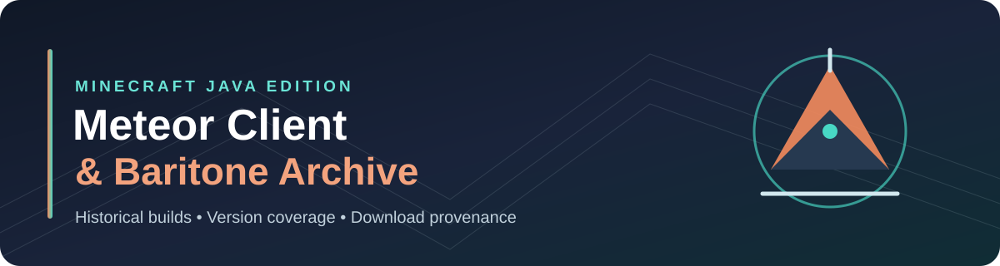

<div align="center">



# Meteor Client & Baritone Archive

**A community-maintained historical Minecraft Java mod archive**

[](#downloads-by-mod)
[](#minecraft-java-releases-100-through-263)
[](https://github.com/Galax71/meteor-archive-and-Baritone-archive/actions/workflows/recover-found.yml)

[**Meteor Client**](#meteor-client) · [**Baritone**](#baritone) · [**Download catalog**](DOWNLOADS.md) · [**Sources**](COMMUNITY-SOURCES.md) · [**Build guide**](BUILDING.md)

</div>

---

<table>
<tr>
<td width="50%" valign="top" align="center" bgcolor="#241d2a">
<a href="https://meteorclient.com/"></a>
<h3>☄️ Meteor Client</h3>
<p><strong>Orange · Coral</strong></p>
<p>Preserved builds, source history, and download links for Minecraft Java.</p>
<p><a href="#meteor-client"><strong>Explore Meteor builds →</strong></a></p>
</td>
<td width="50%" valign="top" align="center" bgcolor="#142a35">
<a href="https://github.com/cabaletta/baritone"></a>
<h3>🧭 Baritone</h3>
<p><strong>Teal · Blue</strong></p>
<p>Historical pathfinding builds, version coverage, and missing releases.</p>
<p><a href="#baritone"><strong>Explore Baritone builds →</strong></a></p>
</td>
</tr>
</table>

> [!IMPORTANT]
> **Archive files are not guaranteed to work in-game.** Version labels and mod-existence statuses describe available evidence, not independently tested compatibility. **Missing** means no archived JAR is currently listed; it does not prove a build never existed.

## 🔗 Quick links

- [Browse and filter downloads on the archive homepage](https://github.com/Galax71/meteor-archive-and-Baritone-archive/blob/master/index.html)
- [Full download catalog](DOWNLOADS.md)
- [83-file ManInMyVan source comparison and per-file provenance](IMPORT-PROVENANCE.json)
- [Community archive source catalog](COMMUNITY-SOURCES.md)
- [Automatic build instructions](AUTOMATED-BUILDS.md)
- [Build matrix](build-matrix.json)
- [GitHub Actions: build all versions](https://github.com/Galax71/meteor-archive-and-Baritone-archive/actions/workflows/build-all-versions.yml)
- [Upstream build instructions](BUILDING.md)

## Downloads by mod


<p align="center">


</p>


**Download preference:** Official Meteor website builds and official Baritone GitHub releases appear first within each Minecraft version. Community archives and inferred versions remain listed after official releases. Official provenance does not establish in-game compatibility.

**Table colour key:** 🟢 archived JAR · 🔴 missing file · 🟡 existence unconfirmed · ⚫ predates documented support. These coloured indicators remain readable in GitHub's light and dark themes.

Minecraft versions are sorted newest first. **(inferred)** means the version is matched from the historical release series, not confirmed from the individual JAR metadata or an in-game launch. See [EXTRA-VERSION-MATCHES.json](EXTRA-VERSION-MATCHES.json). All JARs remain unverified in-game. **Missing** means no JAR is listed in this main table for that exact Minecraft version; it does not prove the mod was released for that version or that the file is permanently lost.

The **Mod existed?** column refers to evidence for that Minecraft version, not whether Minecraft itself existed. **Yes** means an archived build is present; **No — predates documented mod support** means the Minecraft version predates the known mod support history; **Unknown** means no compatible build has been established. Early development versions are representative milestones, not every historical snapshot.

### Meteor Client


 **Meteor Client archive** · 

| Minecraft version | Mod existed? | Loader | Mod version | Archive found in | Download |
|---|---|---|---|---|---|
| 26.3 | 🟡 Unknown — no verified build | — | 🔴 **Missing** | — | 🔴 **Missing** |
| 26.2 | 🟢 Yes — archived build | fabric | meteor-client-26.2 (filename) | [🟠 Official Meteor archive](https://meteorclient.com/api/download?version=26.2) | [⬇️ Download JAR](source/meteorclient.com/meteor/fabric/26.2/meteor-client-26.2.jar) |
| 26.1.2 | 🟢 Yes — archived build | fabric | meteor-client-26.1.2 (filename) | [🟠 Official Meteor archive](https://meteorclient.com/api/download?version=26.1.2) | [⬇️ Download JAR](source/meteorclient.com/meteor/fabric/26.1.2/meteor-client-26.1.2.jar) |
| 26.1.1 | 🟡 Unknown — no verified build | — | 🔴 **Missing** | — | 🔴 **Missing** |
| 26.1 | 🟡 Unknown — no verified build | — | 🔴 **Missing** | — | 🔴 **Missing** |
| 1.21.11 | 🟢 Yes — archived build | fabric | meteor-client-1.21.11 (filename) | [🟠 Official Meteor archive](https://meteorclient.com/api/download?version=1.21.11) | [⬇️ Download JAR](source/meteorclient.com/meteor/fabric/1.21.11/meteor-client-1.21.11.jar) |
| 1.21.10 | 🟢 Yes — archived build | fabric | meteor-client-1.21.10 (filename) | [🟠 Official Meteor archive](https://meteorclient.com/api/download?version=1.21.10) | [⬇️ Download JAR](source/meteorclient.com/meteor/fabric/1.21.10/meteor-client-1.21.10.jar) |
| 1.21.9 | 🟡 Unknown — no verified build | — | 🔴 **Missing** | — | 🔴 **Missing** |
| 1.21.8 | 🟢 Yes — archived build | fabric | meteor-client-1.21.8 (filename) | [🟠 Official Meteor archive](https://meteorclient.com/api/download?version=1.21.8) | [⬇️ Download JAR](source/meteorclient.com/meteor/fabric/1.21.8/meteor-client-1.21.8.jar) |
| 1.21.7 | 🟢 Yes — archived build | fabric | meteor-client-1.21.7 (filename) | [🟠 Official Meteor archive](https://meteorclient.com/api/download?version=1.21.7) | [⬇️ Download JAR](source/meteorclient.com/meteor/fabric/1.21.7/meteor-client-1.21.7.jar) |
| 1.21.6 | 🟢 Yes — archived build | fabric | meteor-client-1.21.6 (filename) | [🟠 Official Meteor archive](https://meteorclient.com/api/download?version=1.21.6) | [⬇️ Download JAR](source/meteorclient.com/meteor/fabric/1.21.6/meteor-client-1.21.6.jar) |
| 1.21.5 | 🟢 Yes — archived build | fabric | meteor-client-1.21.5 (filename) | [🟠 Official Meteor archive](https://meteorclient.com/api/download?version=1.21.5) | [⬇️ Download JAR](source/meteorclient.com/meteor/fabric/1.21.5/meteor-client-1.21.5.jar) |
| 1.21.4 | 🟢 Yes — archived build | fabric | meteor-client-1.21.4 (filename) | [🟠 Official Meteor archive](https://meteorclient.com/api/download?version=1.21.4) | [⬇️ Download JAR](source/meteorclient.com/meteor/fabric/1.21.4/meteor-client-1.21.4.jar) |
| 1.21.3 | 🟢 Yes — archived build | fabric | meteor-client-0.5.9 (filename) | [github.com-ManInMyVan-meteor-archive](https://raw.githubusercontent.com/ManInMyVan/meteor-archive/main/files/meteor-client/meteor-client-0.5.9.jar) | [⬇️ Download JAR](source/github.com-ManInMyVan-meteor-archive/meteor/fabric/1.21.3/meteor-client-0.5.9.jar) |
| 1.21.2 | 🟡 Unknown — no verified build | — | 🔴 **Missing** | — | 🔴 **Missing** |
| 1.21.1 | 🟢 Yes — archived build | fabric | 0.5.8 | [ManInMyVan](https://github.com/ManInMyVan/meteor-archive/tree/main/files) | [⬇️ Download JAR](https://github.com/Galax71/meteor-archive-and-Baritone-archive/raw/refs/heads/master/meteor/fabric/1.21.1/MeteorClient_1.21.1_0.5.8_ManInMyVan.jar) |
| 1.21.1 (inferred) | 🟢 Yes — archived build | fabric | 0.5.8 | [ManInMyVan](https://github.com/ManInMyVan/meteor-archive/tree/main/files) | [⬇️ Download JAR](https://github.com/Galax71/meteor-archive-and-Baritone-archive/raw/refs/heads/master/meteor/fabric/1.21.1/MeteorClient_1.21.1_0.5.8_ManInMyVan_build-f5677724.jar) |
| 1.21.1 | 🟢 Yes — archived build | fabric | meteor-client-0.5.8-2119 (filename) | [github.com-ManInMyVan-meteor-archive](https://raw.githubusercontent.com/ManInMyVan/meteor-archive/main/files/meteor-client/extra/meteor-client-0.5.8-2119.jar) | [⬇️ Download JAR](source/github.com-ManInMyVan-meteor-archive/meteor/fabric/1.21.1/meteor-client-0.5.8-2119.jar) |
| 1.21.1 | 🟢 Yes — archived build | fabric | meteor-client-0.5.8 (filename) | [github.com-ManInMyVan-meteor-archive](https://raw.githubusercontent.com/ManInMyVan/meteor-archive/main/files/meteor-client/meteor-client-0.5.8.jar) | [⬇️ Download JAR](source/github.com-ManInMyVan-meteor-archive/meteor/fabric/1.21.1/meteor-client-0.5.8.jar) |
| 1.21 | 🟡 Unknown — no verified build | — | 🔴 **Missing** | — | 🔴 **Missing** |
| 1.20.6 | 🟢 Yes — archived build | fabric | 0.5.7 | [ManInMyVan](https://github.com/ManInMyVan/meteor-archive/tree/main/files) | [⬇️ Download JAR](https://github.com/Galax71/meteor-archive-and-Baritone-archive/raw/refs/heads/master/meteor/fabric/1.20.6/MeteorClient_1.20.6_0.5.7_ManInMyVan.jar) |
| 1.20.6 (inferred) | 🟢 Yes — archived build | fabric | 0.5.7 | [ManInMyVan](https://github.com/ManInMyVan/meteor-archive/tree/main/files) | [⬇️ Download JAR](https://github.com/Galax71/meteor-archive-and-Baritone-archive/raw/refs/heads/master/meteor/fabric/1.20.6/MeteorClient_1.20.6_0.5.7_ManInMyVan_build-af9f8e66.jar) |
| 1.20.6 | 🟢 Yes — archived build | fabric | meteor-client-0.5.7-2079 (filename) | [github.com-ManInMyVan-meteor-archive](https://raw.githubusercontent.com/ManInMyVan/meteor-archive/main/files/meteor-client/extra/meteor-client-0.5.7-2079.jar) | [⬇️ Download JAR](source/github.com-ManInMyVan-meteor-archive/meteor/fabric/1.20.6/meteor-client-0.5.7-2079.jar) |
| 1.20.6 | 🟢 Yes — archived build | fabric | meteor-client-0.5.7 (filename) | [github.com-ManInMyVan-meteor-archive](https://raw.githubusercontent.com/ManInMyVan/meteor-archive/main/files/meteor-client/meteor-client-0.5.7.jar) | [⬇️ Download JAR](source/github.com-ManInMyVan-meteor-archive/meteor/fabric/1.20.6/meteor-client-0.5.7.jar) |
| 1.20.5 | 🟡 Unknown — no verified build | — | 🔴 **Missing** | — | 🔴 **Missing** |
| 1.20.4 | 🟢 Yes — archived build | fabric | 0.5.6 | [ManInMyVan](https://github.com/ManInMyVan/meteor-archive/tree/main/files) | [⬇️ Download JAR](https://github.com/Galax71/meteor-archive-and-Baritone-archive/raw/refs/heads/master/meteor/fabric/1.20.4/MeteorClient_1.20.4_0.5.6_ManInMyVan.jar) |
| 1.20.4 (inferred) | 🟢 Yes — archived build | fabric | 0.5.6 | [ManInMyVan](https://github.com/ManInMyVan/meteor-archive/tree/main/files) | [⬇️ Download JAR](https://github.com/Galax71/meteor-archive-and-Baritone-archive/raw/refs/heads/master/meteor/fabric/1.20.4/MeteorClient_1.20.4_0.5.6_ManInMyVan_build-a0e45bb5.jar) |
| 1.20.4 (inferred) | 🟢 Yes — archived build | fabric | 0.5.6 | [ManInMyVan](https://github.com/ManInMyVan/meteor-archive/tree/main/files) | [⬇️ Download JAR](https://github.com/Galax71/meteor-archive-and-Baritone-archive/raw/refs/heads/master/meteor/fabric/1.20.4/MeteorClient_1.20.4_0.5.6_ManInMyVan_build-05b42454.jar) |
| 1.20.4 (inferred) | 🟢 Yes — archived build | fabric | 0.5.6 | [ManInMyVan](https://github.com/ManInMyVan/meteor-archive/tree/main/files) | [⬇️ Download JAR](https://github.com/Galax71/meteor-archive-and-Baritone-archive/raw/refs/heads/master/meteor/fabric/1.20.4/MeteorClient_1.20.4_0.5.6_ManInMyVan_build-13c939e4.jar) |
| 1.20.4 (inferred) | 🟢 Yes — archived build | fabric | 0.5.6 | [ManInMyVan](https://github.com/ManInMyVan/meteor-archive/tree/main/files) | [⬇️ Download JAR](https://github.com/Galax71/meteor-archive-and-Baritone-archive/raw/refs/heads/master/meteor/fabric/1.20.4/MeteorClient_1.20.4_0.5.6_ManInMyVan_build-1c070fed.jar) |
| 1.20.4 (inferred) | 🟢 Yes — archived build | fabric | 0.5.6 | [ManInMyVan](https://github.com/ManInMyVan/meteor-archive/tree/main/files) | [⬇️ Download JAR](https://github.com/Galax71/meteor-archive-and-Baritone-archive/raw/refs/heads/master/meteor/fabric/1.20.4/MeteorClient_1.20.4_0.5.6_ManInMyVan_build-22ab601e.jar) |
| 1.20.4 (inferred) | 🟢 Yes — archived build | fabric | 0.5.6 | [ManInMyVan](https://github.com/ManInMyVan/meteor-archive/tree/main/files) | [⬇️ Download JAR](https://github.com/Galax71/meteor-archive-and-Baritone-archive/raw/refs/heads/master/meteor/fabric/1.20.4/MeteorClient_1.20.4_0.5.6_ManInMyVan_build-33f02500.jar) |
| 1.20.4 (inferred) | 🟢 Yes — archived build | fabric | 0.5.6 | [ManInMyVan](https://github.com/ManInMyVan/meteor-archive/tree/main/files) | [⬇️ Download JAR](https://github.com/Galax71/meteor-archive-and-Baritone-archive/raw/refs/heads/master/meteor/fabric/1.20.4/MeteorClient_1.20.4_0.5.6_ManInMyVan_build-37ab721f.jar) |
| 1.20.4 (inferred) | 🟢 Yes — archived build | fabric | 0.5.6 | [ManInMyVan](https://github.com/ManInMyVan/meteor-archive/tree/main/files) | [⬇️ Download JAR](https://github.com/Galax71/meteor-archive-and-Baritone-archive/raw/refs/heads/master/meteor/fabric/1.20.4/MeteorClient_1.20.4_0.5.6_ManInMyVan_build-464e4a98.jar) |
| 1.20.4 (inferred) | 🟢 Yes — archived build | fabric | 0.5.6 | [ManInMyVan](https://github.com/ManInMyVan/meteor-archive/tree/main/files) | [⬇️ Download JAR](https://github.com/Galax71/meteor-archive-and-Baritone-archive/raw/refs/heads/master/meteor/fabric/1.20.4/MeteorClient_1.20.4_0.5.6_ManInMyVan_build-68b73118.jar) |
| 1.20.4 (inferred) | 🟢 Yes — archived build | fabric | 0.5.6 | [ManInMyVan](https://github.com/ManInMyVan/meteor-archive/tree/main/files) | [⬇️ Download JAR](https://github.com/Galax71/meteor-archive-and-Baritone-archive/raw/refs/heads/master/meteor/fabric/1.20.4/MeteorClient_1.20.4_0.5.6_ManInMyVan_build-6f989071.jar) |
| 1.20.4 (inferred) | 🟢 Yes — archived build | fabric | 0.5.6 | [ManInMyVan](https://github.com/ManInMyVan/meteor-archive/tree/main/files) | [⬇️ Download JAR](https://github.com/Galax71/meteor-archive-and-Baritone-archive/raw/refs/heads/master/meteor/fabric/1.20.4/MeteorClient_1.20.4_0.5.6_ManInMyVan_build-8bbd0a7e.jar) |
| 1.20.4 (inferred) | 🟢 Yes — archived build | fabric | 0.5.6 | [ManInMyVan](https://github.com/ManInMyVan/meteor-archive/tree/main/files) | [⬇️ Download JAR](https://github.com/Galax71/meteor-archive-and-Baritone-archive/raw/refs/heads/master/meteor/fabric/1.20.4/MeteorClient_1.20.4_0.5.6_ManInMyVan_build-aad83ef9.jar) |
| 1.20.4 (inferred) | 🟢 Yes — archived build | fabric | 0.5.6 | [ManInMyVan](https://github.com/ManInMyVan/meteor-archive/tree/main/files) | [⬇️ Download JAR](https://github.com/Galax71/meteor-archive-and-Baritone-archive/raw/refs/heads/master/meteor/fabric/1.20.4/MeteorClient_1.20.4_0.5.6_ManInMyVan_build-c13166ed.jar) |
| 1.20.4 | 🟢 Yes — archived build | fabric | meteor-client-0.5.6-1985 (filename) | [github.com-ManInMyVan-meteor-archive](https://raw.githubusercontent.com/ManInMyVan/meteor-archive/main/files/meteor-client/extra/meteor-client-0.5.6-1985.jar) | [⬇️ Download JAR](source/github.com-ManInMyVan-meteor-archive/meteor/fabric/1.20.4/meteor-client-0.5.6-1985.jar) |
| 1.20.4 | 🟢 Yes — archived build | fabric | meteor-client-0.5.6-1993 (filename) | [github.com-ManInMyVan-meteor-archive](https://raw.githubusercontent.com/ManInMyVan/meteor-archive/main/files/meteor-client/extra/meteor-client-0.5.6-1993.jar) | [⬇️ Download JAR](source/github.com-ManInMyVan-meteor-archive/meteor/fabric/1.20.4/meteor-client-0.5.6-1993.jar) |
| 1.20.4 | 🟢 Yes — archived build | fabric | meteor-client-0.5.6-1995 (filename) | [github.com-ManInMyVan-meteor-archive](https://raw.githubusercontent.com/ManInMyVan/meteor-archive/main/files/meteor-client/extra/meteor-client-0.5.6-1995.jar) | [⬇️ Download JAR](source/github.com-ManInMyVan-meteor-archive/meteor/fabric/1.20.4/meteor-client-0.5.6-1995.jar) |
| 1.20.4 | 🟢 Yes — archived build | fabric | meteor-client-0.5.6-1996 (filename) | [github.com-ManInMyVan-meteor-archive](https://raw.githubusercontent.com/ManInMyVan/meteor-archive/main/files/meteor-client/extra/meteor-client-0.5.6-1996.jar) | [⬇️ Download JAR](source/github.com-ManInMyVan-meteor-archive/meteor/fabric/1.20.4/meteor-client-0.5.6-1996.jar) |
| 1.20.4 | 🟢 Yes — archived build | fabric | meteor-client-0.5.6-1997 (filename) | [github.com-ManInMyVan-meteor-archive](https://raw.githubusercontent.com/ManInMyVan/meteor-archive/main/files/meteor-client/extra/meteor-client-0.5.6-1997.jar) | [⬇️ Download JAR](source/github.com-ManInMyVan-meteor-archive/meteor/fabric/1.20.4/meteor-client-0.5.6-1997.jar) |
| 1.20.4 | 🟢 Yes — archived build | fabric | meteor-client-0.5.6-1998 (filename) | [github.com-ManInMyVan-meteor-archive](https://raw.githubusercontent.com/ManInMyVan/meteor-archive/main/files/meteor-client/extra/meteor-client-0.5.6-1998.jar) | [⬇️ Download JAR](source/github.com-ManInMyVan-meteor-archive/meteor/fabric/1.20.4/meteor-client-0.5.6-1998.jar) |
| 1.20.4 | 🟢 Yes — archived build | fabric | meteor-client-0.5.6-1999 (filename) | [github.com-ManInMyVan-meteor-archive](https://raw.githubusercontent.com/ManInMyVan/meteor-archive/main/files/meteor-client/extra/meteor-client-0.5.6-1999.jar) | [⬇️ Download JAR](source/github.com-ManInMyVan-meteor-archive/meteor/fabric/1.20.4/meteor-client-0.5.6-1999.jar) |
| 1.20.4 | 🟢 Yes — archived build | fabric | meteor-client-0.5.6-2001 (filename) | [github.com-ManInMyVan-meteor-archive](https://raw.githubusercontent.com/ManInMyVan/meteor-archive/main/files/meteor-client/extra/meteor-client-0.5.6-2001.jar) | [⬇️ Download JAR](source/github.com-ManInMyVan-meteor-archive/meteor/fabric/1.20.4/meteor-client-0.5.6-2001.jar) |
| 1.20.4 | 🟢 Yes — archived build | fabric | meteor-client-0.5.6-2002 (filename) | [github.com-ManInMyVan-meteor-archive](https://raw.githubusercontent.com/ManInMyVan/meteor-archive/main/files/meteor-client/extra/meteor-client-0.5.6-2002.jar) | [⬇️ Download JAR](source/github.com-ManInMyVan-meteor-archive/meteor/fabric/1.20.4/meteor-client-0.5.6-2002.jar) |
| 1.20.4 | 🟢 Yes — archived build | fabric | meteor-client-0.5.6-2003 (filename) | [github.com-ManInMyVan-meteor-archive](https://raw.githubusercontent.com/ManInMyVan/meteor-archive/main/files/meteor-client/extra/meteor-client-0.5.6-2003.jar) | [⬇️ Download JAR](source/github.com-ManInMyVan-meteor-archive/meteor/fabric/1.20.4/meteor-client-0.5.6-2003.jar) |
| 1.20.4 | 🟢 Yes — archived build | fabric | meteor-client-0.5.6-2005 (filename) | [github.com-ManInMyVan-meteor-archive](https://raw.githubusercontent.com/ManInMyVan/meteor-archive/main/files/meteor-client/extra/meteor-client-0.5.6-2005.jar) | [⬇️ Download JAR](source/github.com-ManInMyVan-meteor-archive/meteor/fabric/1.20.4/meteor-client-0.5.6-2005.jar) |
| 1.20.4 | 🟢 Yes — archived build | fabric | meteor-client-0.5.6-2007 (filename) | [github.com-ManInMyVan-meteor-archive](https://raw.githubusercontent.com/ManInMyVan/meteor-archive/main/files/meteor-client/extra/meteor-client-0.5.6-2007.jar) | [⬇️ Download JAR](source/github.com-ManInMyVan-meteor-archive/meteor/fabric/1.20.4/meteor-client-0.5.6-2007.jar) |
| 1.20.4 | 🟢 Yes — archived build | fabric | meteor-client-0.5.6-2008 (filename) | [github.com-ManInMyVan-meteor-archive](https://raw.githubusercontent.com/ManInMyVan/meteor-archive/main/files/meteor-client/extra/meteor-client-0.5.6-2008.jar) | [⬇️ Download JAR](source/github.com-ManInMyVan-meteor-archive/meteor/fabric/1.20.4/meteor-client-0.5.6-2008.jar) |
| 1.20.4 | 🟢 Yes — archived build | fabric | meteor-client-0.5.6 (filename) | [github.com-ManInMyVan-meteor-archive](https://raw.githubusercontent.com/ManInMyVan/meteor-archive/main/files/meteor-client/meteor-client-0.5.6.jar) | [⬇️ Download JAR](source/github.com-ManInMyVan-meteor-archive/meteor/fabric/1.20.4/meteor-client-0.5.6.jar) |
| 1.20.3 | 🟡 Unknown — no verified build | — | 🔴 **Missing** | — | 🔴 **Missing** |
| 1.20.2 | 🟢 Yes — archived build | fabric | 0.5.5 | [ManInMyVan](https://github.com/ManInMyVan/meteor-archive/tree/main/files) | [⬇️ Download JAR](https://github.com/Galax71/meteor-archive-and-Baritone-archive/raw/refs/heads/master/meteor/fabric/1.20.2/MeteorClient_1.20.2_0.5.5_ManInMyVan.jar) |
| 1.20.2 (inferred) | 🟢 Yes — archived build | fabric | 0.5.5 | [ManInMyVan](https://github.com/ManInMyVan/meteor-archive/tree/main/files) | [⬇️ Download JAR](https://github.com/Galax71/meteor-archive-and-Baritone-archive/raw/refs/heads/master/meteor/fabric/1.20.2/MeteorClient_1.20.2_0.5.5_ManInMyVan_build-0ecbbc55.jar) |
| 1.20.2 | 🟢 Yes — archived build | fabric | meteor-client-0.5.5-1964 (filename) | [github.com-ManInMyVan-meteor-archive](https://raw.githubusercontent.com/ManInMyVan/meteor-archive/main/files/meteor-client/extra/meteor-client-0.5.5-1964.jar) | [⬇️ Download JAR](source/github.com-ManInMyVan-meteor-archive/meteor/fabric/1.20.2/meteor-client-0.5.5-1964.jar) |
| 1.20.2 | 🟢 Yes — archived build | fabric | meteor-client-0.5.5 (filename) | [github.com-ManInMyVan-meteor-archive](https://raw.githubusercontent.com/ManInMyVan/meteor-archive/main/files/meteor-client/meteor-client-0.5.5.jar) | [⬇️ Download JAR](source/github.com-ManInMyVan-meteor-archive/meteor/fabric/1.20.2/meteor-client-0.5.5.jar) |
| 1.20.1 | 🟡 Unknown — no verified build | — | 🔴 **Missing** | — | 🔴 **Missing** |
| 1.20 | 🟡 Unknown — no verified build | — | 🔴 **Missing** | — | 🔴 **Missing** |
| 1.19.4 | 🟢 Yes — archived build | fabric | 0.5.3 | [ManInMyVan](https://github.com/ManInMyVan/meteor-archive/tree/main/files) | [⬇️ Download JAR](https://github.com/Galax71/meteor-archive-and-Baritone-archive/raw/refs/heads/master/meteor/fabric/1.19.4/MeteorClient_1.19.4_0.5.3_ManInMyVan.jar) |
| 1.19.3 | 🟢 Yes — archived build | fabric | 0.5.2 | [ManInMyVan](https://github.com/ManInMyVan/meteor-archive/tree/main/files) | [⬇️ Download JAR](https://github.com/Galax71/meteor-archive-and-Baritone-archive/raw/refs/heads/master/meteor/fabric/1.19.3/MeteorClient_1.19.3_0.5.2_ManInMyVan.jar) |
| 1.19.2 | 🟢 Yes — archived build | fabric | 0.5.1 | [ManInMyVan](https://github.com/ManInMyVan/meteor-archive/tree/main/files) | [⬇️ Download JAR](https://github.com/Galax71/meteor-archive-and-Baritone-archive/raw/refs/heads/master/meteor/fabric/1.19.2/MeteorClient_1.19.2_0.5.1_ManInMyVan.jar) |
| 1.19.2 (inferred) | 🟢 Yes — archived build | fabric | 0.5.1 | [ManInMyVan](https://github.com/ManInMyVan/meteor-archive/tree/main/files) | [⬇️ Download JAR](https://github.com/Galax71/meteor-archive-and-Baritone-archive/raw/refs/heads/master/meteor/fabric/1.19.2/MeteorClient_1.19.2_0.5.1_ManInMyVan_build-e87f5a6a.jar) |
| 1.19.2 (inferred) | 🟢 Yes — archived build | fabric | 0.5.1 | [ManInMyVan](https://github.com/ManInMyVan/meteor-archive/tree/main/files) | [⬇️ Download JAR](https://github.com/Galax71/meteor-archive-and-Baritone-archive/raw/refs/heads/master/meteor/fabric/1.19.2/MeteorClient_1.19.2_0.5.1_ManInMyVan_build-f9d6ed89.jar) |
| 1.19.2 | 🟢 Yes — archived build | fabric | meteor-client-0.5.1-1571 (filename) | [github.com-ManInMyVan-meteor-archive](https://raw.githubusercontent.com/ManInMyVan/meteor-archive/main/files/meteor-client/extra/meteor-client-0.5.1-1571.jar) | [⬇️ Download JAR](source/github.com-ManInMyVan-meteor-archive/meteor/fabric/1.19.2/meteor-client-0.5.1-1571.jar) |
| 1.19.2 | 🟢 Yes — archived build | fabric | meteor-client-0.5.1-1690 (filename) | [github.com-ManInMyVan-meteor-archive](https://raw.githubusercontent.com/ManInMyVan/meteor-archive/main/files/meteor-client/extra/meteor-client-0.5.1-1690.jar) | [⬇️ Download JAR](source/github.com-ManInMyVan-meteor-archive/meteor/fabric/1.19.2/meteor-client-0.5.1-1690.jar) |
| 1.19.2 | 🟢 Yes — archived build | fabric | meteor-client-0.5.1 (filename) | [github.com-ManInMyVan-meteor-archive](https://raw.githubusercontent.com/ManInMyVan/meteor-archive/main/files/meteor-client/meteor-client-0.5.1.jar) | [⬇️ Download JAR](source/github.com-ManInMyVan-meteor-archive/meteor/fabric/1.19.2/meteor-client-0.5.1.jar) |
| 1.19.1 | 🟡 Unknown — no verified build | — | 🔴 **Missing** | — | 🔴 **Missing** |
| 1.19 | 🟢 Yes — archived build | fabric | 0.5.0 | [ManInMyVan](https://github.com/ManInMyVan/meteor-archive/tree/main/files) | [⬇️ Download JAR](https://github.com/Galax71/meteor-archive-and-Baritone-archive/raw/refs/heads/master/meteor/fabric/1.19/MeteorClient_1.19_0.5.0_ManInMyVan.jar) |
| 1.19 (inferred) | 🟢 Yes — archived build | fabric | 0.5.0 | [ManInMyVan](https://github.com/ManInMyVan/meteor-archive/tree/main/files) | [⬇️ Download JAR](https://github.com/Galax71/meteor-archive-and-Baritone-archive/raw/refs/heads/master/meteor/fabric/1.19/MeteorClient_1.19_0.5.0_ManInMyVan_build-97666a93.jar) |
| 1.19 | 🟢 Yes — archived build | fabric | meteor-client-0.5.0-1562 (filename) | [github.com-ManInMyVan-meteor-archive](https://raw.githubusercontent.com/ManInMyVan/meteor-archive/main/files/meteor-client/extra/meteor-client-0.5.0-1562.jar) | [⬇️ Download JAR](source/github.com-ManInMyVan-meteor-archive/meteor/fabric/1.19/meteor-client-0.5.0-1562.jar) |
| 1.19 | 🟢 Yes — archived build | fabric | meteor-client-0.5.0 (filename) | [github.com-ManInMyVan-meteor-archive](https://raw.githubusercontent.com/ManInMyVan/meteor-archive/main/files/meteor-client/meteor-client-0.5.0.jar) | [⬇️ Download JAR](source/github.com-ManInMyVan-meteor-archive/meteor/fabric/1.19/meteor-client-0.5.0.jar) |
| 1.18.2 | 🟢 Yes — archived build | fabric | 0.4.9 | [ManInMyVan](https://github.com/ManInMyVan/meteor-archive/tree/main/files) | [⬇️ Download JAR](https://github.com/Galax71/meteor-archive-and-Baritone-archive/raw/refs/heads/master/meteor/fabric/1.18.2/MeteorClient_1.18.2_0.4.9_ManInMyVan.jar) |
| 1.18.2 | 🟢 Yes — archived build | fabric | 0.4.8 | [ManInMyVan](https://github.com/ManInMyVan/meteor-archive/tree/main/files) | [⬇️ Download JAR](https://github.com/Galax71/meteor-archive-and-Baritone-archive/raw/refs/heads/master/meteor/fabric/1.18.2/MeteorClient_1.18.2_0.4.8_ManInMyVan.jar) |
| 1.18.2 (inferred) | 🟢 Yes — archived build | fabric | 0.4.8 | [ManInMyVan](https://github.com/ManInMyVan/meteor-archive/tree/main/files) | [⬇️ Download JAR](https://github.com/Galax71/meteor-archive-and-Baritone-archive/raw/refs/heads/master/meteor/fabric/1.18.2/MeteorClient_1.18.2_0.4.8_ManInMyVan_build-e0a60a9c.jar) |
| 1.18.2 (inferred) | 🟢 Yes — archived build | fabric | 0.4.8 | [ManInMyVan](https://github.com/ManInMyVan/meteor-archive/tree/main/files) | [⬇️ Download JAR](https://github.com/Galax71/meteor-archive-and-Baritone-archive/raw/refs/heads/master/meteor/fabric/1.18.2/MeteorClient_1.18.2_0.4.8_ManInMyVan_build-8381cbe3.jar) |
| 1.18.2 | 🟢 Yes — archived build | fabric | meteor-client-0.4.8-1427 (filename) | [github.com-ManInMyVan-meteor-archive](https://raw.githubusercontent.com/ManInMyVan/meteor-archive/main/files/meteor-client/extra/meteor-client-0.4.8-1427.jar) | [⬇️ Download JAR](source/github.com-ManInMyVan-meteor-archive/meteor/fabric/1.18.2/meteor-client-0.4.8-1427.jar) |
| 1.18.2 | 🟢 Yes — archived build | fabric | meteor-client-0.4.8-1441 (filename) | [github.com-ManInMyVan-meteor-archive](https://raw.githubusercontent.com/ManInMyVan/meteor-archive/main/files/meteor-client/extra/meteor-client-0.4.8-1441.jar) | [⬇️ Download JAR](source/github.com-ManInMyVan-meteor-archive/meteor/fabric/1.18.2/meteor-client-0.4.8-1441.jar) |
| 1.18.2 | 🟢 Yes — archived build | fabric | meteor-client-0.4.8 (filename) | [github.com-ManInMyVan-meteor-archive](https://raw.githubusercontent.com/ManInMyVan/meteor-archive/main/files/meteor-client/meteor-client-0.4.8.jar) | [⬇️ Download JAR](source/github.com-ManInMyVan-meteor-archive/meteor/fabric/1.18.2/meteor-client-0.4.8.jar) |
| 1.18.1 (inferred) | 🟢 Yes — archived build | fabric | 0.4.7 | [ManInMyVan](https://github.com/ManInMyVan/meteor-archive/tree/main/files) | [⬇️ Download JAR](https://github.com/Galax71/meteor-archive-and-Baritone-archive/raw/refs/heads/master/meteor/fabric/1.18.1/MeteorClient_1.18.1_0.4.7_ManInMyVan.jar) |
| 1.18.1 (inferred) | 🟢 Yes — archived build | fabric | 0.4.7 | [ManInMyVan](https://github.com/ManInMyVan/meteor-archive/tree/main/files) | [⬇️ Download JAR](https://github.com/Galax71/meteor-archive-and-Baritone-archive/raw/refs/heads/master/meteor/fabric/1.18.1/MeteorClient_1.18.1_0.4.7_ManInMyVan_build-05c97f8e.jar) |
| 1.18.1 (inferred) | 🟢 Yes — archived build | fabric | 0.4.7 | [ManInMyVan](https://github.com/ManInMyVan/meteor-archive/tree/main/files) | [⬇️ Download JAR](https://github.com/Galax71/meteor-archive-and-Baritone-archive/raw/refs/heads/master/meteor/fabric/1.18.1/MeteorClient_1.18.1_0.4.7_ManInMyVan_build-1a7416bc.jar) |
| 1.18.1 (inferred) | 🟢 Yes — archived build | fabric | 0.4.7 | [ManInMyVan](https://github.com/ManInMyVan/meteor-archive/tree/main/files) | [⬇️ Download JAR](https://github.com/Galax71/meteor-archive-and-Baritone-archive/raw/refs/heads/master/meteor/fabric/1.18.1/MeteorClient_1.18.1_0.4.7_ManInMyVan_build-540d48a0.jar) |
| 1.18.1 | 🟢 Yes — archived build | fabric | meteor-client-0.4.7-1373 (filename) | [github.com-ManInMyVan-meteor-archive](https://raw.githubusercontent.com/ManInMyVan/meteor-archive/main/files/meteor-client/extra/meteor-client-0.4.7-1373.jar) | [⬇️ Download JAR](source/github.com-ManInMyVan-meteor-archive/meteor/fabric/1.18.1/meteor-client-0.4.7-1373.jar) |
| 1.18.1 | 🟢 Yes — archived build | fabric | meteor-client-0.4.7-1381 (filename) | [github.com-ManInMyVan-meteor-archive](https://raw.githubusercontent.com/ManInMyVan/meteor-archive/main/files/meteor-client/extra/meteor-client-0.4.7-1381.jar) | [⬇️ Download JAR](source/github.com-ManInMyVan-meteor-archive/meteor/fabric/1.18.1/meteor-client-0.4.7-1381.jar) |
| 1.18.1 | 🟢 Yes — archived build | fabric | meteor-client-0.4.7-1384 (filename) | [github.com-ManInMyVan-meteor-archive](https://raw.githubusercontent.com/ManInMyVan/meteor-archive/main/files/meteor-client/extra/meteor-client-0.4.7-1384.jar) | [⬇️ Download JAR](source/github.com-ManInMyVan-meteor-archive/meteor/fabric/1.18.1/meteor-client-0.4.7-1384.jar) |
| 1.18.1 | 🟢 Yes — archived build | fabric | meteor-client-0.4.7-1388 (filename) | [github.com-ManInMyVan-meteor-archive](https://raw.githubusercontent.com/ManInMyVan/meteor-archive/main/files/meteor-client/extra/meteor-client-0.4.7-1388.jar) | [⬇️ Download JAR](source/github.com-ManInMyVan-meteor-archive/meteor/fabric/1.18.1/meteor-client-0.4.7-1388.jar) |
| 1.18.1 | 🟢 Yes — archived build | fabric | meteor-client-0.4.7-1396 (filename) | [github.com-ManInMyVan-meteor-archive](https://raw.githubusercontent.com/ManInMyVan/meteor-archive/main/files/meteor-client/extra/meteor-client-0.4.7-1396.jar) | [⬇️ Download JAR](source/github.com-ManInMyVan-meteor-archive/meteor/fabric/1.18.1/meteor-client-0.4.7-1396.jar) |
| 1.18.1 | 🟢 Yes — archived build | fabric | meteor-client-0.4.7-1405 (filename) | [github.com-ManInMyVan-meteor-archive](https://raw.githubusercontent.com/ManInMyVan/meteor-archive/main/files/meteor-client/extra/meteor-client-0.4.7-1405.jar) | [⬇️ Download JAR](source/github.com-ManInMyVan-meteor-archive/meteor/fabric/1.18.1/meteor-client-0.4.7-1405.jar) |
| 1.18.1 | 🟢 Yes — archived build | fabric | meteor-client-0.4.7 (filename) | [github.com-ManInMyVan-meteor-archive](https://raw.githubusercontent.com/ManInMyVan/meteor-archive/main/files/meteor-client/meteor-client-0.4.7.jar) | [⬇️ Download JAR](source/github.com-ManInMyVan-meteor-archive/meteor/fabric/1.18.1/meteor-client-0.4.7.jar) |
| 1.18 | 🟡 Unknown — no verified build | — | 🔴 **Missing** | — | 🔴 **Missing** |
| 1.17.1 | 🟢 Yes — archived build | fabric | 0.4.6 | [ManInMyVan](https://github.com/ManInMyVan/meteor-archive/tree/main/files) | [⬇️ Download JAR](https://github.com/Galax71/meteor-archive-and-Baritone-archive/raw/refs/heads/master/meteor/fabric/1.17.1/MeteorClient_1.17.1_0.4.6_ManInMyVan.jar) |
| 1.17.1 | 🟢 Yes — archived build | fabric | 0.4.5 | [ManInMyVan](https://github.com/ManInMyVan/meteor-archive/tree/main/files) | [⬇️ Download JAR](https://github.com/Galax71/meteor-archive-and-Baritone-archive/raw/refs/heads/master/meteor/fabric/1.17.1/MeteorClient_1.17.1_0.4.5_ManInMyVan.jar) |
| 1.17.1 (inferred) | 🟢 Yes — archived build | fabric | 0.4.6 | [ManInMyVan](https://github.com/ManInMyVan/meteor-archive/tree/main/files) | [⬇️ Download JAR](https://github.com/Galax71/meteor-archive-and-Baritone-archive/raw/refs/heads/master/meteor/fabric/1.17.1/MeteorClient_1.17.1_0.4.6_ManInMyVan_build-cf58d3dd.jar) |
| 1.17.1 | 🟢 Yes — archived build | fabric | meteor-client-0.4.6-1180 (filename) | [github.com-ManInMyVan-meteor-archive](https://raw.githubusercontent.com/ManInMyVan/meteor-archive/main/files/meteor-client/extra/meteor-client-0.4.6-1180.jar) | [⬇️ Download JAR](source/github.com-ManInMyVan-meteor-archive/meteor/fabric/1.17.1/meteor-client-0.4.6-1180.jar) |
| 1.17.1 | 🟢 Yes — archived build | fabric | meteor-client-0.4.6 (filename) | [github.com-ManInMyVan-meteor-archive](https://raw.githubusercontent.com/ManInMyVan/meteor-archive/main/files/meteor-client/meteor-client-0.4.6.jar) | [⬇️ Download JAR](source/github.com-ManInMyVan-meteor-archive/meteor/fabric/1.17.1/meteor-client-0.4.6.jar) |
| 1.17 | 🟡 Unknown — no verified build | — | 🔴 **Missing** | — | 🔴 **Missing** |
| 1.16.5 | 🟡 Unknown — no verified build | — | 🔴 **Missing** | — | 🔴 **Missing** |
| 1.16.4 | 🟡 Unknown — no verified build | — | 🔴 **Missing** | — | 🔴 **Missing** |
| 1.16.3 | 🟡 Unknown — no verified build | — | 🔴 **Missing** | — | 🔴 **Missing** |
| 1.16.2 | 🟡 Unknown — no verified build | — | 🔴 **Missing** | — | 🔴 **Missing** |
| 1.16.1 (inferred) | 🟢 Yes — archived build | fabric | 0.3.0.1 | [ManInMyVan](https://github.com/ManInMyVan/meteor-archive/tree/main/files) | [⬇️ Download JAR](https://github.com/Galax71/meteor-archive-and-Baritone-archive/raw/refs/heads/master/meteor/fabric/1.16.1/MeteorClient_1.16.1_0.3.0.1_ManInMyVan.jar) |
| 1.16.1 | 🟢 Yes — archived build | fabric | meteor-client-0.3.0.1-1.16.1 (filename) | [github.com-ManInMyVan-meteor-archive](https://raw.githubusercontent.com/ManInMyVan/meteor-archive/main/files/meteor-client/extra/meteor-client-0.3.0.1-1.16.1.jar) | [⬇️ Download JAR](source/github.com-ManInMyVan-meteor-archive/meteor/fabric/1.16.1/meteor-client-0.3.0.1-1.16.1.jar) |
| 1.16 | 🟡 Unknown — no verified build | — | 🔴 **Missing** | — | 🔴 **Missing** |
| 1.15.2 | 🟢 Yes — archived build | fabric | 0.2.6 | [ManInMyVan](https://github.com/ManInMyVan/meteor-archive/tree/main/files) | [⬇️ Download JAR](https://github.com/Galax71/meteor-archive-and-Baritone-archive/raw/refs/heads/master/meteor/fabric/1.15.2/MeteorClient_1.15.2_0.2.6_ManInMyVan.jar) |
| 1.15.2 | 🟢 Yes — archived build | fabric | 0.2.4 | [ManInMyVan](https://github.com/ManInMyVan/meteor-archive/tree/main/files) | [⬇️ Download JAR](https://github.com/Galax71/meteor-archive-and-Baritone-archive/raw/refs/heads/master/meteor/fabric/1.15.2/MeteorClient_1.15.2_0.2.4_ManInMyVan.jar) |
| 1.15.2 | 🟢 Yes — archived build | fabric | 0.2.3 | [ManInMyVan](https://github.com/ManInMyVan/meteor-archive/tree/main/files) | [⬇️ Download JAR](https://github.com/Galax71/meteor-archive-and-Baritone-archive/raw/refs/heads/master/meteor/fabric/1.15.2/MeteorClient_1.15.2_0.2.3_ManInMyVan.jar) |
| 1.15.2 | 🟢 Yes — archived build | fabric | 0.2.2 | [ManInMyVan](https://github.com/ManInMyVan/meteor-archive/tree/main/files) | [⬇️ Download JAR](https://github.com/Galax71/meteor-archive-and-Baritone-archive/raw/refs/heads/master/meteor/fabric/1.15.2/MeteorClient_1.15.2_0.2.2_ManInMyVan.jar) |
| 1.15.2 | 🟢 Yes — archived build | fabric | 0.2.1 | [ManInMyVan](https://github.com/ManInMyVan/meteor-archive/tree/main/files) | [⬇️ Download JAR](https://github.com/Galax71/meteor-archive-and-Baritone-archive/raw/refs/heads/master/meteor/fabric/1.15.2/MeteorClient_1.15.2_0.2.1_ManInMyVan.jar) |
| 1.15.2 | 🟢 Yes — archived build | fabric | 0.2.0 | [ManInMyVan](https://github.com/ManInMyVan/meteor-archive/tree/main/files) | [⬇️ Download JAR](https://github.com/Galax71/meteor-archive-and-Baritone-archive/raw/refs/heads/master/meteor/fabric/1.15.2/MeteorClient_1.15.2_0.2.0_ManInMyVan.jar) |
| 1.15.2 | 🟢 Yes — archived build | fabric | 0.1.9 | [ManInMyVan](https://github.com/ManInMyVan/meteor-archive/tree/main/files) | [⬇️ Download JAR](https://github.com/Galax71/meteor-archive-and-Baritone-archive/raw/refs/heads/master/meteor/fabric/1.15.2/MeteorClient_1.15.2_0.1.9_ManInMyVan.jar) |
| 1.15.2 | 🟢 Yes — archived build | fabric | 0.1.8 | [ManInMyVan](https://github.com/ManInMyVan/meteor-archive/tree/main/files) | [⬇️ Download JAR](https://github.com/Galax71/meteor-archive-and-Baritone-archive/raw/refs/heads/master/meteor/fabric/1.15.2/MeteorClient_1.15.2_0.1.8_ManInMyVan.jar) |
| 1.15.2 | 🟢 Yes — archived build | fabric | 0.1.7 | [ManInMyVan](https://github.com/ManInMyVan/meteor-archive/tree/main/files) | [⬇️ Download JAR](https://github.com/Galax71/meteor-archive-and-Baritone-archive/raw/refs/heads/master/meteor/fabric/1.15.2/MeteorClient_1.15.2_0.1.7_ManInMyVan.jar) |
| 1.15.1 | 🟡 Unknown — no verified build | — | 🔴 **Missing** | — | 🔴 **Missing** |
| 1.15 | 🟡 Unknown — no verified build | — | 🔴 **Missing** | — | 🔴 **Missing** |
| 1.14.4 | 🟢 Yes — archived build | fabric | 0.2.8 | [ManInMyVan](https://github.com/ManInMyVan/meteor-archive/tree/main/files) | [⬇️ Download JAR](https://github.com/Galax71/meteor-archive-and-Baritone-archive/raw/refs/heads/master/meteor/fabric/1.14.4/MeteorClient_1.14.4_0.2.8_ManInMyVan.jar) |
| 1.14.4 | 🟢 Yes — archived build | fabric | 0.2.4 | [ManInMyVan](https://github.com/ManInMyVan/meteor-archive/tree/main/files) | [⬇️ Download JAR](https://github.com/Galax71/meteor-archive-and-Baritone-archive/raw/refs/heads/master/meteor/fabric/1.14.4/MeteorClient_1.14.4_0.2.4_ManInMyVan.jar) |
| 1.14.4 | 🟢 Yes — archived build | fabric | 0.2.3 | [ManInMyVan](https://github.com/ManInMyVan/meteor-archive/tree/main/files) | [⬇️ Download JAR](https://github.com/Galax71/meteor-archive-and-Baritone-archive/raw/refs/heads/master/meteor/fabric/1.14.4/MeteorClient_1.14.4_0.2.3_ManInMyVan.jar) |
| 1.14.4 | 🟢 Yes — archived build | fabric | 0.2.2 | [ManInMyVan](https://github.com/ManInMyVan/meteor-archive/tree/main/files) | [⬇️ Download JAR](https://github.com/Galax71/meteor-archive-and-Baritone-archive/raw/refs/heads/master/meteor/fabric/1.14.4/MeteorClient_1.14.4_0.2.2_ManInMyVan.jar) |
| 1.14.4 | 🟢 Yes — archived build | fabric | 0.2.1 | [ManInMyVan](https://github.com/ManInMyVan/meteor-archive/tree/main/files) | [⬇️ Download JAR](https://github.com/Galax71/meteor-archive-and-Baritone-archive/raw/refs/heads/master/meteor/fabric/1.14.4/MeteorClient_1.14.4_0.2.1_ManInMyVan.jar) |
| 1.14.4 | 🟢 Yes — archived build | fabric | 0.2.0 | [ManInMyVan](https://github.com/ManInMyVan/meteor-archive/tree/main/files) | [⬇️ Download JAR](https://github.com/Galax71/meteor-archive-and-Baritone-archive/raw/refs/heads/master/meteor/fabric/1.14.4/MeteorClient_1.14.4_0.2.0_ManInMyVan.jar) |
| 1.14.4 | 🟢 Yes — archived build | fabric | 0.1.9 | [ManInMyVan](https://github.com/ManInMyVan/meteor-archive/tree/main/files) | [⬇️ Download JAR](https://github.com/Galax71/meteor-archive-and-Baritone-archive/raw/refs/heads/master/meteor/fabric/1.14.4/MeteorClient_1.14.4_0.1.9_ManInMyVan.jar) |
| 1.14.4 | 🟢 Yes — archived build | fabric | 0.1.8 | [ManInMyVan](https://github.com/ManInMyVan/meteor-archive/tree/main/files) | [⬇️ Download JAR](https://github.com/Galax71/meteor-archive-and-Baritone-archive/raw/refs/heads/master/meteor/fabric/1.14.4/MeteorClient_1.14.4_0.1.8_ManInMyVan.jar) |
| 1.14.4 | 🟢 Yes — archived build | fabric | 0.1.7 | [ManInMyVan](https://github.com/ManInMyVan/meteor-archive/tree/main/files) | [⬇️ Download JAR](https://github.com/Galax71/meteor-archive-and-Baritone-archive/raw/refs/heads/master/meteor/fabric/1.14.4/MeteorClient_1.14.4_0.1.7_ManInMyVan.jar) |
| 1.14.4 | 🟢 Yes — archived build | fabric | 0.1.6 | [ManInMyVan](https://github.com/ManInMyVan/meteor-archive/tree/main/files) | [⬇️ Download JAR](https://github.com/Galax71/meteor-archive-and-Baritone-archive/raw/refs/heads/master/meteor/fabric/1.14.4/MeteorClient_1.14.4_0.1.6_ManInMyVan.jar) |
| 1.14.4 | 🟢 Yes — archived build | fabric | 0.1.5 | [ManInMyVan](https://github.com/ManInMyVan/meteor-archive/tree/main/files) | [⬇️ Download JAR](https://github.com/Galax71/meteor-archive-and-Baritone-archive/raw/refs/heads/master/meteor/fabric/1.14.4/MeteorClient_1.14.4_0.1.5_ManInMyVan.jar) |
| 1.14.4 | 🟢 Yes — archived build | fabric | 0.1.4 | [ManInMyVan](https://github.com/ManInMyVan/meteor-archive/tree/main/files) | [⬇️ Download JAR](https://github.com/Galax71/meteor-archive-and-Baritone-archive/raw/refs/heads/master/meteor/fabric/1.14.4/MeteorClient_1.14.4_0.1.4_ManInMyVan.jar) |
| 1.14.4 | 🟢 Yes — archived build | fabric | 0.1.3 | [ManInMyVan](https://github.com/ManInMyVan/meteor-archive/tree/main/files) | [⬇️ Download JAR](https://github.com/Galax71/meteor-archive-and-Baritone-archive/raw/refs/heads/master/meteor/fabric/1.14.4/MeteorClient_1.14.4_0.1.3_ManInMyVan.jar) |
| 1.14.4 | 🟢 Yes — archived build | fabric | 0.1.2 | [ManInMyVan](https://github.com/ManInMyVan/meteor-archive/tree/main/files) | [⬇️ Download JAR](https://github.com/Galax71/meteor-archive-and-Baritone-archive/raw/refs/heads/master/meteor/fabric/1.14.4/MeteorClient_1.14.4_0.1.2_ManInMyVan.jar) |
| 1.14.4 | 🟢 Yes — archived build | fabric | 0.1.1 | [ManInMyVan](https://github.com/ManInMyVan/meteor-archive/tree/main/files) | [⬇️ Download JAR](https://github.com/Galax71/meteor-archive-and-Baritone-archive/raw/refs/heads/master/meteor/fabric/1.14.4/MeteorClient_1.14.4_0.1.1_ManInMyVan.jar) |
| 1.14.4 | 🟢 Yes — archived build | fabric | 0.1.0 | [ManInMyVan](https://github.com/ManInMyVan/meteor-archive/tree/main/files) | [⬇️ Download JAR](https://github.com/Galax71/meteor-archive-and-Baritone-archive/raw/refs/heads/master/meteor/fabric/1.14.4/MeteorClient_1.14.4_0.1.0_ManInMyVan.jar) |
| 1.14.3 | 🟡 Unknown — no verified build | — | 🔴 **Missing** | — | 🔴 **Missing** |
| 1.14.2 | 🟡 Unknown — no verified build | — | 🔴 **Missing** | — | 🔴 **Missing** |
| 1.14.1 | 🟡 Unknown — no verified build | — | 🔴 **Missing** | — | 🔴 **Missing** |
| 1.14 | 🟡 Unknown — no verified build | — | 🔴 **Missing** | — | 🔴 **Missing** |
| 1.13.2 | 🟡 Unknown — no verified build | — | 🔴 **Missing** | — | 🔴 **Missing** |
| 1.13.1 | 🟡 Unknown — no verified build | — | 🔴 **Missing** | — | 🔴 **Missing** |
| 1.13 | 🟡 Unknown — no verified build | — | 🔴 **Missing** | — | 🔴 **Missing** |
| 1.12.2 | 🟡 Unknown — no verified build | — | 🔴 **Missing** | — | 🔴 **Missing** |
| 1.12.1 | 🟡 Unknown — no verified build | — | 🔴 **Missing** | — | 🔴 **Missing** |
| 1.12 | 🟡 Unknown — no verified build | — | 🔴 **Missing** | — | 🔴 **Missing** |
| 1.11.2 | ⚫ No — predates documented mod support | — | 🔴 **Missing** | — | 🔴 **Missing** |
| 1.11.1 | ⚫ No — predates documented mod support | — | 🔴 **Missing** | — | 🔴 **Missing** |
| 1.11 | ⚫ No — predates documented mod support | — | 🔴 **Missing** | — | 🔴 **Missing** |
| 1.10.2 | ⚫ No — predates documented mod support | — | 🔴 **Missing** | — | 🔴 **Missing** |
| 1.10.1 | ⚫ No — predates documented mod support | — | 🔴 **Missing** | — | 🔴 **Missing** |
| 1.10 | ⚫ No — predates documented mod support | — | 🔴 **Missing** | — | 🔴 **Missing** |
| 1.9.4 | ⚫ No — predates documented mod support | — | 🔴 **Missing** | — | 🔴 **Missing** |
| 1.9.3 | ⚫ No — predates documented mod support | — | 🔴 **Missing** | — | 🔴 **Missing** |
| 1.9.2 | ⚫ No — predates documented mod support | — | 🔴 **Missing** | — | 🔴 **Missing** |
| 1.9.1 | ⚫ No — predates documented mod support | — | 🔴 **Missing** | — | 🔴 **Missing** |
| 1.9 | ⚫ No — predates documented mod support | — | 🔴 **Missing** | — | 🔴 **Missing** |
| 1.8.9 | ⚫ No — predates documented mod support | — | 🔴 **Missing** | — | 🔴 **Missing** |
| 1.8.8 | ⚫ No — predates documented mod support | — | 🔴 **Missing** | — | 🔴 **Missing** |
| 1.8.7 | ⚫ No — predates documented mod support | — | 🔴 **Missing** | — | 🔴 **Missing** |
| 1.8.6 | ⚫ No — predates documented mod support | — | 🔴 **Missing** | — | 🔴 **Missing** |
| 1.8.5 | ⚫ No — predates documented mod support | — | 🔴 **Missing** | — | 🔴 **Missing** |
| 1.8.4 | ⚫ No — predates documented mod support | — | 🔴 **Missing** | — | 🔴 **Missing** |
| 1.8.3 | ⚫ No — predates documented mod support | — | 🔴 **Missing** | — | 🔴 **Missing** |
| 1.8.2 | ⚫ No — predates documented mod support | — | 🔴 **Missing** | — | 🔴 **Missing** |
| 1.8.1 | ⚫ No — predates documented mod support | — | 🔴 **Missing** | — | 🔴 **Missing** |
| 1.8 | ⚫ No — predates documented mod support | — | 🔴 **Missing** | — | 🔴 **Missing** |
| 1.7.10 | ⚫ No — predates documented mod support | — | 🔴 **Missing** | — | 🔴 **Missing** |
| 1.7.9 | ⚫ No — predates documented mod support | — | 🔴 **Missing** | — | 🔴 **Missing** |
| 1.7.8 | ⚫ No — predates documented mod support | — | 🔴 **Missing** | — | 🔴 **Missing** |
| 1.7.7 | ⚫ No — predates documented mod support | — | 🔴 **Missing** | — | 🔴 **Missing** |
| 1.7.6 | ⚫ No — predates documented mod support | — | 🔴 **Missing** | — | 🔴 **Missing** |
| 1.7.5 | ⚫ No — predates documented mod support | — | 🔴 **Missing** | — | 🔴 **Missing** |
| 1.7.4 | ⚫ No — predates documented mod support | — | 🔴 **Missing** | — | 🔴 **Missing** |
| 1.7.2 | ⚫ No — predates documented mod support | — | 🔴 **Missing** | — | 🔴 **Missing** |
| 1.6.4 | ⚫ No — predates documented mod support | — | 🔴 **Missing** | — | 🔴 **Missing** |
| 1.6.2 | ⚫ No — predates documented mod support | — | 🔴 **Missing** | — | 🔴 **Missing** |
| 1.6.1 | ⚫ No — predates documented mod support | — | 🔴 **Missing** | — | 🔴 **Missing** |
| 1.5.2 | ⚫ No — predates documented mod support | — | 🔴 **Missing** | — | 🔴 **Missing** |
| 1.5.1 | ⚫ No — predates documented mod support | — | 🔴 **Missing** | — | 🔴 **Missing** |
| 1.5 | ⚫ No — predates documented mod support | — | 🔴 **Missing** | — | 🔴 **Missing** |
| 1.4.7 | ⚫ No — predates documented mod support | — | 🔴 **Missing** | — | 🔴 **Missing** |
| 1.4.6 | ⚫ No — predates documented mod support | — | 🔴 **Missing** | — | 🔴 **Missing** |
| 1.4.5 | ⚫ No — predates documented mod support | — | 🔴 **Missing** | — | 🔴 **Missing** |
| 1.4.4 | ⚫ No — predates documented mod support | — | 🔴 **Missing** | — | 🔴 **Missing** |
| 1.4.2 | ⚫ No — predates documented mod support | — | 🔴 **Missing** | — | 🔴 **Missing** |
| 1.3.2 | ⚫ No — predates documented mod support | — | 🔴 **Missing** | — | 🔴 **Missing** |
| 1.3.1 | ⚫ No — predates documented mod support | — | 🔴 **Missing** | — | 🔴 **Missing** |
| 1.2.5 | ⚫ No — predates documented mod support | — | 🔴 **Missing** | — | 🔴 **Missing** |
| 1.2.4 | ⚫ No — predates documented mod support | — | 🔴 **Missing** | — | 🔴 **Missing** |
| 1.2.3 | ⚫ No — predates documented mod support | — | 🔴 **Missing** | — | 🔴 **Missing** |
| 1.2.2 | ⚫ No — predates documented mod support | — | 🔴 **Missing** | — | 🔴 **Missing** |
| 1.2.1 | ⚫ No — predates documented mod support | — | 🔴 **Missing** | — | 🔴 **Missing** |
| 1.1 | ⚫ No — predates documented mod support | — | 🔴 **Missing** | — | 🔴 **Missing** |
| 1.0.1 | ⚫ No — predates documented mod support | — | 🔴 **Missing** | — | 🔴 **Missing** |
| 1.0.0 | ⚫ No — predates documented mod support | — | 🔴 **Missing** | — | 🔴 **Missing** |
| rd-160052 | ⚫ No — predates documented mod support | — | 🔴 **Missing** | — | 🔴 **Missing** |
| rd-132328 | ⚫ No — predates documented mod support | — | 🔴 **Missing** | — | 🔴 **Missing** |
| rd-132211 | ⚫ No — predates documented mod support | — | 🔴 **Missing** | — | 🔴 **Missing** |
| inf-20100630 | ⚫ No — predates documented mod support | — | 🔴 **Missing** | — | 🔴 **Missing** |
| inf-20100618 | ⚫ No — predates documented mod support | — | 🔴 **Missing** | — | 🔴 **Missing** |
| in-20100223 | ⚫ No — predates documented mod support | — | 🔴 **Missing** | — | 🔴 **Missing** |
| in-20100206 | ⚫ No — predates documented mod support | — | 🔴 **Missing** | — | 🔴 **Missing** |
| in-20100128 | ⚫ No — predates documented mod support | — | 🔴 **Missing** | — | 🔴 **Missing** |
| c0.0.30 | ⚫ No — predates documented mod support | — | 🔴 **Missing** | — | 🔴 **Missing** |
| c0.0.23a | ⚫ No — predates documented mod support | — | 🔴 **Missing** | — | 🔴 **Missing** |
| c0.0.21a | ⚫ No — predates documented mod support | — | 🔴 **Missing** | — | 🔴 **Missing** |
| c0.0.20a | ⚫ No — predates documented mod support | — | 🔴 **Missing** | — | 🔴 **Missing** |
| c0.0.18a | ⚫ No — predates documented mod support | — | 🔴 **Missing** | — | 🔴 **Missing** |
| c0.0.16a | ⚫ No — predates documented mod support | — | 🔴 **Missing** | — | 🔴 **Missing** |
| c0.0.14a | ⚫ No — predates documented mod support | — | 🔴 **Missing** | — | 🔴 **Missing** |
| c0.0.13a | ⚫ No — predates documented mod support | — | 🔴 **Missing** | — | 🔴 **Missing** |
| c0.0.11a | ⚫ No — predates documented mod support | — | 🔴 **Missing** | — | 🔴 **Missing** |
| b1.8.1 | ⚫ No — predates documented mod support | — | 🔴 **Missing** | — | 🔴 **Missing** |
| b1.7.3 | ⚫ No — predates documented mod support | — | 🔴 **Missing** | — | 🔴 **Missing** |
| b1.6.6 | ⚫ No — predates documented mod support | — | 🔴 **Missing** | — | 🔴 **Missing** |
| b1.5_01 | ⚫ No — predates documented mod support | — | 🔴 **Missing** | — | 🔴 **Missing** |
| b1.4_01 | ⚫ No — predates documented mod support | — | 🔴 **Missing** | — | 🔴 **Missing** |
| b1.3_01 | ⚫ No — predates documented mod support | — | 🔴 **Missing** | — | 🔴 **Missing** |
| b1.2_02 | ⚫ No — predates documented mod support | — | 🔴 **Missing** | — | 🔴 **Missing** |
| b1.1_02 | ⚫ No — predates documented mod support | — | 🔴 **Missing** | — | 🔴 **Missing** |
| b1.0 | ⚫ No — predates documented mod support | — | 🔴 **Missing** | — | 🔴 **Missing** |
| a1.2.6 | ⚫ No — predates documented mod support | — | 🔴 **Missing** | — | 🔴 **Missing** |
| a1.2.0 | ⚫ No — predates documented mod support | — | 🔴 **Missing** | — | 🔴 **Missing** |
| a1.1.2_01 | ⚫ No — predates documented mod support | — | 🔴 **Missing** | — | 🔴 **Missing** |
| a1.0.4 | ⚫ No — predates documented mod support | — | 🔴 **Missing** | — | 🔴 **Missing** |
| a1.0.17 | ⚫ No — predates documented mod support | — | 🔴 **Missing** | — | 🔴 **Missing** |
| a1.0.14 | ⚫ No — predates documented mod support | — | 🔴 **Missing** | — | 🔴 **Missing** |
| a1.0.11 | ⚫ No — predates documented mod support | — | 🔴 **Missing** | — | 🔴 **Missing** |

### Baritone


 **Baritone archive** · 

| Minecraft version | Mod existed? | Loader | Mod version | Archive found in | Download |
|---|---|---|---|---|---|
| 26.3 | 🟡 Unknown — no verified build | — | 🔴 **Missing** | — | 🔴 **Missing** |
| 26.2 | 🟢 Yes — archived build | fabric | baritone-26.2 (filename) | [🟠 Official Meteor archive](https://meteorclient.com/api/downloadBaritone?version=26.2) | [⬇️ Download JAR](source/meteorclient.com/baritone/fabric/26.2/baritone-26.2.jar) |
| 26.1.2 | 🟡 Unknown — no verified build | — | 🔴 **Missing** | — | 🔴 **Missing** |
| 26.1.1 | 🟡 Unknown — no verified build | — | 🔴 **Missing** | — | 🔴 **Missing** |
| 26.1 | 🟢 Yes — archived build | fabric | baritone-26.1 (filename) | [🟠 Official Meteor archive](https://meteorclient.com/api/downloadBaritone?version=26.1) | [⬇️ Download JAR](source/meteorclient.com/baritone/fabric/26.1/baritone-26.1.jar) |
| 1.21.11 | 🟢 Yes — archived build | fabric | baritone-1.21.11 (filename) | [🟠 Official Meteor archive](https://meteorclient.com/api/downloadBaritone?version=1.21.11) | [⬇️ Download JAR](source/meteorclient.com/baritone/fabric/1.21.11/baritone-1.21.11.jar) |
| 1.21.10 | 🟢 Yes — archived build | fabric | baritone-1.21.10 (filename) | [🟠 Official Meteor archive](https://meteorclient.com/api/downloadBaritone?version=1.21.10) | [⬇️ Download JAR](source/meteorclient.com/baritone/fabric/1.21.10/baritone-1.21.10.jar) |
| 1.21.9 | 🟢 Yes — archived build | fabric | baritone-api-fabric-1.16.0 (filename) | [🔵 Official Baritone GitHub](https://github.com/cabaletta/baritone/releases/download/v1.16.0/baritone-api-fabric-1.16.0.jar) | [⬇️ Download JAR](source/github.com-cabaletta-baritone/baritone/fabric/1.21.9/baritone-api-fabric-1.16.0.jar) |
| 1.21.9 | 🟢 Yes — archived build | fabric | baritone-standalone-fabric-1.16.0 (filename) | [🔵 Official Baritone GitHub](https://github.com/cabaletta/baritone/releases/download/v1.16.0/baritone-standalone-fabric-1.16.0.jar) | [⬇️ Download JAR](source/github.com-cabaletta-baritone/baritone/fabric/1.21.9/baritone-standalone-fabric-1.16.0.jar) |
| 1.21.9 | 🟢 Yes — archived build | fabric | baritone-unoptimized-fabric-1.16.0 (filename) | [🔵 Official Baritone GitHub](https://github.com/cabaletta/baritone/releases/download/v1.16.0/baritone-unoptimized-fabric-1.16.0.jar) | [⬇️ Download JAR](source/github.com-cabaletta-baritone/baritone/fabric/1.21.9/baritone-unoptimized-fabric-1.16.0.jar) |
| 1.21.9 | 🟢 Yes — archived build | forge | baritone-api-forge-1.16.0 (filename) | [🔵 Official Baritone GitHub](https://github.com/cabaletta/baritone/releases/download/v1.16.0/baritone-api-forge-1.16.0.jar) | [⬇️ Download JAR](source/github.com-cabaletta-baritone/baritone/forge/1.21.9/baritone-api-forge-1.16.0.jar) |
| 1.21.9 | 🟢 Yes — archived build | forge | baritone-standalone-forge-1.16.0 (filename) | [🔵 Official Baritone GitHub](https://github.com/cabaletta/baritone/releases/download/v1.16.0/baritone-standalone-forge-1.16.0.jar) | [⬇️ Download JAR](source/github.com-cabaletta-baritone/baritone/forge/1.21.9/baritone-standalone-forge-1.16.0.jar) |
| 1.21.9 | 🟢 Yes — archived build | forge | baritone-unoptimized-forge-1.16.0 (filename) | [🔵 Official Baritone GitHub](https://github.com/cabaletta/baritone/releases/download/v1.16.0/baritone-unoptimized-forge-1.16.0.jar) | [⬇️ Download JAR](source/github.com-cabaletta-baritone/baritone/forge/1.21.9/baritone-unoptimized-forge-1.16.0.jar) |
| 1.21.9 | 🟢 Yes — archived build | neoforge | baritone-api-neoforge-1.16.0 (filename) | [🔵 Official Baritone GitHub](https://github.com/cabaletta/baritone/releases/download/v1.16.0/baritone-api-neoforge-1.16.0.jar) | [⬇️ Download JAR](source/github.com-cabaletta-baritone/baritone/neoforge/1.21.9/baritone-api-neoforge-1.16.0.jar) |
| 1.21.9 | 🟢 Yes — archived build | neoforge | baritone-standalone-neoforge-1.16.0 (filename) | [🔵 Official Baritone GitHub](https://github.com/cabaletta/baritone/releases/download/v1.16.0/baritone-standalone-neoforge-1.16.0.jar) | [⬇️ Download JAR](source/github.com-cabaletta-baritone/baritone/neoforge/1.21.9/baritone-standalone-neoforge-1.16.0.jar) |
| 1.21.9 | 🟢 Yes — archived build | neoforge | baritone-unoptimized-neoforge-1.16.0 (filename) | [🔵 Official Baritone GitHub](https://github.com/cabaletta/baritone/releases/download/v1.16.0/baritone-unoptimized-neoforge-1.16.0.jar) | [⬇️ Download JAR](source/github.com-cabaletta-baritone/baritone/neoforge/1.21.9/baritone-unoptimized-neoforge-1.16.0.jar) |
| 1.21.9 | 🟢 Yes — archived build | standalone | baritone-api-1.16.0 (filename) | [🔵 Official Baritone GitHub](https://github.com/cabaletta/baritone/releases/download/v1.16.0/baritone-api-1.16.0.jar) | [⬇️ Download JAR](source/github.com-cabaletta-baritone/baritone/standalone/1.21.9/baritone-api-1.16.0.jar) |
| 1.21.9 | 🟢 Yes — archived build | standalone | baritone-standalone-1.16.0 (filename) | [🔵 Official Baritone GitHub](https://github.com/cabaletta/baritone/releases/download/v1.16.0/baritone-standalone-1.16.0.jar) | [⬇️ Download JAR](source/github.com-cabaletta-baritone/baritone/standalone/1.21.9/baritone-standalone-1.16.0.jar) |
| 1.21.9 | 🟢 Yes — archived build | standalone | baritone-unoptimized-1.16.0 (filename) | [🔵 Official Baritone GitHub](https://github.com/cabaletta/baritone/releases/download/v1.16.0/baritone-unoptimized-1.16.0.jar) | [⬇️ Download JAR](source/github.com-cabaletta-baritone/baritone/standalone/1.21.9/baritone-unoptimized-1.16.0.jar) |
| 1.21.8 | 🟢 Yes — archived build | fabric | baritone-1.21.8 (filename) | [🟠 Official Meteor archive](https://meteorclient.com/api/downloadBaritone?version=1.21.8) | [⬇️ Download JAR](source/meteorclient.com/baritone/fabric/1.21.8/baritone-1.21.8.jar) |
| 1.21.7 | 🟢 Yes — archived build | fabric | baritone-api-fabric-1.15.0 (filename) | [🔵 Official Baritone GitHub](https://github.com/cabaletta/baritone/releases/download/v1.15.0/baritone-api-fabric-1.15.0.jar) | [⬇️ Download JAR](source/github.com-cabaletta-baritone/baritone/fabric/1.21.7/baritone-api-fabric-1.15.0.jar) |
| 1.21.7 | 🟢 Yes — archived build | fabric | baritone-standalone-fabric-1.15.0 (filename) | [🔵 Official Baritone GitHub](https://github.com/cabaletta/baritone/releases/download/v1.15.0/baritone-standalone-fabric-1.15.0.jar) | [⬇️ Download JAR](source/github.com-cabaletta-baritone/baritone/fabric/1.21.7/baritone-standalone-fabric-1.15.0.jar) |
| 1.21.7 | 🟢 Yes — archived build | fabric | baritone-unoptimized-fabric-1.15.0 (filename) | [🔵 Official Baritone GitHub](https://github.com/cabaletta/baritone/releases/download/v1.15.0/baritone-unoptimized-fabric-1.15.0.jar) | [⬇️ Download JAR](source/github.com-cabaletta-baritone/baritone/fabric/1.21.7/baritone-unoptimized-fabric-1.15.0.jar) |
| 1.21.7 | 🟢 Yes — archived build | forge | baritone-api-forge-1.15.0 (filename) | [🔵 Official Baritone GitHub](https://github.com/cabaletta/baritone/releases/download/v1.15.0/baritone-api-forge-1.15.0.jar) | [⬇️ Download JAR](source/github.com-cabaletta-baritone/baritone/forge/1.21.7/baritone-api-forge-1.15.0.jar) |
| 1.21.7 | 🟢 Yes — archived build | forge | baritone-standalone-forge-1.15.0 (filename) | [🔵 Official Baritone GitHub](https://github.com/cabaletta/baritone/releases/download/v1.15.0/baritone-standalone-forge-1.15.0.jar) | [⬇️ Download JAR](source/github.com-cabaletta-baritone/baritone/forge/1.21.7/baritone-standalone-forge-1.15.0.jar) |
| 1.21.7 | 🟢 Yes — archived build | forge | baritone-unoptimized-forge-1.15.0 (filename) | [🔵 Official Baritone GitHub](https://github.com/cabaletta/baritone/releases/download/v1.15.0/baritone-unoptimized-forge-1.15.0.jar) | [⬇️ Download JAR](source/github.com-cabaletta-baritone/baritone/forge/1.21.7/baritone-unoptimized-forge-1.15.0.jar) |
| 1.21.7 | 🟢 Yes — archived build | neoforge | baritone-api-neoforge-1.15.0 (filename) | [🔵 Official Baritone GitHub](https://github.com/cabaletta/baritone/releases/download/v1.15.0/baritone-api-neoforge-1.15.0.jar) | [⬇️ Download JAR](source/github.com-cabaletta-baritone/baritone/neoforge/1.21.7/baritone-api-neoforge-1.15.0.jar) |
| 1.21.7 | 🟢 Yes — archived build | neoforge | baritone-standalone-neoforge-1.15.0 (filename) | [🔵 Official Baritone GitHub](https://github.com/cabaletta/baritone/releases/download/v1.15.0/baritone-standalone-neoforge-1.15.0.jar) | [⬇️ Download JAR](source/github.com-cabaletta-baritone/baritone/neoforge/1.21.7/baritone-standalone-neoforge-1.15.0.jar) |
| 1.21.7 | 🟢 Yes — archived build | neoforge | baritone-unoptimized-neoforge-1.15.0 (filename) | [🔵 Official Baritone GitHub](https://github.com/cabaletta/baritone/releases/download/v1.15.0/baritone-unoptimized-neoforge-1.15.0.jar) | [⬇️ Download JAR](source/github.com-cabaletta-baritone/baritone/neoforge/1.21.7/baritone-unoptimized-neoforge-1.15.0.jar) |
| 1.21.7 | 🟢 Yes — archived build | standalone | baritone-api-1.15.0 (filename) | [🔵 Official Baritone GitHub](https://github.com/cabaletta/baritone/releases/download/v1.15.0/baritone-api-1.15.0.jar) | [⬇️ Download JAR](source/github.com-cabaletta-baritone/baritone/standalone/1.21.7/baritone-api-1.15.0.jar) |
| 1.21.7 | 🟢 Yes — archived build | standalone | baritone-standalone-1.15.0 (filename) | [🔵 Official Baritone GitHub](https://github.com/cabaletta/baritone/releases/download/v1.15.0/baritone-standalone-1.15.0.jar) | [⬇️ Download JAR](source/github.com-cabaletta-baritone/baritone/standalone/1.21.7/baritone-standalone-1.15.0.jar) |
| 1.21.7 | 🟢 Yes — archived build | standalone | baritone-unoptimized-1.15.0 (filename) | [🔵 Official Baritone GitHub](https://github.com/cabaletta/baritone/releases/download/v1.15.0/baritone-unoptimized-1.15.0.jar) | [⬇️ Download JAR](source/github.com-cabaletta-baritone/baritone/standalone/1.21.7/baritone-unoptimized-1.15.0.jar) |
| 1.21.6 | 🟢 Yes — archived build | fabric | baritone-api-fabric-1.15.0 (filename) | [🔵 Official Baritone GitHub](https://github.com/cabaletta/baritone/releases/download/v1.15.0/baritone-api-fabric-1.15.0.jar) | [⬇️ Download JAR](source/github.com-cabaletta-baritone/baritone/fabric/1.21.6/baritone-api-fabric-1.15.0.jar) |
| 1.21.6 | 🟢 Yes — archived build | fabric | baritone-standalone-fabric-1.15.0 (filename) | [🔵 Official Baritone GitHub](https://github.com/cabaletta/baritone/releases/download/v1.15.0/baritone-standalone-fabric-1.15.0.jar) | [⬇️ Download JAR](source/github.com-cabaletta-baritone/baritone/fabric/1.21.6/baritone-standalone-fabric-1.15.0.jar) |
| 1.21.6 | 🟢 Yes — archived build | fabric | baritone-unoptimized-fabric-1.15.0 (filename) | [🔵 Official Baritone GitHub](https://github.com/cabaletta/baritone/releases/download/v1.15.0/baritone-unoptimized-fabric-1.15.0.jar) | [⬇️ Download JAR](source/github.com-cabaletta-baritone/baritone/fabric/1.21.6/baritone-unoptimized-fabric-1.15.0.jar) |
| 1.21.6 | 🟢 Yes — archived build | forge | baritone-api-forge-1.15.0 (filename) | [🔵 Official Baritone GitHub](https://github.com/cabaletta/baritone/releases/download/v1.15.0/baritone-api-forge-1.15.0.jar) | [⬇️ Download JAR](source/github.com-cabaletta-baritone/baritone/forge/1.21.6/baritone-api-forge-1.15.0.jar) |
| 1.21.6 | 🟢 Yes — archived build | forge | baritone-standalone-forge-1.15.0 (filename) | [🔵 Official Baritone GitHub](https://github.com/cabaletta/baritone/releases/download/v1.15.0/baritone-standalone-forge-1.15.0.jar) | [⬇️ Download JAR](source/github.com-cabaletta-baritone/baritone/forge/1.21.6/baritone-standalone-forge-1.15.0.jar) |
| 1.21.6 | 🟢 Yes — archived build | forge | baritone-unoptimized-forge-1.15.0 (filename) | [🔵 Official Baritone GitHub](https://github.com/cabaletta/baritone/releases/download/v1.15.0/baritone-unoptimized-forge-1.15.0.jar) | [⬇️ Download JAR](source/github.com-cabaletta-baritone/baritone/forge/1.21.6/baritone-unoptimized-forge-1.15.0.jar) |
| 1.21.6 | 🟢 Yes — archived build | neoforge | baritone-api-neoforge-1.15.0 (filename) | [🔵 Official Baritone GitHub](https://github.com/cabaletta/baritone/releases/download/v1.15.0/baritone-api-neoforge-1.15.0.jar) | [⬇️ Download JAR](source/github.com-cabaletta-baritone/baritone/neoforge/1.21.6/baritone-api-neoforge-1.15.0.jar) |
| 1.21.6 | 🟢 Yes — archived build | neoforge | baritone-standalone-neoforge-1.15.0 (filename) | [🔵 Official Baritone GitHub](https://github.com/cabaletta/baritone/releases/download/v1.15.0/baritone-standalone-neoforge-1.15.0.jar) | [⬇️ Download JAR](source/github.com-cabaletta-baritone/baritone/neoforge/1.21.6/baritone-standalone-neoforge-1.15.0.jar) |
| 1.21.6 | 🟢 Yes — archived build | neoforge | baritone-unoptimized-neoforge-1.15.0 (filename) | [🔵 Official Baritone GitHub](https://github.com/cabaletta/baritone/releases/download/v1.15.0/baritone-unoptimized-neoforge-1.15.0.jar) | [⬇️ Download JAR](source/github.com-cabaletta-baritone/baritone/neoforge/1.21.6/baritone-unoptimized-neoforge-1.15.0.jar) |
| 1.21.6 | 🟢 Yes — archived build | standalone | baritone-api-1.15.0 (filename) | [🔵 Official Baritone GitHub](https://github.com/cabaletta/baritone/releases/download/v1.15.0/baritone-api-1.15.0.jar) | [⬇️ Download JAR](source/github.com-cabaletta-baritone/baritone/standalone/1.21.6/baritone-api-1.15.0.jar) |
| 1.21.6 | 🟢 Yes — archived build | standalone | baritone-standalone-1.15.0 (filename) | [🔵 Official Baritone GitHub](https://github.com/cabaletta/baritone/releases/download/v1.15.0/baritone-standalone-1.15.0.jar) | [⬇️ Download JAR](source/github.com-cabaletta-baritone/baritone/standalone/1.21.6/baritone-standalone-1.15.0.jar) |
| 1.21.6 | 🟢 Yes — archived build | standalone | baritone-unoptimized-1.15.0 (filename) | [🔵 Official Baritone GitHub](https://github.com/cabaletta/baritone/releases/download/v1.15.0/baritone-unoptimized-1.15.0.jar) | [⬇️ Download JAR](source/github.com-cabaletta-baritone/baritone/standalone/1.21.6/baritone-unoptimized-1.15.0.jar) |
| 1.21.5 | 🟢 Yes — archived build | fabric | baritone-1.21.5 (filename) | [🟠 Official Meteor archive](https://meteorclient.com/api/downloadBaritone?version=1.21.5) | [⬇️ Download JAR](source/meteorclient.com/baritone/fabric/1.21.5/baritone-1.21.5.jar) |
| 1.21.4 | 🟢 Yes — archived build | fabric | baritone-1.21.4 (filename) | [🟠 Official Meteor archive](https://meteorclient.com/api/downloadBaritone?version=1.21.4) | [⬇️ Download JAR](source/meteorclient.com/baritone/fabric/1.21.4/baritone-1.21.4.jar) |
| 1.21.3 | 🟢 Yes — archived build | fabric | baritone-api-fabric-1.11.1 (filename) | [🔵 Official Baritone GitHub](https://github.com/cabaletta/baritone/releases/download/v1.11.1/baritone-api-fabric-1.11.1.jar) | [⬇️ Download JAR](source/github.com-cabaletta-baritone/baritone/fabric/1.21.3/baritone-api-fabric-1.11.1.jar) |
| 1.21.3 | 🟢 Yes — archived build | fabric | baritone-standalone-fabric-1.11.1 (filename) | [🔵 Official Baritone GitHub](https://github.com/cabaletta/baritone/releases/download/v1.11.1/baritone-standalone-fabric-1.11.1.jar) | [⬇️ Download JAR](source/github.com-cabaletta-baritone/baritone/fabric/1.21.3/baritone-standalone-fabric-1.11.1.jar) |
| 1.21.3 | 🟢 Yes — archived build | fabric | baritone-unoptimized-fabric-1.11.1 (filename) | [🔵 Official Baritone GitHub](https://github.com/cabaletta/baritone/releases/download/v1.11.1/baritone-unoptimized-fabric-1.11.1.jar) | [⬇️ Download JAR](source/github.com-cabaletta-baritone/baritone/fabric/1.21.3/baritone-unoptimized-fabric-1.11.1.jar) |
| 1.21.3 | 🟢 Yes — archived build | forge | baritone-api-forge-1.11.1 (filename) | [🔵 Official Baritone GitHub](https://github.com/cabaletta/baritone/releases/download/v1.11.1/baritone-api-forge-1.11.1.jar) | [⬇️ Download JAR](source/github.com-cabaletta-baritone/baritone/forge/1.21.3/baritone-api-forge-1.11.1.jar) |
| 1.21.3 | 🟢 Yes — archived build | forge | baritone-standalone-forge-1.11.1 (filename) | [🔵 Official Baritone GitHub](https://github.com/cabaletta/baritone/releases/download/v1.11.1/baritone-standalone-forge-1.11.1.jar) | [⬇️ Download JAR](source/github.com-cabaletta-baritone/baritone/forge/1.21.3/baritone-standalone-forge-1.11.1.jar) |
| 1.21.3 | 🟢 Yes — archived build | forge | baritone-unoptimized-forge-1.11.1 (filename) | [🔵 Official Baritone GitHub](https://github.com/cabaletta/baritone/releases/download/v1.11.1/baritone-unoptimized-forge-1.11.1.jar) | [⬇️ Download JAR](source/github.com-cabaletta-baritone/baritone/forge/1.21.3/baritone-unoptimized-forge-1.11.1.jar) |
| 1.21.3 | 🟢 Yes — archived build | neoforge | baritone-api-neoforge-1.11.1 (filename) | [🔵 Official Baritone GitHub](https://github.com/cabaletta/baritone/releases/download/v1.11.1/baritone-api-neoforge-1.11.1.jar) | [⬇️ Download JAR](source/github.com-cabaletta-baritone/baritone/neoforge/1.21.3/baritone-api-neoforge-1.11.1.jar) |
| 1.21.3 | 🟢 Yes — archived build | neoforge | baritone-standalone-neoforge-1.11.1 (filename) | [🔵 Official Baritone GitHub](https://github.com/cabaletta/baritone/releases/download/v1.11.1/baritone-standalone-neoforge-1.11.1.jar) | [⬇️ Download JAR](source/github.com-cabaletta-baritone/baritone/neoforge/1.21.3/baritone-standalone-neoforge-1.11.1.jar) |
| 1.21.3 | 🟢 Yes — archived build | neoforge | baritone-unoptimized-neoforge-1.11.1 (filename) | [🔵 Official Baritone GitHub](https://github.com/cabaletta/baritone/releases/download/v1.11.1/baritone-unoptimized-neoforge-1.11.1.jar) | [⬇️ Download JAR](source/github.com-cabaletta-baritone/baritone/neoforge/1.21.3/baritone-unoptimized-neoforge-1.11.1.jar) |
| 1.21.3 | 🟢 Yes — archived build | standalone | baritone-api-1.11.1 (filename) | [🔵 Official Baritone GitHub](https://github.com/cabaletta/baritone/releases/download/v1.11.1/baritone-api-1.11.1.jar) | [⬇️ Download JAR](source/github.com-cabaletta-baritone/baritone/standalone/1.21.3/baritone-api-1.11.1.jar) |
| 1.21.3 | 🟢 Yes — archived build | standalone | baritone-standalone-1.11.1 (filename) | [🔵 Official Baritone GitHub](https://github.com/cabaletta/baritone/releases/download/v1.11.1/baritone-standalone-1.11.1.jar) | [⬇️ Download JAR](source/github.com-cabaletta-baritone/baritone/standalone/1.21.3/baritone-standalone-1.11.1.jar) |
| 1.21.3 | 🟢 Yes — archived build | standalone | baritone-unoptimized-1.11.1 (filename) | [🔵 Official Baritone GitHub](https://github.com/cabaletta/baritone/releases/download/v1.11.1/baritone-unoptimized-1.11.1.jar) | [⬇️ Download JAR](source/github.com-cabaletta-baritone/baritone/standalone/1.21.3/baritone-unoptimized-1.11.1.jar) |
| 1.21.3 | 🟢 Yes — archived build | fabric | baritone-1.21.3 (filename) | [🟠 Official Meteor archive](https://meteorclient.com/api/downloadBaritone?version=1.21.3) | [⬇️ Download JAR](source/meteorclient.com/baritone/fabric/1.21.3/baritone-1.21.3.jar) |
| 1.21.3 | 🟢 Yes — archived build | fabric | 1.21.3 | Unknown | [⬇️ Download JAR](https://github.com/Galax71/meteor-archive-and-Baritone-archive/raw/refs/heads/master/baratone/fabric/1.21.3/Baritone_1.21.3_1.21.3_UnknownOrigin.jar) |
| 1.21.3 | 🟢 Yes — archived build | forge | 1.21.3 | Unknown | [⬇️ Download JAR](https://github.com/Galax71/meteor-archive-and-Baritone-archive/raw/refs/heads/master/baratone/forge/1.21.3/Baritone_1.21.3_1.21.3_UnknownOrigin.jar) |
| 1.21.3 | 🟢 Yes — archived build | fabric | baritone-1.21.3-20241117.084726-1 (filename) | [github.com-ManInMyVan-meteor-archive](https://raw.githubusercontent.com/ManInMyVan/meteor-archive/main/files/baritone/baritone-1.21.3-20241117.084726-1.jar) | [⬇️ Download JAR](source/github.com-ManInMyVan-meteor-archive/baritone/fabric/1.21.3/baritone-1.21.3-20241117.084726-1.jar) |
| 1.21.2 | 🟢 Yes — archived build | fabric | baritone-api-fabric-1.12.0 (filename) | [🔵 Official Baritone GitHub](https://github.com/cabaletta/baritone/releases/download/v1.12.0/baritone-api-fabric-1.12.0.jar) | [⬇️ Download JAR](source/github.com-cabaletta-baritone/baritone/fabric/1.21.2/baritone-api-fabric-1.12.0.jar) |
| 1.21.2 | 🟢 Yes — archived build | fabric | baritone-standalone-fabric-1.12.0 (filename) | [🔵 Official Baritone GitHub](https://github.com/cabaletta/baritone/releases/download/v1.12.0/baritone-standalone-fabric-1.12.0.jar) | [⬇️ Download JAR](source/github.com-cabaletta-baritone/baritone/fabric/1.21.2/baritone-standalone-fabric-1.12.0.jar) |
| 1.21.2 | 🟢 Yes — archived build | fabric | baritone-unoptimized-fabric-1.12.0 (filename) | [🔵 Official Baritone GitHub](https://github.com/cabaletta/baritone/releases/download/v1.12.0/baritone-unoptimized-fabric-1.12.0.jar) | [⬇️ Download JAR](source/github.com-cabaletta-baritone/baritone/fabric/1.21.2/baritone-unoptimized-fabric-1.12.0.jar) |
| 1.21.2 | 🟢 Yes — archived build | forge | baritone-api-forge-1.12.0 (filename) | [🔵 Official Baritone GitHub](https://github.com/cabaletta/baritone/releases/download/v1.12.0/baritone-api-forge-1.12.0.jar) | [⬇️ Download JAR](source/github.com-cabaletta-baritone/baritone/forge/1.21.2/baritone-api-forge-1.12.0.jar) |
| 1.21.2 | 🟢 Yes — archived build | forge | baritone-standalone-forge-1.12.0 (filename) | [🔵 Official Baritone GitHub](https://github.com/cabaletta/baritone/releases/download/v1.12.0/baritone-standalone-forge-1.12.0.jar) | [⬇️ Download JAR](source/github.com-cabaletta-baritone/baritone/forge/1.21.2/baritone-standalone-forge-1.12.0.jar) |
| 1.21.2 | 🟢 Yes — archived build | forge | baritone-unoptimized-forge-1.12.0 (filename) | [🔵 Official Baritone GitHub](https://github.com/cabaletta/baritone/releases/download/v1.12.0/baritone-unoptimized-forge-1.12.0.jar) | [⬇️ Download JAR](source/github.com-cabaletta-baritone/baritone/forge/1.21.2/baritone-unoptimized-forge-1.12.0.jar) |
| 1.21.2 | 🟢 Yes — archived build | neoforge | baritone-api-neoforge-1.12.0 (filename) | [🔵 Official Baritone GitHub](https://github.com/cabaletta/baritone/releases/download/v1.12.0/baritone-api-neoforge-1.12.0.jar) | [⬇️ Download JAR](source/github.com-cabaletta-baritone/baritone/neoforge/1.21.2/baritone-api-neoforge-1.12.0.jar) |
| 1.21.2 | 🟢 Yes — archived build | neoforge | baritone-standalone-neoforge-1.12.0 (filename) | [🔵 Official Baritone GitHub](https://github.com/cabaletta/baritone/releases/download/v1.12.0/baritone-standalone-neoforge-1.12.0.jar) | [⬇️ Download JAR](source/github.com-cabaletta-baritone/baritone/neoforge/1.21.2/baritone-standalone-neoforge-1.12.0.jar) |
| 1.21.2 | 🟢 Yes — archived build | neoforge | baritone-unoptimized-neoforge-1.12.0 (filename) | [🔵 Official Baritone GitHub](https://github.com/cabaletta/baritone/releases/download/v1.12.0/baritone-unoptimized-neoforge-1.12.0.jar) | [⬇️ Download JAR](source/github.com-cabaletta-baritone/baritone/neoforge/1.21.2/baritone-unoptimized-neoforge-1.12.0.jar) |
| 1.21.2 | 🟢 Yes — archived build | standalone | baritone-api-1.12.0 (filename) | [🔵 Official Baritone GitHub](https://github.com/cabaletta/baritone/releases/download/v1.12.0/baritone-api-1.12.0.jar) | [⬇️ Download JAR](source/github.com-cabaletta-baritone/baritone/standalone/1.21.2/baritone-api-1.12.0.jar) |
| 1.21.2 | 🟢 Yes — archived build | standalone | baritone-standalone-1.12.0 (filename) | [🔵 Official Baritone GitHub](https://github.com/cabaletta/baritone/releases/download/v1.12.0/baritone-standalone-1.12.0.jar) | [⬇️ Download JAR](source/github.com-cabaletta-baritone/baritone/standalone/1.21.2/baritone-standalone-1.12.0.jar) |
| 1.21.2 | 🟢 Yes — archived build | standalone | baritone-unoptimized-1.12.0 (filename) | [🔵 Official Baritone GitHub](https://github.com/cabaletta/baritone/releases/download/v1.12.0/baritone-unoptimized-1.12.0.jar) | [⬇️ Download JAR](source/github.com-cabaletta-baritone/baritone/standalone/1.21.2/baritone-unoptimized-1.12.0.jar) |
| 1.21.1 | 🟢 Yes — archived build | fabric | baritone-1.21.1 (filename) | [🟠 Official Meteor archive](https://meteorclient.com/api/downloadBaritone?version=1.21.1) | [⬇️ Download JAR](source/meteorclient.com/baritone/fabric/1.21.1/baritone-1.21.1.jar) |
| 1.21.1 | 🟢 Yes — archived build | fabric | 1.21.1 | Unknown | [⬇️ Download JAR](https://github.com/Galax71/meteor-archive-and-Baritone-archive/raw/refs/heads/master/baratone/fabric/1.21.1/Baritone_1.21.1_1.21.1_UnknownOrigin.jar) |
| 1.21 | 🟢 Yes — archived build | fabric | baritone-api-fabric-1.11.2 (filename) | [🔵 Official Baritone GitHub](https://github.com/cabaletta/baritone/releases/download/v1.11.2/baritone-api-fabric-1.11.2.jar) | [⬇️ Download JAR](source/github.com-cabaletta-baritone/baritone/fabric/1.21/baritone-api-fabric-1.11.2.jar) |
| 1.21 | 🟢 Yes — archived build | fabric | baritone-api-fabric-1.11.3 (filename) | [🔵 Official Baritone GitHub](https://github.com/cabaletta/baritone/releases/download/v1.11.3/baritone-api-fabric-1.11.3.jar) | [⬇️ Download JAR](source/github.com-cabaletta-baritone/baritone/fabric/1.21/baritone-api-fabric-1.11.3.jar) |
| 1.21 | 🟢 Yes — archived build | fabric | baritone-standalone-fabric-1.11.2 (filename) | [🔵 Official Baritone GitHub](https://github.com/cabaletta/baritone/releases/download/v1.11.2/baritone-standalone-fabric-1.11.2.jar) | [⬇️ Download JAR](source/github.com-cabaletta-baritone/baritone/fabric/1.21/baritone-standalone-fabric-1.11.2.jar) |
| 1.21 | 🟢 Yes — archived build | fabric | baritone-standalone-fabric-1.11.3 (filename) | [🔵 Official Baritone GitHub](https://github.com/cabaletta/baritone/releases/download/v1.11.3/baritone-standalone-fabric-1.11.3.jar) | [⬇️ Download JAR](source/github.com-cabaletta-baritone/baritone/fabric/1.21/baritone-standalone-fabric-1.11.3.jar) |
| 1.21 | 🟢 Yes — archived build | fabric | baritone-unoptimized-fabric-1.11.2 (filename) | [🔵 Official Baritone GitHub](https://github.com/cabaletta/baritone/releases/download/v1.11.2/baritone-unoptimized-fabric-1.11.2.jar) | [⬇️ Download JAR](source/github.com-cabaletta-baritone/baritone/fabric/1.21/baritone-unoptimized-fabric-1.11.2.jar) |
| 1.21 | 🟢 Yes — archived build | fabric | baritone-unoptimized-fabric-1.11.3 (filename) | [🔵 Official Baritone GitHub](https://github.com/cabaletta/baritone/releases/download/v1.11.3/baritone-unoptimized-fabric-1.11.3.jar) | [⬇️ Download JAR](source/github.com-cabaletta-baritone/baritone/fabric/1.21/baritone-unoptimized-fabric-1.11.3.jar) |
| 1.21 | 🟢 Yes — archived build | forge | baritone-api-forge-1.11.2 (filename) | [🔵 Official Baritone GitHub](https://github.com/cabaletta/baritone/releases/download/v1.11.2/baritone-api-forge-1.11.2.jar) | [⬇️ Download JAR](source/github.com-cabaletta-baritone/baritone/forge/1.21/baritone-api-forge-1.11.2.jar) |
| 1.21 | 🟢 Yes — archived build | forge | baritone-api-forge-1.11.3 (filename) | [🔵 Official Baritone GitHub](https://github.com/cabaletta/baritone/releases/download/v1.11.3/baritone-api-forge-1.11.3.jar) | [⬇️ Download JAR](source/github.com-cabaletta-baritone/baritone/forge/1.21/baritone-api-forge-1.11.3.jar) |
| 1.21 | 🟢 Yes — archived build | forge | baritone-standalone-forge-1.11.2 (filename) | [🔵 Official Baritone GitHub](https://github.com/cabaletta/baritone/releases/download/v1.11.2/baritone-standalone-forge-1.11.2.jar) | [⬇️ Download JAR](source/github.com-cabaletta-baritone/baritone/forge/1.21/baritone-standalone-forge-1.11.2.jar) |
| 1.21 | 🟢 Yes — archived build | forge | baritone-standalone-forge-1.11.3 (filename) | [🔵 Official Baritone GitHub](https://github.com/cabaletta/baritone/releases/download/v1.11.3/baritone-standalone-forge-1.11.3.jar) | [⬇️ Download JAR](source/github.com-cabaletta-baritone/baritone/forge/1.21/baritone-standalone-forge-1.11.3.jar) |
| 1.21 | 🟢 Yes — archived build | forge | baritone-unoptimized-forge-1.11.2 (filename) | [🔵 Official Baritone GitHub](https://github.com/cabaletta/baritone/releases/download/v1.11.2/baritone-unoptimized-forge-1.11.2.jar) | [⬇️ Download JAR](source/github.com-cabaletta-baritone/baritone/forge/1.21/baritone-unoptimized-forge-1.11.2.jar) |
| 1.21 | 🟢 Yes — archived build | forge | baritone-unoptimized-forge-1.11.3 (filename) | [🔵 Official Baritone GitHub](https://github.com/cabaletta/baritone/releases/download/v1.11.3/baritone-unoptimized-forge-1.11.3.jar) | [⬇️ Download JAR](source/github.com-cabaletta-baritone/baritone/forge/1.21/baritone-unoptimized-forge-1.11.3.jar) |
| 1.21 | 🟢 Yes — archived build | neoforge | baritone-api-neoforge-1.11.2 (filename) | [🔵 Official Baritone GitHub](https://github.com/cabaletta/baritone/releases/download/v1.11.2/baritone-api-neoforge-1.11.2.jar) | [⬇️ Download JAR](source/github.com-cabaletta-baritone/baritone/neoforge/1.21/baritone-api-neoforge-1.11.2.jar) |
| 1.21 | 🟢 Yes — archived build | neoforge | baritone-api-neoforge-1.11.3 (filename) | [🔵 Official Baritone GitHub](https://github.com/cabaletta/baritone/releases/download/v1.11.3/baritone-api-neoforge-1.11.3.jar) | [⬇️ Download JAR](source/github.com-cabaletta-baritone/baritone/neoforge/1.21/baritone-api-neoforge-1.11.3.jar) |
| 1.21 | 🟢 Yes — archived build | neoforge | baritone-standalone-neoforge-1.11.2 (filename) | [🔵 Official Baritone GitHub](https://github.com/cabaletta/baritone/releases/download/v1.11.2/baritone-standalone-neoforge-1.11.2.jar) | [⬇️ Download JAR](source/github.com-cabaletta-baritone/baritone/neoforge/1.21/baritone-standalone-neoforge-1.11.2.jar) |
| 1.21 | 🟢 Yes — archived build | neoforge | baritone-standalone-neoforge-1.11.3 (filename) | [🔵 Official Baritone GitHub](https://github.com/cabaletta/baritone/releases/download/v1.11.3/baritone-standalone-neoforge-1.11.3.jar) | [⬇️ Download JAR](source/github.com-cabaletta-baritone/baritone/neoforge/1.21/baritone-standalone-neoforge-1.11.3.jar) |
| 1.21 | 🟢 Yes — archived build | neoforge | baritone-unoptimized-neoforge-1.11.2 (filename) | [🔵 Official Baritone GitHub](https://github.com/cabaletta/baritone/releases/download/v1.11.2/baritone-unoptimized-neoforge-1.11.2.jar) | [⬇️ Download JAR](source/github.com-cabaletta-baritone/baritone/neoforge/1.21/baritone-unoptimized-neoforge-1.11.2.jar) |
| 1.21 | 🟢 Yes — archived build | neoforge | baritone-unoptimized-neoforge-1.11.3 (filename) | [🔵 Official Baritone GitHub](https://github.com/cabaletta/baritone/releases/download/v1.11.3/baritone-unoptimized-neoforge-1.11.3.jar) | [⬇️ Download JAR](source/github.com-cabaletta-baritone/baritone/neoforge/1.21/baritone-unoptimized-neoforge-1.11.3.jar) |
| 1.21 | 🟢 Yes — archived build | standalone | baritone-api-1.11.2 (filename) | [🔵 Official Baritone GitHub](https://github.com/cabaletta/baritone/releases/download/v1.11.2/baritone-api-1.11.2.jar) | [⬇️ Download JAR](source/github.com-cabaletta-baritone/baritone/standalone/1.21/baritone-api-1.11.2.jar) |
| 1.21 | 🟢 Yes — archived build | standalone | baritone-api-1.11.3 (filename) | [🔵 Official Baritone GitHub](https://github.com/cabaletta/baritone/releases/download/v1.11.3/baritone-api-1.11.3.jar) | [⬇️ Download JAR](source/github.com-cabaletta-baritone/baritone/standalone/1.21/baritone-api-1.11.3.jar) |
| 1.21 | 🟢 Yes — archived build | standalone | baritone-standalone-1.11.2 (filename) | [🔵 Official Baritone GitHub](https://github.com/cabaletta/baritone/releases/download/v1.11.2/baritone-standalone-1.11.2.jar) | [⬇️ Download JAR](source/github.com-cabaletta-baritone/baritone/standalone/1.21/baritone-standalone-1.11.2.jar) |
| 1.21 | 🟢 Yes — archived build | standalone | baritone-standalone-1.11.3 (filename) | [🔵 Official Baritone GitHub](https://github.com/cabaletta/baritone/releases/download/v1.11.3/baritone-standalone-1.11.3.jar) | [⬇️ Download JAR](source/github.com-cabaletta-baritone/baritone/standalone/1.21/baritone-standalone-1.11.3.jar) |
| 1.21 | 🟢 Yes — archived build | standalone | baritone-unoptimized-1.11.2 (filename) | [🔵 Official Baritone GitHub](https://github.com/cabaletta/baritone/releases/download/v1.11.2/baritone-unoptimized-1.11.2.jar) | [⬇️ Download JAR](source/github.com-cabaletta-baritone/baritone/standalone/1.21/baritone-unoptimized-1.11.2.jar) |
| 1.21 | 🟢 Yes — archived build | standalone | baritone-unoptimized-1.11.3 (filename) | [🔵 Official Baritone GitHub](https://github.com/cabaletta/baritone/releases/download/v1.11.3/baritone-unoptimized-1.11.3.jar) | [⬇️ Download JAR](source/github.com-cabaletta-baritone/baritone/standalone/1.21/baritone-unoptimized-1.11.3.jar) |
| 1.21 | 🟢 Yes — archived build | fabric | baritone-1.21 (filename) | [🟠 Official Meteor archive](https://meteorclient.com/api/downloadBaritone?version=1.21) | [⬇️ Download JAR](source/meteorclient.com/baritone/fabric/1.21/baritone-1.21.jar) |
| 1.21 | 🟢 Yes — archived build | fabric | 1.21 | Unknown | [⬇️ Download JAR](https://github.com/Galax71/meteor-archive-and-Baritone-archive/raw/refs/heads/master/baratone/fabric/1.21/Baritone_1.21_1.21_UnknownOrigin.jar) |
| 1.20.6 | 🟢 Yes — archived build | fabric | baritone-1.20.6 (filename) | [🟠 Official Meteor archive](https://meteorclient.com/api/downloadBaritone?version=1.20.6) | [⬇️ Download JAR](source/meteorclient.com/baritone/fabric/1.20.6/baritone-1.20.6.jar) |
| 1.20.6 | 🟢 Yes — archived build | fabric | 1.20.6 | Unknown | [⬇️ Download JAR](https://github.com/Galax71/meteor-archive-and-Baritone-archive/raw/refs/heads/master/baratone/fabric/1.20.6/Baritone_1.20.6_1.20.6_UnknownOrigin.jar) |
| 1.20.5 | 🟢 Yes — archived build | fabric | baritone-api-fabric-1.10.8 (filename) | [🔵 Official Baritone GitHub](https://github.com/cabaletta/baritone/releases/download/v1.10.8/baritone-api-fabric-1.10.8.jar) | [⬇️ Download JAR](source/github.com-cabaletta-baritone/baritone/fabric/1.20.5/baritone-api-fabric-1.10.8.jar) |
| 1.20.5 | 🟢 Yes — archived build | fabric | baritone-standalone-fabric-1.10.8 (filename) | [🔵 Official Baritone GitHub](https://github.com/cabaletta/baritone/releases/download/v1.10.8/baritone-standalone-fabric-1.10.8.jar) | [⬇️ Download JAR](source/github.com-cabaletta-baritone/baritone/fabric/1.20.5/baritone-standalone-fabric-1.10.8.jar) |
| 1.20.5 | 🟢 Yes — archived build | fabric | baritone-unoptimized-fabric-1.10.8 (filename) | [🔵 Official Baritone GitHub](https://github.com/cabaletta/baritone/releases/download/v1.10.8/baritone-unoptimized-fabric-1.10.8.jar) | [⬇️ Download JAR](source/github.com-cabaletta-baritone/baritone/fabric/1.20.5/baritone-unoptimized-fabric-1.10.8.jar) |
| 1.20.5 | 🟢 Yes — archived build | forge | baritone-api-forge-1.10.8 (filename) | [🔵 Official Baritone GitHub](https://github.com/cabaletta/baritone/releases/download/v1.10.8/baritone-api-forge-1.10.8.jar) | [⬇️ Download JAR](source/github.com-cabaletta-baritone/baritone/forge/1.20.5/baritone-api-forge-1.10.8.jar) |
| 1.20.5 | 🟢 Yes — archived build | forge | baritone-standalone-forge-1.10.8 (filename) | [🔵 Official Baritone GitHub](https://github.com/cabaletta/baritone/releases/download/v1.10.8/baritone-standalone-forge-1.10.8.jar) | [⬇️ Download JAR](source/github.com-cabaletta-baritone/baritone/forge/1.20.5/baritone-standalone-forge-1.10.8.jar) |
| 1.20.5 | 🟢 Yes — archived build | forge | baritone-unoptimized-forge-1.10.8 (filename) | [🔵 Official Baritone GitHub](https://github.com/cabaletta/baritone/releases/download/v1.10.8/baritone-unoptimized-forge-1.10.8.jar) | [⬇️ Download JAR](source/github.com-cabaletta-baritone/baritone/forge/1.20.5/baritone-unoptimized-forge-1.10.8.jar) |
| 1.20.5 | 🟢 Yes — archived build | neoforge | baritone-api-neoforge-1.10.8 (filename) | [🔵 Official Baritone GitHub](https://github.com/cabaletta/baritone/releases/download/v1.10.8/baritone-api-neoforge-1.10.8.jar) | [⬇️ Download JAR](source/github.com-cabaletta-baritone/baritone/neoforge/1.20.5/baritone-api-neoforge-1.10.8.jar) |
| 1.20.5 | 🟢 Yes — archived build | neoforge | baritone-standalone-neoforge-1.10.8 (filename) | [🔵 Official Baritone GitHub](https://github.com/cabaletta/baritone/releases/download/v1.10.8/baritone-standalone-neoforge-1.10.8.jar) | [⬇️ Download JAR](source/github.com-cabaletta-baritone/baritone/neoforge/1.20.5/baritone-standalone-neoforge-1.10.8.jar) |
| 1.20.5 | 🟢 Yes — archived build | neoforge | baritone-unoptimized-neoforge-1.10.8 (filename) | [🔵 Official Baritone GitHub](https://github.com/cabaletta/baritone/releases/download/v1.10.8/baritone-unoptimized-neoforge-1.10.8.jar) | [⬇️ Download JAR](source/github.com-cabaletta-baritone/baritone/neoforge/1.20.5/baritone-unoptimized-neoforge-1.10.8.jar) |
| 1.20.5 | 🟢 Yes — archived build | standalone | baritone-api-1.10.8 (filename) | [🔵 Official Baritone GitHub](https://github.com/cabaletta/baritone/releases/download/v1.10.8/baritone-api-1.10.8.jar) | [⬇️ Download JAR](source/github.com-cabaletta-baritone/baritone/standalone/1.20.5/baritone-api-1.10.8.jar) |
| 1.20.5 | 🟢 Yes — archived build | standalone | baritone-standalone-1.10.8 (filename) | [🔵 Official Baritone GitHub](https://github.com/cabaletta/baritone/releases/download/v1.10.8/baritone-standalone-1.10.8.jar) | [⬇️ Download JAR](source/github.com-cabaletta-baritone/baritone/standalone/1.20.5/baritone-standalone-1.10.8.jar) |
| 1.20.5 | 🟢 Yes — archived build | standalone | baritone-unoptimized-1.10.8 (filename) | [🔵 Official Baritone GitHub](https://github.com/cabaletta/baritone/releases/download/v1.10.8/baritone-unoptimized-1.10.8.jar) | [⬇️ Download JAR](source/github.com-cabaletta-baritone/baritone/standalone/1.20.5/baritone-unoptimized-1.10.8.jar) |
| 1.20.4 | 🟢 Yes — archived build | fabric | baritone-api-fabric-1.10.2 (filename) | [🔵 Official Baritone GitHub](https://github.com/cabaletta/baritone/releases/download/v1.10.2/baritone-api-fabric-1.10.2.jar) | [⬇️ Download JAR](source/github.com-cabaletta-baritone/baritone/fabric/1.20.4/baritone-api-fabric-1.10.2.jar) |
| 1.20.4 | 🟢 Yes — archived build | fabric | baritone-standalone-fabric-1.10.2 (filename) | [🔵 Official Baritone GitHub](https://github.com/cabaletta/baritone/releases/download/v1.10.2/baritone-standalone-fabric-1.10.2.jar) | [⬇️ Download JAR](source/github.com-cabaletta-baritone/baritone/fabric/1.20.4/baritone-standalone-fabric-1.10.2.jar) |
| 1.20.4 | 🟢 Yes — archived build | fabric | baritone-unoptimized-fabric-1.10.2 (filename) | [🔵 Official Baritone GitHub](https://github.com/cabaletta/baritone/releases/download/v1.10.2/baritone-unoptimized-fabric-1.10.2.jar) | [⬇️ Download JAR](source/github.com-cabaletta-baritone/baritone/fabric/1.20.4/baritone-unoptimized-fabric-1.10.2.jar) |
| 1.20.4 | 🟢 Yes — archived build | forge | baritone-api-forge-1.10.2 (filename) | [🔵 Official Baritone GitHub](https://github.com/cabaletta/baritone/releases/download/v1.10.2/baritone-api-forge-1.10.2.jar) | [⬇️ Download JAR](source/github.com-cabaletta-baritone/baritone/forge/1.20.4/baritone-api-forge-1.10.2.jar) |
| 1.20.4 | 🟢 Yes — archived build | forge | baritone-standalone-forge-1.10.2 (filename) | [🔵 Official Baritone GitHub](https://github.com/cabaletta/baritone/releases/download/v1.10.2/baritone-standalone-forge-1.10.2.jar) | [⬇️ Download JAR](source/github.com-cabaletta-baritone/baritone/forge/1.20.4/baritone-standalone-forge-1.10.2.jar) |
| 1.20.4 | 🟢 Yes — archived build | forge | baritone-unoptimized-forge-1.10.2 (filename) | [🔵 Official Baritone GitHub](https://github.com/cabaletta/baritone/releases/download/v1.10.2/baritone-unoptimized-forge-1.10.2.jar) | [⬇️ Download JAR](source/github.com-cabaletta-baritone/baritone/forge/1.20.4/baritone-unoptimized-forge-1.10.2.jar) |
| 1.20.4 | 🟢 Yes — archived build | neoforge | baritone-api-neoforge-1.10.2 (filename) | [🔵 Official Baritone GitHub](https://github.com/cabaletta/baritone/releases/download/v1.10.2/baritone-api-neoforge-1.10.2.jar) | [⬇️ Download JAR](source/github.com-cabaletta-baritone/baritone/neoforge/1.20.4/baritone-api-neoforge-1.10.2.jar) |
| 1.20.4 | 🟢 Yes — archived build | neoforge | baritone-standalone-neoforge-1.10.2 (filename) | [🔵 Official Baritone GitHub](https://github.com/cabaletta/baritone/releases/download/v1.10.2/baritone-standalone-neoforge-1.10.2.jar) | [⬇️ Download JAR](source/github.com-cabaletta-baritone/baritone/neoforge/1.20.4/baritone-standalone-neoforge-1.10.2.jar) |
| 1.20.4 | 🟢 Yes — archived build | neoforge | baritone-unoptimized-neoforge-1.10.2 (filename) | [🔵 Official Baritone GitHub](https://github.com/cabaletta/baritone/releases/download/v1.10.2/baritone-unoptimized-neoforge-1.10.2.jar) | [⬇️ Download JAR](source/github.com-cabaletta-baritone/baritone/neoforge/1.20.4/baritone-unoptimized-neoforge-1.10.2.jar) |
| 1.20.4 | 🟢 Yes — archived build | standalone | baritone-api-1.10.2 (filename) | [🔵 Official Baritone GitHub](https://github.com/cabaletta/baritone/releases/download/v1.10.2/baritone-api-1.10.2.jar) | [⬇️ Download JAR](source/github.com-cabaletta-baritone/baritone/standalone/1.20.4/baritone-api-1.10.2.jar) |
| 1.20.4 | 🟢 Yes — archived build | standalone | baritone-standalone-1.10.2 (filename) | [🔵 Official Baritone GitHub](https://github.com/cabaletta/baritone/releases/download/v1.10.2/baritone-standalone-1.10.2.jar) | [⬇️ Download JAR](source/github.com-cabaletta-baritone/baritone/standalone/1.20.4/baritone-standalone-1.10.2.jar) |
| 1.20.4 | 🟢 Yes — archived build | standalone | baritone-unoptimized-1.10.2 (filename) | [🔵 Official Baritone GitHub](https://github.com/cabaletta/baritone/releases/download/v1.10.2/baritone-unoptimized-1.10.2.jar) | [⬇️ Download JAR](source/github.com-cabaletta-baritone/baritone/standalone/1.20.4/baritone-unoptimized-1.10.2.jar) |
| 1.20.4 | 🟢 Yes — archived build | fabric | baritone-1.20.4 (filename) | [🟠 Official Meteor archive](https://meteorclient.com/api/downloadBaritone?version=1.20.4) | [⬇️ Download JAR](source/meteorclient.com/baritone/fabric/1.20.4/baritone-1.20.4.jar) |
| 1.20.4 | 🟢 Yes — archived build | fabric | 1.20.4 | Unknown | [⬇️ Download JAR](https://github.com/Galax71/meteor-archive-and-Baritone-archive/raw/refs/heads/master/baratone/fabric/1.20.4/Baritone_1.20.4_1.20.4_UnknownOrigin.jar) |
| 1.20.4 | 🟢 Yes — archived build | forge | 1.20.4 | Unknown | [⬇️ Download JAR](https://github.com/Galax71/meteor-archive-and-Baritone-archive/raw/refs/heads/master/baratone/forge/1.20.4/Baritone_1.20.4_1.20.4_UnknownOrigin.jar) |
| 1.20.3 | 🟢 Yes — archived build | fabric | baritone-api-fabric-1.10.2 (filename) | [🔵 Official Baritone GitHub](https://github.com/cabaletta/baritone/releases/download/v1.10.2/baritone-api-fabric-1.10.2.jar) | [⬇️ Download JAR](source/github.com-cabaletta-baritone/baritone/fabric/1.20.3/baritone-api-fabric-1.10.2.jar) |
| 1.20.3 | 🟢 Yes — archived build | fabric | baritone-api-fabric-1.10.4 (filename) | [🔵 Official Baritone GitHub](https://github.com/cabaletta/baritone/releases/download/v1.10.4/baritone-api-fabric-1.10.4.jar) | [⬇️ Download JAR](source/github.com-cabaletta-baritone/baritone/fabric/1.20.3/baritone-api-fabric-1.10.4.jar) |
| 1.20.3 | 🟢 Yes — archived build | fabric | baritone-api-fabric-1.10.7 (filename) | [🔵 Official Baritone GitHub](https://github.com/cabaletta/baritone/releases/download/v1.10.7/baritone-api-fabric-1.10.7.jar) | [⬇️ Download JAR](source/github.com-cabaletta-baritone/baritone/fabric/1.20.3/baritone-api-fabric-1.10.7.jar) |
| 1.20.3 | 🟢 Yes — archived build | fabric | baritone-standalone-fabric-1.10.2 (filename) | [🔵 Official Baritone GitHub](https://github.com/cabaletta/baritone/releases/download/v1.10.2/baritone-standalone-fabric-1.10.2.jar) | [⬇️ Download JAR](source/github.com-cabaletta-baritone/baritone/fabric/1.20.3/baritone-standalone-fabric-1.10.2.jar) |
| 1.20.3 | 🟢 Yes — archived build | fabric | baritone-standalone-fabric-1.10.4 (filename) | [🔵 Official Baritone GitHub](https://github.com/cabaletta/baritone/releases/download/v1.10.4/baritone-standalone-fabric-1.10.4.jar) | [⬇️ Download JAR](source/github.com-cabaletta-baritone/baritone/fabric/1.20.3/baritone-standalone-fabric-1.10.4.jar) |
| 1.20.3 | 🟢 Yes — archived build | fabric | baritone-standalone-fabric-1.10.7 (filename) | [🔵 Official Baritone GitHub](https://github.com/cabaletta/baritone/releases/download/v1.10.7/baritone-standalone-fabric-1.10.7.jar) | [⬇️ Download JAR](source/github.com-cabaletta-baritone/baritone/fabric/1.20.3/baritone-standalone-fabric-1.10.7.jar) |
| 1.20.3 | 🟢 Yes — archived build | fabric | baritone-unoptimized-fabric-1.10.2 (filename) | [🔵 Official Baritone GitHub](https://github.com/cabaletta/baritone/releases/download/v1.10.2/baritone-unoptimized-fabric-1.10.2.jar) | [⬇️ Download JAR](source/github.com-cabaletta-baritone/baritone/fabric/1.20.3/baritone-unoptimized-fabric-1.10.2.jar) |
| 1.20.3 | 🟢 Yes — archived build | fabric | baritone-unoptimized-fabric-1.10.4 (filename) | [🔵 Official Baritone GitHub](https://github.com/cabaletta/baritone/releases/download/v1.10.4/baritone-unoptimized-fabric-1.10.4.jar) | [⬇️ Download JAR](source/github.com-cabaletta-baritone/baritone/fabric/1.20.3/baritone-unoptimized-fabric-1.10.4.jar) |
| 1.20.3 | 🟢 Yes — archived build | fabric | baritone-unoptimized-fabric-1.10.7 (filename) | [🔵 Official Baritone GitHub](https://github.com/cabaletta/baritone/releases/download/v1.10.7/baritone-unoptimized-fabric-1.10.7.jar) | [⬇️ Download JAR](source/github.com-cabaletta-baritone/baritone/fabric/1.20.3/baritone-unoptimized-fabric-1.10.7.jar) |
| 1.20.3 | 🟢 Yes — archived build | forge | baritone-api-forge-1.10.2 (filename) | [🔵 Official Baritone GitHub](https://github.com/cabaletta/baritone/releases/download/v1.10.2/baritone-api-forge-1.10.2.jar) | [⬇️ Download JAR](source/github.com-cabaletta-baritone/baritone/forge/1.20.3/baritone-api-forge-1.10.2.jar) |
| 1.20.3 | 🟢 Yes — archived build | forge | baritone-api-forge-1.10.4 (filename) | [🔵 Official Baritone GitHub](https://github.com/cabaletta/baritone/releases/download/v1.10.4/baritone-api-forge-1.10.4.jar) | [⬇️ Download JAR](source/github.com-cabaletta-baritone/baritone/forge/1.20.3/baritone-api-forge-1.10.4.jar) |
| 1.20.3 | 🟢 Yes — archived build | forge | baritone-api-forge-1.10.7 (filename) | [🔵 Official Baritone GitHub](https://github.com/cabaletta/baritone/releases/download/v1.10.7/baritone-api-forge-1.10.7.jar) | [⬇️ Download JAR](source/github.com-cabaletta-baritone/baritone/forge/1.20.3/baritone-api-forge-1.10.7.jar) |
| 1.20.3 | 🟢 Yes — archived build | forge | baritone-standalone-forge-1.10.2 (filename) | [🔵 Official Baritone GitHub](https://github.com/cabaletta/baritone/releases/download/v1.10.2/baritone-standalone-forge-1.10.2.jar) | [⬇️ Download JAR](source/github.com-cabaletta-baritone/baritone/forge/1.20.3/baritone-standalone-forge-1.10.2.jar) |
| 1.20.3 | 🟢 Yes — archived build | forge | baritone-standalone-forge-1.10.4 (filename) | [🔵 Official Baritone GitHub](https://github.com/cabaletta/baritone/releases/download/v1.10.4/baritone-standalone-forge-1.10.4.jar) | [⬇️ Download JAR](source/github.com-cabaletta-baritone/baritone/forge/1.20.3/baritone-standalone-forge-1.10.4.jar) |
| 1.20.3 | 🟢 Yes — archived build | forge | baritone-standalone-forge-1.10.7 (filename) | [🔵 Official Baritone GitHub](https://github.com/cabaletta/baritone/releases/download/v1.10.7/baritone-standalone-forge-1.10.7.jar) | [⬇️ Download JAR](source/github.com-cabaletta-baritone/baritone/forge/1.20.3/baritone-standalone-forge-1.10.7.jar) |
| 1.20.3 | 🟢 Yes — archived build | forge | baritone-unoptimized-forge-1.10.2 (filename) | [🔵 Official Baritone GitHub](https://github.com/cabaletta/baritone/releases/download/v1.10.2/baritone-unoptimized-forge-1.10.2.jar) | [⬇️ Download JAR](source/github.com-cabaletta-baritone/baritone/forge/1.20.3/baritone-unoptimized-forge-1.10.2.jar) |
| 1.20.3 | 🟢 Yes — archived build | forge | baritone-unoptimized-forge-1.10.4 (filename) | [🔵 Official Baritone GitHub](https://github.com/cabaletta/baritone/releases/download/v1.10.4/baritone-unoptimized-forge-1.10.4.jar) | [⬇️ Download JAR](source/github.com-cabaletta-baritone/baritone/forge/1.20.3/baritone-unoptimized-forge-1.10.4.jar) |
| 1.20.3 | 🟢 Yes — archived build | forge | baritone-unoptimized-forge-1.10.7 (filename) | [🔵 Official Baritone GitHub](https://github.com/cabaletta/baritone/releases/download/v1.10.7/baritone-unoptimized-forge-1.10.7.jar) | [⬇️ Download JAR](source/github.com-cabaletta-baritone/baritone/forge/1.20.3/baritone-unoptimized-forge-1.10.7.jar) |
| 1.20.3 | 🟢 Yes — archived build | neoforge | baritone-api-neoforge-1.10.2 (filename) | [🔵 Official Baritone GitHub](https://github.com/cabaletta/baritone/releases/download/v1.10.2/baritone-api-neoforge-1.10.2.jar) | [⬇️ Download JAR](source/github.com-cabaletta-baritone/baritone/neoforge/1.20.3/baritone-api-neoforge-1.10.2.jar) |
| 1.20.3 | 🟢 Yes — archived build | neoforge | baritone-api-neoforge-1.10.4 (filename) | [🔵 Official Baritone GitHub](https://github.com/cabaletta/baritone/releases/download/v1.10.4/baritone-api-neoforge-1.10.4.jar) | [⬇️ Download JAR](source/github.com-cabaletta-baritone/baritone/neoforge/1.20.3/baritone-api-neoforge-1.10.4.jar) |
| 1.20.3 | 🟢 Yes — archived build | neoforge | baritone-api-neoforge-1.10.7 (filename) | [🔵 Official Baritone GitHub](https://github.com/cabaletta/baritone/releases/download/v1.10.7/baritone-api-neoforge-1.10.7.jar) | [⬇️ Download JAR](source/github.com-cabaletta-baritone/baritone/neoforge/1.20.3/baritone-api-neoforge-1.10.7.jar) |
| 1.20.3 | 🟢 Yes — archived build | neoforge | baritone-standalone-neoforge-1.10.2 (filename) | [🔵 Official Baritone GitHub](https://github.com/cabaletta/baritone/releases/download/v1.10.2/baritone-standalone-neoforge-1.10.2.jar) | [⬇️ Download JAR](source/github.com-cabaletta-baritone/baritone/neoforge/1.20.3/baritone-standalone-neoforge-1.10.2.jar) |
| 1.20.3 | 🟢 Yes — archived build | neoforge | baritone-standalone-neoforge-1.10.4 (filename) | [🔵 Official Baritone GitHub](https://github.com/cabaletta/baritone/releases/download/v1.10.4/baritone-standalone-neoforge-1.10.4.jar) | [⬇️ Download JAR](source/github.com-cabaletta-baritone/baritone/neoforge/1.20.3/baritone-standalone-neoforge-1.10.4.jar) |
| 1.20.3 | 🟢 Yes — archived build | neoforge | baritone-standalone-neoforge-1.10.7 (filename) | [🔵 Official Baritone GitHub](https://github.com/cabaletta/baritone/releases/download/v1.10.7/baritone-standalone-neoforge-1.10.7.jar) | [⬇️ Download JAR](source/github.com-cabaletta-baritone/baritone/neoforge/1.20.3/baritone-standalone-neoforge-1.10.7.jar) |
| 1.20.3 | 🟢 Yes — archived build | neoforge | baritone-unoptimized-neoforge-1.10.2 (filename) | [🔵 Official Baritone GitHub](https://github.com/cabaletta/baritone/releases/download/v1.10.2/baritone-unoptimized-neoforge-1.10.2.jar) | [⬇️ Download JAR](source/github.com-cabaletta-baritone/baritone/neoforge/1.20.3/baritone-unoptimized-neoforge-1.10.2.jar) |
| 1.20.3 | 🟢 Yes — archived build | neoforge | baritone-unoptimized-neoforge-1.10.4 (filename) | [🔵 Official Baritone GitHub](https://github.com/cabaletta/baritone/releases/download/v1.10.4/baritone-unoptimized-neoforge-1.10.4.jar) | [⬇️ Download JAR](source/github.com-cabaletta-baritone/baritone/neoforge/1.20.3/baritone-unoptimized-neoforge-1.10.4.jar) |
| 1.20.3 | 🟢 Yes — archived build | neoforge | baritone-unoptimized-neoforge-1.10.7 (filename) | [🔵 Official Baritone GitHub](https://github.com/cabaletta/baritone/releases/download/v1.10.7/baritone-unoptimized-neoforge-1.10.7.jar) | [⬇️ Download JAR](source/github.com-cabaletta-baritone/baritone/neoforge/1.20.3/baritone-unoptimized-neoforge-1.10.7.jar) |
| 1.20.3 | 🟢 Yes — archived build | standalone | baritone-api-1.10.2 (filename) | [🔵 Official Baritone GitHub](https://github.com/cabaletta/baritone/releases/download/v1.10.2/baritone-api-1.10.2.jar) | [⬇️ Download JAR](source/github.com-cabaletta-baritone/baritone/standalone/1.20.3/baritone-api-1.10.2.jar) |
| 1.20.3 | 🟢 Yes — archived build | standalone | baritone-api-1.10.4 (filename) | [🔵 Official Baritone GitHub](https://github.com/cabaletta/baritone/releases/download/v1.10.4/baritone-api-1.10.4.jar) | [⬇️ Download JAR](source/github.com-cabaletta-baritone/baritone/standalone/1.20.3/baritone-api-1.10.4.jar) |
| 1.20.3 | 🟢 Yes — archived build | standalone | baritone-api-1.10.7 (filename) | [🔵 Official Baritone GitHub](https://github.com/cabaletta/baritone/releases/download/v1.10.7/baritone-api-1.10.7.jar) | [⬇️ Download JAR](source/github.com-cabaletta-baritone/baritone/standalone/1.20.3/baritone-api-1.10.7.jar) |
| 1.20.3 | 🟢 Yes — archived build | standalone | baritone-standalone-1.10.2 (filename) | [🔵 Official Baritone GitHub](https://github.com/cabaletta/baritone/releases/download/v1.10.2/baritone-standalone-1.10.2.jar) | [⬇️ Download JAR](source/github.com-cabaletta-baritone/baritone/standalone/1.20.3/baritone-standalone-1.10.2.jar) |
| 1.20.3 | 🟢 Yes — archived build | standalone | baritone-standalone-1.10.4 (filename) | [🔵 Official Baritone GitHub](https://github.com/cabaletta/baritone/releases/download/v1.10.4/baritone-standalone-1.10.4.jar) | [⬇️ Download JAR](source/github.com-cabaletta-baritone/baritone/standalone/1.20.3/baritone-standalone-1.10.4.jar) |
| 1.20.3 | 🟢 Yes — archived build | standalone | baritone-standalone-1.10.7 (filename) | [🔵 Official Baritone GitHub](https://github.com/cabaletta/baritone/releases/download/v1.10.7/baritone-standalone-1.10.7.jar) | [⬇️ Download JAR](source/github.com-cabaletta-baritone/baritone/standalone/1.20.3/baritone-standalone-1.10.7.jar) |
| 1.20.3 | 🟢 Yes — archived build | standalone | baritone-unoptimized-1.10.2 (filename) | [🔵 Official Baritone GitHub](https://github.com/cabaletta/baritone/releases/download/v1.10.2/baritone-unoptimized-1.10.2.jar) | [⬇️ Download JAR](source/github.com-cabaletta-baritone/baritone/standalone/1.20.3/baritone-unoptimized-1.10.2.jar) |
| 1.20.3 | 🟢 Yes — archived build | standalone | baritone-unoptimized-1.10.4 (filename) | [🔵 Official Baritone GitHub](https://github.com/cabaletta/baritone/releases/download/v1.10.4/baritone-unoptimized-1.10.4.jar) | [⬇️ Download JAR](source/github.com-cabaletta-baritone/baritone/standalone/1.20.3/baritone-unoptimized-1.10.4.jar) |
| 1.20.3 | 🟢 Yes — archived build | standalone | baritone-unoptimized-1.10.7 (filename) | [🔵 Official Baritone GitHub](https://github.com/cabaletta/baritone/releases/download/v1.10.7/baritone-unoptimized-1.10.7.jar) | [⬇️ Download JAR](source/github.com-cabaletta-baritone/baritone/standalone/1.20.3/baritone-unoptimized-1.10.7.jar) |
| 1.20.3 | 🟢 Yes — archived build | fabric | 1.20.3 | Unknown | [⬇️ Download JAR](https://github.com/Galax71/meteor-archive-and-Baritone-archive/raw/refs/heads/master/baratone/fabric/1.20.3/Baritone_1.20.3_1.20.3_UnknownOrigin.jar) |
| 1.20.3 | 🟢 Yes — archived build | forge | 1.20.3 | Unknown | [⬇️ Download JAR](https://github.com/Galax71/meteor-archive-and-Baritone-archive/raw/refs/heads/master/baratone/forge/1.20.3/Baritone_1.20.3_1.20.3_UnknownOrigin.jar) |
| 1.20.2 | 🟢 Yes — archived build | fabric | baritone-1.20.2 (filename) | [🟠 Official Meteor archive](https://meteorclient.com/api/downloadBaritone?version=1.20.2) | [⬇️ Download JAR](source/meteorclient.com/baritone/fabric/1.20.2/baritone-1.20.2.jar) |
| 1.20.2 | 🟢 Yes — archived build | fabric | 1.20.2 | [ManInMyVan](https://github.com/ManInMyVan/meteor-archive/tree/main/files) | [⬇️ Download JAR](https://github.com/Galax71/meteor-archive-and-Baritone-archive/raw/refs/heads/master/baratone/fabric/1.20.2/Baritone_1.20.2_1.20.2_ManInMyVan.jar) |
| 1.20.1 | 🟢 Yes — archived build | forge | 1.20.1 | Unknown | [⬇️ Download JAR](https://github.com/Galax71/meteor-archive-and-Baritone-archive/raw/refs/heads/master/baratone/forge/1.20.1/Baritone_1.20.1_1.20.1_UnknownOrigin.jar) |
| 1.20.1 | 🟢 Yes — archived build | fabric | 1.20.1 | [ManInMyVan](https://github.com/ManInMyVan/meteor-archive/tree/main/files) | [⬇️ Download JAR](https://github.com/Galax71/meteor-archive-and-Baritone-archive/raw/refs/heads/master/baratone/fabric/1.20.1/Baritone_1.20.1_1.20.1_ManInMyVan.jar) |
| 1.20.1 | 🟢 Yes — archived build | fabric | baritone-1.20.1-SNAPSHOT (filename) | [github.com-ManInMyVan-meteor-archive](https://raw.githubusercontent.com/ManInMyVan/meteor-archive/main/files/baritone/baritone-1.20.1-SNAPSHOT.jar) | [⬇️ Download JAR](source/github.com-ManInMyVan-meteor-archive/baritone/fabric/1.20.1/baritone-1.20.1-SNAPSHOT.jar) |
| 1.20 | 🟢 Yes — archived build | fabric | baritone-api-fabric-1.10.1 (filename) | [🔵 Official Baritone GitHub](https://github.com/cabaletta/baritone/releases/download/v1.10.1/baritone-api-fabric-1.10.1.jar) | [⬇️ Download JAR](source/github.com-cabaletta-baritone/baritone/fabric/1.20/baritone-api-fabric-1.10.1.jar) |
| 1.20 | 🟢 Yes — archived build | fabric | baritone-api-fabric-1.10.3 (filename) | [🔵 Official Baritone GitHub](https://github.com/cabaletta/baritone/releases/download/v1.10.3/baritone-api-fabric-1.10.3.jar) | [⬇️ Download JAR](source/github.com-cabaletta-baritone/baritone/fabric/1.20/baritone-api-fabric-1.10.3.jar) |
| 1.20 | 🟢 Yes — archived build | fabric | baritone-api-fabric-1.10.5 (filename) | [🔵 Official Baritone GitHub](https://github.com/cabaletta/baritone/releases/download/v1.10.5/baritone-api-fabric-1.10.5.jar) | [⬇️ Download JAR](source/github.com-cabaletta-baritone/baritone/fabric/1.20/baritone-api-fabric-1.10.5.jar) |
| 1.20 | 🟢 Yes — archived build | fabric | baritone-standalone-fabric-1.10.1 (filename) | [🔵 Official Baritone GitHub](https://github.com/cabaletta/baritone/releases/download/v1.10.1/baritone-standalone-fabric-1.10.1.jar) | [⬇️ Download JAR](source/github.com-cabaletta-baritone/baritone/fabric/1.20/baritone-standalone-fabric-1.10.1.jar) |
| 1.20 | 🟢 Yes — archived build | fabric | baritone-standalone-fabric-1.10.3 (filename) | [🔵 Official Baritone GitHub](https://github.com/cabaletta/baritone/releases/download/v1.10.3/baritone-standalone-fabric-1.10.3.jar) | [⬇️ Download JAR](source/github.com-cabaletta-baritone/baritone/fabric/1.20/baritone-standalone-fabric-1.10.3.jar) |
| 1.20 | 🟢 Yes — archived build | fabric | baritone-standalone-fabric-1.10.5 (filename) | [🔵 Official Baritone GitHub](https://github.com/cabaletta/baritone/releases/download/v1.10.5/baritone-standalone-fabric-1.10.5.jar) | [⬇️ Download JAR](source/github.com-cabaletta-baritone/baritone/fabric/1.20/baritone-standalone-fabric-1.10.5.jar) |
| 1.20 | 🟢 Yes — archived build | fabric | baritone-unoptimized-fabric-1.10.1 (filename) | [🔵 Official Baritone GitHub](https://github.com/cabaletta/baritone/releases/download/v1.10.1/baritone-unoptimized-fabric-1.10.1.jar) | [⬇️ Download JAR](source/github.com-cabaletta-baritone/baritone/fabric/1.20/baritone-unoptimized-fabric-1.10.1.jar) |
| 1.20 | 🟢 Yes — archived build | fabric | baritone-unoptimized-fabric-1.10.3 (filename) | [🔵 Official Baritone GitHub](https://github.com/cabaletta/baritone/releases/download/v1.10.3/baritone-unoptimized-fabric-1.10.3.jar) | [⬇️ Download JAR](source/github.com-cabaletta-baritone/baritone/fabric/1.20/baritone-unoptimized-fabric-1.10.3.jar) |
| 1.20 | 🟢 Yes — archived build | fabric | baritone-unoptimized-fabric-1.10.5 (filename) | [🔵 Official Baritone GitHub](https://github.com/cabaletta/baritone/releases/download/v1.10.5/baritone-unoptimized-fabric-1.10.5.jar) | [⬇️ Download JAR](source/github.com-cabaletta-baritone/baritone/fabric/1.20/baritone-unoptimized-fabric-1.10.5.jar) |
| 1.20 | 🟢 Yes — archived build | forge | baritone-api-forge-1.10.1 (filename) | [🔵 Official Baritone GitHub](https://github.com/cabaletta/baritone/releases/download/v1.10.1/baritone-api-forge-1.10.1.jar) | [⬇️ Download JAR](source/github.com-cabaletta-baritone/baritone/forge/1.20/baritone-api-forge-1.10.1.jar) |
| 1.20 | 🟢 Yes — archived build | forge | baritone-api-forge-1.10.3 (filename) | [🔵 Official Baritone GitHub](https://github.com/cabaletta/baritone/releases/download/v1.10.3/baritone-api-forge-1.10.3.jar) | [⬇️ Download JAR](source/github.com-cabaletta-baritone/baritone/forge/1.20/baritone-api-forge-1.10.3.jar) |
| 1.20 | 🟢 Yes — archived build | forge | baritone-api-forge-1.10.5 (filename) | [🔵 Official Baritone GitHub](https://github.com/cabaletta/baritone/releases/download/v1.10.5/baritone-api-forge-1.10.5.jar) | [⬇️ Download JAR](source/github.com-cabaletta-baritone/baritone/forge/1.20/baritone-api-forge-1.10.5.jar) |
| 1.20 | 🟢 Yes — archived build | forge | baritone-standalone-forge-1.10.1 (filename) | [🔵 Official Baritone GitHub](https://github.com/cabaletta/baritone/releases/download/v1.10.1/baritone-standalone-forge-1.10.1.jar) | [⬇️ Download JAR](source/github.com-cabaletta-baritone/baritone/forge/1.20/baritone-standalone-forge-1.10.1.jar) |
| 1.20 | 🟢 Yes — archived build | forge | baritone-standalone-forge-1.10.3 (filename) | [🔵 Official Baritone GitHub](https://github.com/cabaletta/baritone/releases/download/v1.10.3/baritone-standalone-forge-1.10.3.jar) | [⬇️ Download JAR](source/github.com-cabaletta-baritone/baritone/forge/1.20/baritone-standalone-forge-1.10.3.jar) |
| 1.20 | 🟢 Yes — archived build | forge | baritone-standalone-forge-1.10.5 (filename) | [🔵 Official Baritone GitHub](https://github.com/cabaletta/baritone/releases/download/v1.10.5/baritone-standalone-forge-1.10.5.jar) | [⬇️ Download JAR](source/github.com-cabaletta-baritone/baritone/forge/1.20/baritone-standalone-forge-1.10.5.jar) |
| 1.20 | 🟢 Yes — archived build | forge | baritone-unoptimized-forge-1.10.1 (filename) | [🔵 Official Baritone GitHub](https://github.com/cabaletta/baritone/releases/download/v1.10.1/baritone-unoptimized-forge-1.10.1.jar) | [⬇️ Download JAR](source/github.com-cabaletta-baritone/baritone/forge/1.20/baritone-unoptimized-forge-1.10.1.jar) |
| 1.20 | 🟢 Yes — archived build | forge | baritone-unoptimized-forge-1.10.3 (filename) | [🔵 Official Baritone GitHub](https://github.com/cabaletta/baritone/releases/download/v1.10.3/baritone-unoptimized-forge-1.10.3.jar) | [⬇️ Download JAR](source/github.com-cabaletta-baritone/baritone/forge/1.20/baritone-unoptimized-forge-1.10.3.jar) |
| 1.20 | 🟢 Yes — archived build | forge | baritone-unoptimized-forge-1.10.5 (filename) | [🔵 Official Baritone GitHub](https://github.com/cabaletta/baritone/releases/download/v1.10.5/baritone-unoptimized-forge-1.10.5.jar) | [⬇️ Download JAR](source/github.com-cabaletta-baritone/baritone/forge/1.20/baritone-unoptimized-forge-1.10.5.jar) |
| 1.20 | 🟢 Yes — archived build | standalone | baritone-api-1.10.1 (filename) | [🔵 Official Baritone GitHub](https://github.com/cabaletta/baritone/releases/download/v1.10.1/baritone-api-1.10.1.jar) | [⬇️ Download JAR](source/github.com-cabaletta-baritone/baritone/standalone/1.20/baritone-api-1.10.1.jar) |
| 1.20 | 🟢 Yes — archived build | standalone | baritone-api-1.10.3 (filename) | [🔵 Official Baritone GitHub](https://github.com/cabaletta/baritone/releases/download/v1.10.3/baritone-api-1.10.3.jar) | [⬇️ Download JAR](source/github.com-cabaletta-baritone/baritone/standalone/1.20/baritone-api-1.10.3.jar) |
| 1.20 | 🟢 Yes — archived build | standalone | baritone-api-1.10.5 (filename) | [🔵 Official Baritone GitHub](https://github.com/cabaletta/baritone/releases/download/v1.10.5/baritone-api-1.10.5.jar) | [⬇️ Download JAR](source/github.com-cabaletta-baritone/baritone/standalone/1.20/baritone-api-1.10.5.jar) |
| 1.20 | 🟢 Yes — archived build | standalone | baritone-standalone-1.10.1 (filename) | [🔵 Official Baritone GitHub](https://github.com/cabaletta/baritone/releases/download/v1.10.1/baritone-standalone-1.10.1.jar) | [⬇️ Download JAR](source/github.com-cabaletta-baritone/baritone/standalone/1.20/baritone-standalone-1.10.1.jar) |
| 1.20 | 🟢 Yes — archived build | standalone | baritone-standalone-1.10.3 (filename) | [🔵 Official Baritone GitHub](https://github.com/cabaletta/baritone/releases/download/v1.10.3/baritone-standalone-1.10.3.jar) | [⬇️ Download JAR](source/github.com-cabaletta-baritone/baritone/standalone/1.20/baritone-standalone-1.10.3.jar) |
| 1.20 | 🟢 Yes — archived build | standalone | baritone-standalone-1.10.5 (filename) | [🔵 Official Baritone GitHub](https://github.com/cabaletta/baritone/releases/download/v1.10.5/baritone-standalone-1.10.5.jar) | [⬇️ Download JAR](source/github.com-cabaletta-baritone/baritone/standalone/1.20/baritone-standalone-1.10.5.jar) |
| 1.20 | 🟢 Yes — archived build | standalone | baritone-unoptimized-1.10.1 (filename) | [🔵 Official Baritone GitHub](https://github.com/cabaletta/baritone/releases/download/v1.10.1/baritone-unoptimized-1.10.1.jar) | [⬇️ Download JAR](source/github.com-cabaletta-baritone/baritone/standalone/1.20/baritone-unoptimized-1.10.1.jar) |
| 1.20 | 🟢 Yes — archived build | standalone | baritone-unoptimized-1.10.3 (filename) | [🔵 Official Baritone GitHub](https://github.com/cabaletta/baritone/releases/download/v1.10.3/baritone-unoptimized-1.10.3.jar) | [⬇️ Download JAR](source/github.com-cabaletta-baritone/baritone/standalone/1.20/baritone-unoptimized-1.10.3.jar) |
| 1.20 | 🟢 Yes — archived build | standalone | baritone-unoptimized-1.10.5 (filename) | [🔵 Official Baritone GitHub](https://github.com/cabaletta/baritone/releases/download/v1.10.5/baritone-unoptimized-1.10.5.jar) | [⬇️ Download JAR](source/github.com-cabaletta-baritone/baritone/standalone/1.20/baritone-unoptimized-1.10.5.jar) |
| 1.20 | 🟢 Yes — archived build | forge | 1.20 | Unknown | [⬇️ Download JAR](https://github.com/Galax71/meteor-archive-and-Baritone-archive/raw/refs/heads/master/baratone/forge/1.20/Baritone_1.20_1.20_UnknownOrigin.jar) |
| 1.20 | 🟢 Yes — archived build | fabric | 1.20 | [ManInMyVan](https://github.com/ManInMyVan/meteor-archive/tree/main/files) | [⬇️ Download JAR](https://github.com/Galax71/meteor-archive-and-Baritone-archive/raw/refs/heads/master/baratone/fabric/1.20/Baritone_1.20_1.20_ManInMyVan.jar) |
| 1.20 | 🟢 Yes — archived build | fabric | baritone-1.20-SNAPSHOT (filename) | [github.com-ManInMyVan-meteor-archive](https://raw.githubusercontent.com/ManInMyVan/meteor-archive/main/files/baritone/baritone-1.20-SNAPSHOT.jar) | [⬇️ Download JAR](source/github.com-ManInMyVan-meteor-archive/baritone/fabric/1.20/baritone-1.20-SNAPSHOT.jar) |
| 1.19.4 | 🟢 Yes — archived build | fabric | baritone-api-fabric-1.9.2 (filename) | [🔵 Official Baritone GitHub](https://github.com/cabaletta/baritone/releases/download/v1.9.2/baritone-api-fabric-1.9.2.jar) | [⬇️ Download JAR](source/github.com-cabaletta-baritone/baritone/fabric/1.19.4/baritone-api-fabric-1.9.2.jar) |
| 1.19.4 | 🟢 Yes — archived build | fabric | baritone-api-fabric-1.9.3 (filename) | [🔵 Official Baritone GitHub](https://github.com/cabaletta/baritone/releases/download/v1.9.3/baritone-api-fabric-1.9.3.jar) | [⬇️ Download JAR](source/github.com-cabaletta-baritone/baritone/fabric/1.19.4/baritone-api-fabric-1.9.3.jar) |
| 1.19.4 | 🟢 Yes — archived build | fabric | baritone-standalone-fabric-1.9.2 (filename) | [🔵 Official Baritone GitHub](https://github.com/cabaletta/baritone/releases/download/v1.9.2/baritone-standalone-fabric-1.9.2.jar) | [⬇️ Download JAR](source/github.com-cabaletta-baritone/baritone/fabric/1.19.4/baritone-standalone-fabric-1.9.2.jar) |
| 1.19.4 | 🟢 Yes — archived build | fabric | baritone-standalone-fabric-1.9.3 (filename) | [🔵 Official Baritone GitHub](https://github.com/cabaletta/baritone/releases/download/v1.9.3/baritone-standalone-fabric-1.9.3.jar) | [⬇️ Download JAR](source/github.com-cabaletta-baritone/baritone/fabric/1.19.4/baritone-standalone-fabric-1.9.3.jar) |
| 1.19.4 | 🟢 Yes — archived build | fabric | baritone-unoptimized-fabric-1.9.2 (filename) | [🔵 Official Baritone GitHub](https://github.com/cabaletta/baritone/releases/download/v1.9.2/baritone-unoptimized-fabric-1.9.2.jar) | [⬇️ Download JAR](source/github.com-cabaletta-baritone/baritone/fabric/1.19.4/baritone-unoptimized-fabric-1.9.2.jar) |
| 1.19.4 | 🟢 Yes — archived build | fabric | baritone-unoptimized-fabric-1.9.3 (filename) | [🔵 Official Baritone GitHub](https://github.com/cabaletta/baritone/releases/download/v1.9.3/baritone-unoptimized-fabric-1.9.3.jar) | [⬇️ Download JAR](source/github.com-cabaletta-baritone/baritone/fabric/1.19.4/baritone-unoptimized-fabric-1.9.3.jar) |
| 1.19.4 | 🟢 Yes — archived build | forge | baritone-api-forge-1.9.3 (filename) | [🔵 Official Baritone GitHub](https://github.com/cabaletta/baritone/releases/download/v1.9.3/baritone-api-forge-1.9.3.jar) | [⬇️ Download JAR](source/github.com-cabaletta-baritone/baritone/forge/1.19.4/baritone-api-forge-1.9.3.jar) |
| 1.19.4 | 🟢 Yes — archived build | forge | baritone-standalone-forge-1.9.3 (filename) | [🔵 Official Baritone GitHub](https://github.com/cabaletta/baritone/releases/download/v1.9.3/baritone-standalone-forge-1.9.3.jar) | [⬇️ Download JAR](source/github.com-cabaletta-baritone/baritone/forge/1.19.4/baritone-standalone-forge-1.9.3.jar) |
| 1.19.4 | 🟢 Yes — archived build | forge | baritone-unoptimized-forge-1.9.3 (filename) | [🔵 Official Baritone GitHub](https://github.com/cabaletta/baritone/releases/download/v1.9.3/baritone-unoptimized-forge-1.9.3.jar) | [⬇️ Download JAR](source/github.com-cabaletta-baritone/baritone/forge/1.19.4/baritone-unoptimized-forge-1.9.3.jar) |
| 1.19.4 | 🟢 Yes — archived build | standalone | baritone-api-1.9.2 (filename) | [🔵 Official Baritone GitHub](https://github.com/cabaletta/baritone/releases/download/v1.9.2/baritone-api-1.9.2.jar) | [⬇️ Download JAR](source/github.com-cabaletta-baritone/baritone/standalone/1.19.4/baritone-api-1.9.2.jar) |
| 1.19.4 | 🟢 Yes — archived build | standalone | baritone-api-1.9.3 (filename) | [🔵 Official Baritone GitHub](https://github.com/cabaletta/baritone/releases/download/v1.9.3/baritone-api-1.9.3.jar) | [⬇️ Download JAR](source/github.com-cabaletta-baritone/baritone/standalone/1.19.4/baritone-api-1.9.3.jar) |
| 1.19.4 | 🟢 Yes — archived build | standalone | baritone-standalone-1.9.2 (filename) | [🔵 Official Baritone GitHub](https://github.com/cabaletta/baritone/releases/download/v1.9.2/baritone-standalone-1.9.2.jar) | [⬇️ Download JAR](source/github.com-cabaletta-baritone/baritone/standalone/1.19.4/baritone-standalone-1.9.2.jar) |
| 1.19.4 | 🟢 Yes — archived build | standalone | baritone-standalone-1.9.3 (filename) | [🔵 Official Baritone GitHub](https://github.com/cabaletta/baritone/releases/download/v1.9.3/baritone-standalone-1.9.3.jar) | [⬇️ Download JAR](source/github.com-cabaletta-baritone/baritone/standalone/1.19.4/baritone-standalone-1.9.3.jar) |
| 1.19.4 | 🟢 Yes — archived build | standalone | baritone-unoptimized-1.9.2 (filename) | [🔵 Official Baritone GitHub](https://github.com/cabaletta/baritone/releases/download/v1.9.2/baritone-unoptimized-1.9.2.jar) | [⬇️ Download JAR](source/github.com-cabaletta-baritone/baritone/standalone/1.19.4/baritone-unoptimized-1.9.2.jar) |
| 1.19.4 | 🟢 Yes — archived build | standalone | baritone-unoptimized-1.9.3 (filename) | [🔵 Official Baritone GitHub](https://github.com/cabaletta/baritone/releases/download/v1.9.3/baritone-unoptimized-1.9.3.jar) | [⬇️ Download JAR](source/github.com-cabaletta-baritone/baritone/standalone/1.19.4/baritone-unoptimized-1.9.3.jar) |
| 1.19.4 | 🟢 Yes — archived build | forge | 1.19.4 | Unknown | [⬇️ Download JAR](https://github.com/Galax71/meteor-archive-and-Baritone-archive/raw/refs/heads/master/baratone/forge/1.19.4/Baritone_1.19.4_1.19.4_UnknownOrigin.jar) |
| 1.19.4 | 🟢 Yes — archived build | fabric | 1.19.4 | [ManInMyVan](https://github.com/ManInMyVan/meteor-archive/tree/main/files) | [⬇️ Download JAR](https://github.com/Galax71/meteor-archive-and-Baritone-archive/raw/refs/heads/master/baratone/fabric/1.19.4/Baritone_1.19.4_1.19.4_ManInMyVan.jar) |
| 1.19.4 | 🟢 Yes — archived build | fabric | baritone-1.19.4-SNAPSHOT (filename) | [github.com-ManInMyVan-meteor-archive](https://raw.githubusercontent.com/ManInMyVan/meteor-archive/main/files/baritone/baritone-1.19.4-SNAPSHOT.jar) | [⬇️ Download JAR](source/github.com-ManInMyVan-meteor-archive/baritone/fabric/1.19.4/baritone-1.19.4-SNAPSHOT.jar) |
| 1.19.3 | 🟢 Yes — archived build | fabric | baritone-api-fabric-1.9.1 (filename) | [🔵 Official Baritone GitHub](https://github.com/cabaletta/baritone/releases/download/v1.9.1/baritone-api-fabric-1.9.1.jar) | [⬇️ Download JAR](source/github.com-cabaletta-baritone/baritone/fabric/1.19.3/baritone-api-fabric-1.9.1.jar) |
| 1.19.3 | 🟢 Yes — archived build | fabric | baritone-standalone-fabric-1.9.1 (filename) | [🔵 Official Baritone GitHub](https://github.com/cabaletta/baritone/releases/download/v1.9.1/baritone-standalone-fabric-1.9.1.jar) | [⬇️ Download JAR](source/github.com-cabaletta-baritone/baritone/fabric/1.19.3/baritone-standalone-fabric-1.9.1.jar) |
| 1.19.3 | 🟢 Yes — archived build | fabric | baritone-unoptimized-fabric-1.9.1 (filename) | [🔵 Official Baritone GitHub](https://github.com/cabaletta/baritone/releases/download/v1.9.1/baritone-unoptimized-fabric-1.9.1.jar) | [⬇️ Download JAR](source/github.com-cabaletta-baritone/baritone/fabric/1.19.3/baritone-unoptimized-fabric-1.9.1.jar) |
| 1.19.3 | 🟢 Yes — archived build | forge | baritone-api-forge-1.9.1 (filename) | [🔵 Official Baritone GitHub](https://github.com/cabaletta/baritone/releases/download/v1.9.1/baritone-api-forge-1.9.1.jar) | [⬇️ Download JAR](source/github.com-cabaletta-baritone/baritone/forge/1.19.3/baritone-api-forge-1.9.1.jar) |
| 1.19.3 | 🟢 Yes — archived build | forge | baritone-standalone-forge-1.9.1 (filename) | [🔵 Official Baritone GitHub](https://github.com/cabaletta/baritone/releases/download/v1.9.1/baritone-standalone-forge-1.9.1.jar) | [⬇️ Download JAR](source/github.com-cabaletta-baritone/baritone/forge/1.19.3/baritone-standalone-forge-1.9.1.jar) |
| 1.19.3 | 🟢 Yes — archived build | forge | baritone-unoptimized-forge-1.9.1 (filename) | [🔵 Official Baritone GitHub](https://github.com/cabaletta/baritone/releases/download/v1.9.1/baritone-unoptimized-forge-1.9.1.jar) | [⬇️ Download JAR](source/github.com-cabaletta-baritone/baritone/forge/1.19.3/baritone-unoptimized-forge-1.9.1.jar) |
| 1.19.3 | 🟢 Yes — archived build | standalone | baritone-api-1.9.1 (filename) | [🔵 Official Baritone GitHub](https://github.com/cabaletta/baritone/releases/download/v1.9.1/baritone-api-1.9.1.jar) | [⬇️ Download JAR](source/github.com-cabaletta-baritone/baritone/standalone/1.19.3/baritone-api-1.9.1.jar) |
| 1.19.3 | 🟢 Yes — archived build | standalone | baritone-standalone-1.9.1 (filename) | [🔵 Official Baritone GitHub](https://github.com/cabaletta/baritone/releases/download/v1.9.1/baritone-standalone-1.9.1.jar) | [⬇️ Download JAR](source/github.com-cabaletta-baritone/baritone/standalone/1.19.3/baritone-standalone-1.9.1.jar) |
| 1.19.3 | 🟢 Yes — archived build | standalone | baritone-unoptimized-1.9.1 (filename) | [🔵 Official Baritone GitHub](https://github.com/cabaletta/baritone/releases/download/v1.9.1/baritone-unoptimized-1.9.1.jar) | [⬇️ Download JAR](source/github.com-cabaletta-baritone/baritone/standalone/1.19.3/baritone-unoptimized-1.9.1.jar) |
| 1.19.3 | 🟢 Yes — archived build | fabric | 1.19.3 | [ManInMyVan](https://github.com/ManInMyVan/meteor-archive/tree/main/files) | [⬇️ Download JAR](https://github.com/Galax71/meteor-archive-and-Baritone-archive/raw/refs/heads/master/baratone/fabric/1.19.3/Baritone_1.19.3_1.19.3_ManInMyVan.jar) |
| 1.19.3 | 🟢 Yes — archived build | fabric | baritone-1.19.3-SNAPSHOT (filename) | [github.com-ManInMyVan-meteor-archive](https://raw.githubusercontent.com/ManInMyVan/meteor-archive/main/files/baritone/baritone-1.19.3-SNAPSHOT.jar) | [⬇️ Download JAR](source/github.com-ManInMyVan-meteor-archive/baritone/fabric/1.19.3/baritone-1.19.3-SNAPSHOT.jar) |
| 1.19.2 | 🟢 Yes — archived build | fabric | baritone-api-fabric-1.9.4 (filename) | [🔵 Official Baritone GitHub](https://github.com/cabaletta/baritone/releases/download/v1.9.4/baritone-api-fabric-1.9.4.jar) | [⬇️ Download JAR](source/github.com-cabaletta-baritone/baritone/fabric/1.19.2/baritone-api-fabric-1.9.4.jar) |
| 1.19.2 | 🟢 Yes — archived build | fabric | baritone-standalone-fabric-1.9.4 (filename) | [🔵 Official Baritone GitHub](https://github.com/cabaletta/baritone/releases/download/v1.9.4/baritone-standalone-fabric-1.9.4.jar) | [⬇️ Download JAR](source/github.com-cabaletta-baritone/baritone/fabric/1.19.2/baritone-standalone-fabric-1.9.4.jar) |
| 1.19.2 | 🟢 Yes — archived build | fabric | baritone-unoptimized-fabric-1.9.4 (filename) | [🔵 Official Baritone GitHub](https://github.com/cabaletta/baritone/releases/download/v1.9.4/baritone-unoptimized-fabric-1.9.4.jar) | [⬇️ Download JAR](source/github.com-cabaletta-baritone/baritone/fabric/1.19.2/baritone-unoptimized-fabric-1.9.4.jar) |
| 1.19.2 | 🟢 Yes — archived build | forge | baritone-api-forge-1.9.4 (filename) | [🔵 Official Baritone GitHub](https://github.com/cabaletta/baritone/releases/download/v1.9.4/baritone-api-forge-1.9.4.jar) | [⬇️ Download JAR](source/github.com-cabaletta-baritone/baritone/forge/1.19.2/baritone-api-forge-1.9.4.jar) |
| 1.19.2 | 🟢 Yes — archived build | forge | baritone-standalone-forge-1.9.4 (filename) | [🔵 Official Baritone GitHub](https://github.com/cabaletta/baritone/releases/download/v1.9.4/baritone-standalone-forge-1.9.4.jar) | [⬇️ Download JAR](source/github.com-cabaletta-baritone/baritone/forge/1.19.2/baritone-standalone-forge-1.9.4.jar) |
| 1.19.2 | 🟢 Yes — archived build | forge | baritone-unoptimized-forge-1.9.4 (filename) | [🔵 Official Baritone GitHub](https://github.com/cabaletta/baritone/releases/download/v1.9.4/baritone-unoptimized-forge-1.9.4.jar) | [⬇️ Download JAR](source/github.com-cabaletta-baritone/baritone/forge/1.19.2/baritone-unoptimized-forge-1.9.4.jar) |
| 1.19.2 | 🟢 Yes — archived build | standalone | baritone-api-1.9.4 (filename) | [🔵 Official Baritone GitHub](https://github.com/cabaletta/baritone/releases/download/v1.9.4/baritone-api-1.9.4.jar) | [⬇️ Download JAR](source/github.com-cabaletta-baritone/baritone/standalone/1.19.2/baritone-api-1.9.4.jar) |
| 1.19.2 | 🟢 Yes — archived build | standalone | baritone-standalone-1.9.4 (filename) | [🔵 Official Baritone GitHub](https://github.com/cabaletta/baritone/releases/download/v1.9.4/baritone-standalone-1.9.4.jar) | [⬇️ Download JAR](source/github.com-cabaletta-baritone/baritone/standalone/1.19.2/baritone-standalone-1.9.4.jar) |
| 1.19.2 | 🟢 Yes — archived build | standalone | baritone-unoptimized-1.9.4 (filename) | [🔵 Official Baritone GitHub](https://github.com/cabaletta/baritone/releases/download/v1.9.4/baritone-unoptimized-1.9.4.jar) | [⬇️ Download JAR](source/github.com-cabaletta-baritone/baritone/standalone/1.19.2/baritone-unoptimized-1.9.4.jar) |
| 1.19.2 | 🟢 Yes — archived build | forge | 1.19.2 | Unknown | [⬇️ Download JAR](https://github.com/Galax71/meteor-archive-and-Baritone-archive/raw/refs/heads/master/baratone/forge/1.19.2/Baritone_1.19.2_1.19.2_UnknownOrigin.jar) |
| 1.19.2 | 🟢 Yes — archived build | fabric | 1.19.2 | [ManInMyVan](https://github.com/ManInMyVan/meteor-archive/tree/main/files) | [⬇️ Download JAR](https://github.com/Galax71/meteor-archive-and-Baritone-archive/raw/refs/heads/master/baratone/fabric/1.19.2/Baritone_1.19.2_1.19.2_ManInMyVan.jar) |
| 1.19.2 | 🟢 Yes — archived build | fabric | baritone-1.19.2-SNAPSHOT (filename) | [github.com-ManInMyVan-meteor-archive](https://raw.githubusercontent.com/ManInMyVan/meteor-archive/main/files/baritone/baritone-1.19.2-SNAPSHOT.jar) | [⬇️ Download JAR](source/github.com-ManInMyVan-meteor-archive/baritone/fabric/1.19.2/baritone-1.19.2-SNAPSHOT.jar) |
| 1.19.1 | 🟡 Unknown — no verified build | — | 🔴 **Missing** | — | 🔴 **Missing** |
| 1.19 | 🟢 Yes — archived build | fabric | 1.19 | [ManInMyVan](https://github.com/ManInMyVan/meteor-archive/tree/main/files) | [⬇️ Download JAR](https://github.com/Galax71/meteor-archive-and-Baritone-archive/raw/refs/heads/master/baratone/fabric/1.19/Baritone_1.19_1.19_ManInMyVan.jar) |
| 1.19 | 🟢 Yes — archived build | fabric | baritone-1.19-SNAPSHOT (filename) | [github.com-ManInMyVan-meteor-archive](https://raw.githubusercontent.com/ManInMyVan/meteor-archive/main/files/baritone/baritone-1.19-SNAPSHOT.jar) | [⬇️ Download JAR](source/github.com-ManInMyVan-meteor-archive/baritone/fabric/1.19/baritone-1.19-SNAPSHOT.jar) |
| 1.18.2 | 🟢 Yes — archived build | fabric | baritone-api-fabric-1.8.3 (filename) | [🔵 Official Baritone GitHub](https://github.com/cabaletta/baritone/releases/download/v1.8.3/baritone-api-fabric-1.8.3.jar) | [⬇️ Download JAR](source/github.com-cabaletta-baritone/baritone/fabric/1.18.2/baritone-api-fabric-1.8.3.jar) |
| 1.18.2 | 🟢 Yes — archived build | fabric | baritone-api-fabric-1.8.4 (filename) | [🔵 Official Baritone GitHub](https://github.com/cabaletta/baritone/releases/download/v1.8.4/baritone-api-fabric-1.8.4.jar) | [⬇️ Download JAR](source/github.com-cabaletta-baritone/baritone/fabric/1.18.2/baritone-api-fabric-1.8.4.jar) |
| 1.18.2 | 🟢 Yes — archived build | fabric | baritone-api-fabric-1.8.5 (filename) | [🔵 Official Baritone GitHub](https://github.com/cabaletta/baritone/releases/download/v1.8.5/baritone-api-fabric-1.8.5.jar) | [⬇️ Download JAR](source/github.com-cabaletta-baritone/baritone/fabric/1.18.2/baritone-api-fabric-1.8.5.jar) |
| 1.18.2 | 🟢 Yes — archived build | fabric | baritone-api-fabric-1.8.6 (filename) | [🔵 Official Baritone GitHub](https://github.com/cabaletta/baritone/releases/download/v1.8.6/baritone-api-fabric-1.8.6.jar) | [⬇️ Download JAR](source/github.com-cabaletta-baritone/baritone/fabric/1.18.2/baritone-api-fabric-1.8.6.jar) |
| 1.18.2 | 🟢 Yes — archived build | fabric | baritone-standalone-fabric-1.8.3 (filename) | [🔵 Official Baritone GitHub](https://github.com/cabaletta/baritone/releases/download/v1.8.3/baritone-standalone-fabric-1.8.3.jar) | [⬇️ Download JAR](source/github.com-cabaletta-baritone/baritone/fabric/1.18.2/baritone-standalone-fabric-1.8.3.jar) |
| 1.18.2 | 🟢 Yes — archived build | fabric | baritone-standalone-fabric-1.8.4 (filename) | [🔵 Official Baritone GitHub](https://github.com/cabaletta/baritone/releases/download/v1.8.4/baritone-standalone-fabric-1.8.4.jar) | [⬇️ Download JAR](source/github.com-cabaletta-baritone/baritone/fabric/1.18.2/baritone-standalone-fabric-1.8.4.jar) |
| 1.18.2 | 🟢 Yes — archived build | fabric | baritone-standalone-fabric-1.8.5 (filename) | [🔵 Official Baritone GitHub](https://github.com/cabaletta/baritone/releases/download/v1.8.5/baritone-standalone-fabric-1.8.5.jar) | [⬇️ Download JAR](source/github.com-cabaletta-baritone/baritone/fabric/1.18.2/baritone-standalone-fabric-1.8.5.jar) |
| 1.18.2 | 🟢 Yes — archived build | fabric | baritone-standalone-fabric-1.8.6 (filename) | [🔵 Official Baritone GitHub](https://github.com/cabaletta/baritone/releases/download/v1.8.6/baritone-standalone-fabric-1.8.6.jar) | [⬇️ Download JAR](source/github.com-cabaletta-baritone/baritone/fabric/1.18.2/baritone-standalone-fabric-1.8.6.jar) |
| 1.18.2 | 🟢 Yes — archived build | fabric | baritone-unoptimized-fabric-1.8.3 (filename) | [🔵 Official Baritone GitHub](https://github.com/cabaletta/baritone/releases/download/v1.8.3/baritone-unoptimized-fabric-1.8.3.jar) | [⬇️ Download JAR](source/github.com-cabaletta-baritone/baritone/fabric/1.18.2/baritone-unoptimized-fabric-1.8.3.jar) |
| 1.18.2 | 🟢 Yes — archived build | fabric | baritone-unoptimized-fabric-1.8.4 (filename) | [🔵 Official Baritone GitHub](https://github.com/cabaletta/baritone/releases/download/v1.8.4/baritone-unoptimized-fabric-1.8.4.jar) | [⬇️ Download JAR](source/github.com-cabaletta-baritone/baritone/fabric/1.18.2/baritone-unoptimized-fabric-1.8.4.jar) |
| 1.18.2 | 🟢 Yes — archived build | fabric | baritone-unoptimized-fabric-1.8.5 (filename) | [🔵 Official Baritone GitHub](https://github.com/cabaletta/baritone/releases/download/v1.8.5/baritone-unoptimized-fabric-1.8.5.jar) | [⬇️ Download JAR](source/github.com-cabaletta-baritone/baritone/fabric/1.18.2/baritone-unoptimized-fabric-1.8.5.jar) |
| 1.18.2 | 🟢 Yes — archived build | fabric | baritone-unoptimized-fabric-1.8.6 (filename) | [🔵 Official Baritone GitHub](https://github.com/cabaletta/baritone/releases/download/v1.8.6/baritone-unoptimized-fabric-1.8.6.jar) | [⬇️ Download JAR](source/github.com-cabaletta-baritone/baritone/fabric/1.18.2/baritone-unoptimized-fabric-1.8.6.jar) |
| 1.18.2 | 🟢 Yes — archived build | forge | baritone-api-forge-1.8.3 (filename) | [🔵 Official Baritone GitHub](https://github.com/cabaletta/baritone/releases/download/v1.8.3/baritone-api-forge-1.8.3.jar) | [⬇️ Download JAR](source/github.com-cabaletta-baritone/baritone/forge/1.18.2/baritone-api-forge-1.8.3.jar) |
| 1.18.2 | 🟢 Yes — archived build | forge | baritone-api-forge-1.8.4 (filename) | [🔵 Official Baritone GitHub](https://github.com/cabaletta/baritone/releases/download/v1.8.4/baritone-api-forge-1.8.4.jar) | [⬇️ Download JAR](source/github.com-cabaletta-baritone/baritone/forge/1.18.2/baritone-api-forge-1.8.4.jar) |
| 1.18.2 | 🟢 Yes — archived build | forge | baritone-api-forge-1.8.5 (filename) | [🔵 Official Baritone GitHub](https://github.com/cabaletta/baritone/releases/download/v1.8.5/baritone-api-forge-1.8.5.jar) | [⬇️ Download JAR](source/github.com-cabaletta-baritone/baritone/forge/1.18.2/baritone-api-forge-1.8.5.jar) |
| 1.18.2 | 🟢 Yes — archived build | forge | baritone-api-forge-1.8.6 (filename) | [🔵 Official Baritone GitHub](https://github.com/cabaletta/baritone/releases/download/v1.8.6/baritone-api-forge-1.8.6.jar) | [⬇️ Download JAR](source/github.com-cabaletta-baritone/baritone/forge/1.18.2/baritone-api-forge-1.8.6.jar) |
| 1.18.2 | 🟢 Yes — archived build | forge | baritone-standalone-forge-1.8.3 (filename) | [🔵 Official Baritone GitHub](https://github.com/cabaletta/baritone/releases/download/v1.8.3/baritone-standalone-forge-1.8.3.jar) | [⬇️ Download JAR](source/github.com-cabaletta-baritone/baritone/forge/1.18.2/baritone-standalone-forge-1.8.3.jar) |
| 1.18.2 | 🟢 Yes — archived build | forge | baritone-standalone-forge-1.8.4 (filename) | [🔵 Official Baritone GitHub](https://github.com/cabaletta/baritone/releases/download/v1.8.4/baritone-standalone-forge-1.8.4.jar) | [⬇️ Download JAR](source/github.com-cabaletta-baritone/baritone/forge/1.18.2/baritone-standalone-forge-1.8.4.jar) |
| 1.18.2 | 🟢 Yes — archived build | forge | baritone-standalone-forge-1.8.5 (filename) | [🔵 Official Baritone GitHub](https://github.com/cabaletta/baritone/releases/download/v1.8.5/baritone-standalone-forge-1.8.5.jar) | [⬇️ Download JAR](source/github.com-cabaletta-baritone/baritone/forge/1.18.2/baritone-standalone-forge-1.8.5.jar) |
| 1.18.2 | 🟢 Yes — archived build | forge | baritone-standalone-forge-1.8.6 (filename) | [🔵 Official Baritone GitHub](https://github.com/cabaletta/baritone/releases/download/v1.8.6/baritone-standalone-forge-1.8.6.jar) | [⬇️ Download JAR](source/github.com-cabaletta-baritone/baritone/forge/1.18.2/baritone-standalone-forge-1.8.6.jar) |
| 1.18.2 | 🟢 Yes — archived build | forge | baritone-unoptimized-forge-1.8.3 (filename) | [🔵 Official Baritone GitHub](https://github.com/cabaletta/baritone/releases/download/v1.8.3/baritone-unoptimized-forge-1.8.3.jar) | [⬇️ Download JAR](source/github.com-cabaletta-baritone/baritone/forge/1.18.2/baritone-unoptimized-forge-1.8.3.jar) |
| 1.18.2 | 🟢 Yes — archived build | forge | baritone-unoptimized-forge-1.8.4 (filename) | [🔵 Official Baritone GitHub](https://github.com/cabaletta/baritone/releases/download/v1.8.4/baritone-unoptimized-forge-1.8.4.jar) | [⬇️ Download JAR](source/github.com-cabaletta-baritone/baritone/forge/1.18.2/baritone-unoptimized-forge-1.8.4.jar) |
| 1.18.2 | 🟢 Yes — archived build | forge | baritone-unoptimized-forge-1.8.5 (filename) | [🔵 Official Baritone GitHub](https://github.com/cabaletta/baritone/releases/download/v1.8.5/baritone-unoptimized-forge-1.8.5.jar) | [⬇️ Download JAR](source/github.com-cabaletta-baritone/baritone/forge/1.18.2/baritone-unoptimized-forge-1.8.5.jar) |
| 1.18.2 | 🟢 Yes — archived build | forge | baritone-unoptimized-forge-1.8.6 (filename) | [🔵 Official Baritone GitHub](https://github.com/cabaletta/baritone/releases/download/v1.8.6/baritone-unoptimized-forge-1.8.6.jar) | [⬇️ Download JAR](source/github.com-cabaletta-baritone/baritone/forge/1.18.2/baritone-unoptimized-forge-1.8.6.jar) |
| 1.18.2 | 🟢 Yes — archived build | standalone | baritone-api-1.8.3 (filename) | [🔵 Official Baritone GitHub](https://github.com/cabaletta/baritone/releases/download/v1.8.3/baritone-api-1.8.3.jar) | [⬇️ Download JAR](source/github.com-cabaletta-baritone/baritone/standalone/1.18.2/baritone-api-1.8.3.jar) |
| 1.18.2 | 🟢 Yes — archived build | standalone | baritone-api-1.8.4 (filename) | [🔵 Official Baritone GitHub](https://github.com/cabaletta/baritone/releases/download/v1.8.4/baritone-api-1.8.4.jar) | [⬇️ Download JAR](source/github.com-cabaletta-baritone/baritone/standalone/1.18.2/baritone-api-1.8.4.jar) |
| 1.18.2 | 🟢 Yes — archived build | standalone | baritone-api-1.8.5 (filename) | [🔵 Official Baritone GitHub](https://github.com/cabaletta/baritone/releases/download/v1.8.5/baritone-api-1.8.5.jar) | [⬇️ Download JAR](source/github.com-cabaletta-baritone/baritone/standalone/1.18.2/baritone-api-1.8.5.jar) |
| 1.18.2 | 🟢 Yes — archived build | standalone | baritone-api-1.8.6 (filename) | [🔵 Official Baritone GitHub](https://github.com/cabaletta/baritone/releases/download/v1.8.6/baritone-api-1.8.6.jar) | [⬇️ Download JAR](source/github.com-cabaletta-baritone/baritone/standalone/1.18.2/baritone-api-1.8.6.jar) |
| 1.18.2 | 🟢 Yes — archived build | standalone | baritone-standalone-1.8.3 (filename) | [🔵 Official Baritone GitHub](https://github.com/cabaletta/baritone/releases/download/v1.8.3/baritone-standalone-1.8.3.jar) | [⬇️ Download JAR](source/github.com-cabaletta-baritone/baritone/standalone/1.18.2/baritone-standalone-1.8.3.jar) |
| 1.18.2 | 🟢 Yes — archived build | standalone | baritone-standalone-1.8.4 (filename) | [🔵 Official Baritone GitHub](https://github.com/cabaletta/baritone/releases/download/v1.8.4/baritone-standalone-1.8.4.jar) | [⬇️ Download JAR](source/github.com-cabaletta-baritone/baritone/standalone/1.18.2/baritone-standalone-1.8.4.jar) |
| 1.18.2 | 🟢 Yes — archived build | standalone | baritone-standalone-1.8.5 (filename) | [🔵 Official Baritone GitHub](https://github.com/cabaletta/baritone/releases/download/v1.8.5/baritone-standalone-1.8.5.jar) | [⬇️ Download JAR](source/github.com-cabaletta-baritone/baritone/standalone/1.18.2/baritone-standalone-1.8.5.jar) |
| 1.18.2 | 🟢 Yes — archived build | standalone | baritone-standalone-1.8.6 (filename) | [🔵 Official Baritone GitHub](https://github.com/cabaletta/baritone/releases/download/v1.8.6/baritone-standalone-1.8.6.jar) | [⬇️ Download JAR](source/github.com-cabaletta-baritone/baritone/standalone/1.18.2/baritone-standalone-1.8.6.jar) |
| 1.18.2 | 🟢 Yes — archived build | standalone | baritone-unoptimized-1.8.3 (filename) | [🔵 Official Baritone GitHub](https://github.com/cabaletta/baritone/releases/download/v1.8.3/baritone-unoptimized-1.8.3.jar) | [⬇️ Download JAR](source/github.com-cabaletta-baritone/baritone/standalone/1.18.2/baritone-unoptimized-1.8.3.jar) |
| 1.18.2 | 🟢 Yes — archived build | standalone | baritone-unoptimized-1.8.4 (filename) | [🔵 Official Baritone GitHub](https://github.com/cabaletta/baritone/releases/download/v1.8.4/baritone-unoptimized-1.8.4.jar) | [⬇️ Download JAR](source/github.com-cabaletta-baritone/baritone/standalone/1.18.2/baritone-unoptimized-1.8.4.jar) |
| 1.18.2 | 🟢 Yes — archived build | standalone | baritone-unoptimized-1.8.5 (filename) | [🔵 Official Baritone GitHub](https://github.com/cabaletta/baritone/releases/download/v1.8.5/baritone-unoptimized-1.8.5.jar) | [⬇️ Download JAR](source/github.com-cabaletta-baritone/baritone/standalone/1.18.2/baritone-unoptimized-1.8.5.jar) |
| 1.18.2 | 🟢 Yes — archived build | standalone | baritone-unoptimized-1.8.6 (filename) | [🔵 Official Baritone GitHub](https://github.com/cabaletta/baritone/releases/download/v1.8.6/baritone-unoptimized-1.8.6.jar) | [⬇️ Download JAR](source/github.com-cabaletta-baritone/baritone/standalone/1.18.2/baritone-unoptimized-1.8.6.jar) |
| 1.18.2 | 🟢 Yes — archived build | forge | 1.18.2 | Unknown | [⬇️ Download JAR](https://github.com/Galax71/meteor-archive-and-Baritone-archive/raw/refs/heads/master/baratone/forge/1.18.2/Baritone_1.18.2_1.18.2_UnknownOrigin.jar) |
| 1.18.2 | 🟢 Yes — archived build | fabric | 1.18.2 | [ManInMyVan](https://github.com/ManInMyVan/meteor-archive/tree/main/files) | [⬇️ Download JAR](https://github.com/Galax71/meteor-archive-and-Baritone-archive/raw/refs/heads/master/baratone/fabric/1.18.2/Baritone_1.18.2_1.18.2_ManInMyVan.jar) |
| 1.18.2 | 🟢 Yes — archived build | fabric | baritone-1.18.2-SNAPSHOT (filename) | [github.com-ManInMyVan-meteor-archive](https://raw.githubusercontent.com/ManInMyVan/meteor-archive/main/files/baritone/baritone-1.18.2-SNAPSHOT.jar) | [⬇️ Download JAR](source/github.com-ManInMyVan-meteor-archive/baritone/fabric/1.18.2/baritone-1.18.2-SNAPSHOT.jar) |
| 1.18.1 | 🟢 Yes — archived build | fabric | baritone-api-fabric-1.8.1 (filename) | [🔵 Official Baritone GitHub](https://github.com/cabaletta/baritone/releases/download/v1.8.1/baritone-api-fabric-1.8.1.jar) | [⬇️ Download JAR](source/github.com-cabaletta-baritone/baritone/fabric/1.18.1/baritone-api-fabric-1.8.1.jar) |
| 1.18.1 | 🟢 Yes — archived build | fabric | baritone-api-fabric-1.8.2 (filename) | [🔵 Official Baritone GitHub](https://github.com/cabaletta/baritone/releases/download/v1.8.2/baritone-api-fabric-1.8.2.jar) | [⬇️ Download JAR](source/github.com-cabaletta-baritone/baritone/fabric/1.18.1/baritone-api-fabric-1.8.2.jar) |
| 1.18.1 | 🟢 Yes — archived build | fabric | baritone-standalone-fabric-1.8.1 (filename) | [🔵 Official Baritone GitHub](https://github.com/cabaletta/baritone/releases/download/v1.8.1/baritone-standalone-fabric-1.8.1.jar) | [⬇️ Download JAR](source/github.com-cabaletta-baritone/baritone/fabric/1.18.1/baritone-standalone-fabric-1.8.1.jar) |
| 1.18.1 | 🟢 Yes — archived build | fabric | baritone-standalone-fabric-1.8.2 (filename) | [🔵 Official Baritone GitHub](https://github.com/cabaletta/baritone/releases/download/v1.8.2/baritone-standalone-fabric-1.8.2.jar) | [⬇️ Download JAR](source/github.com-cabaletta-baritone/baritone/fabric/1.18.1/baritone-standalone-fabric-1.8.2.jar) |
| 1.18.1 | 🟢 Yes — archived build | fabric | baritone-unoptimized-fabric-1.8.1 (filename) | [🔵 Official Baritone GitHub](https://github.com/cabaletta/baritone/releases/download/v1.8.1/baritone-unoptimized-fabric-1.8.1.jar) | [⬇️ Download JAR](source/github.com-cabaletta-baritone/baritone/fabric/1.18.1/baritone-unoptimized-fabric-1.8.1.jar) |
| 1.18.1 | 🟢 Yes — archived build | fabric | baritone-unoptimized-fabric-1.8.2 (filename) | [🔵 Official Baritone GitHub](https://github.com/cabaletta/baritone/releases/download/v1.8.2/baritone-unoptimized-fabric-1.8.2.jar) | [⬇️ Download JAR](source/github.com-cabaletta-baritone/baritone/fabric/1.18.1/baritone-unoptimized-fabric-1.8.2.jar) |
| 1.18.1 | 🟢 Yes — archived build | forge | baritone-api-forge-1.8.1 (filename) | [🔵 Official Baritone GitHub](https://github.com/cabaletta/baritone/releases/download/v1.8.1/baritone-api-forge-1.8.1.jar) | [⬇️ Download JAR](source/github.com-cabaletta-baritone/baritone/forge/1.18.1/baritone-api-forge-1.8.1.jar) |
| 1.18.1 | 🟢 Yes — archived build | forge | baritone-api-forge-1.8.2 (filename) | [🔵 Official Baritone GitHub](https://github.com/cabaletta/baritone/releases/download/v1.8.2/baritone-api-forge-1.8.2.jar) | [⬇️ Download JAR](source/github.com-cabaletta-baritone/baritone/forge/1.18.1/baritone-api-forge-1.8.2.jar) |
| 1.18.1 | 🟢 Yes — archived build | forge | baritone-standalone-forge-1.8.1 (filename) | [🔵 Official Baritone GitHub](https://github.com/cabaletta/baritone/releases/download/v1.8.1/baritone-standalone-forge-1.8.1.jar) | [⬇️ Download JAR](source/github.com-cabaletta-baritone/baritone/forge/1.18.1/baritone-standalone-forge-1.8.1.jar) |
| 1.18.1 | 🟢 Yes — archived build | forge | baritone-standalone-forge-1.8.2 (filename) | [🔵 Official Baritone GitHub](https://github.com/cabaletta/baritone/releases/download/v1.8.2/baritone-standalone-forge-1.8.2.jar) | [⬇️ Download JAR](source/github.com-cabaletta-baritone/baritone/forge/1.18.1/baritone-standalone-forge-1.8.2.jar) |
| 1.18.1 | 🟢 Yes — archived build | forge | baritone-unoptimized-forge-1.8.1 (filename) | [🔵 Official Baritone GitHub](https://github.com/cabaletta/baritone/releases/download/v1.8.1/baritone-unoptimized-forge-1.8.1.jar) | [⬇️ Download JAR](source/github.com-cabaletta-baritone/baritone/forge/1.18.1/baritone-unoptimized-forge-1.8.1.jar) |
| 1.18.1 | 🟢 Yes — archived build | forge | baritone-unoptimized-forge-1.8.2 (filename) | [🔵 Official Baritone GitHub](https://github.com/cabaletta/baritone/releases/download/v1.8.2/baritone-unoptimized-forge-1.8.2.jar) | [⬇️ Download JAR](source/github.com-cabaletta-baritone/baritone/forge/1.18.1/baritone-unoptimized-forge-1.8.2.jar) |
| 1.18.1 | 🟢 Yes — archived build | standalone | baritone-api-1.8.1 (filename) | [🔵 Official Baritone GitHub](https://github.com/cabaletta/baritone/releases/download/v1.8.1/baritone-api-1.8.1.jar) | [⬇️ Download JAR](source/github.com-cabaletta-baritone/baritone/standalone/1.18.1/baritone-api-1.8.1.jar) |
| 1.18.1 | 🟢 Yes — archived build | standalone | baritone-api-1.8.2 (filename) | [🔵 Official Baritone GitHub](https://github.com/cabaletta/baritone/releases/download/v1.8.2/baritone-api-1.8.2.jar) | [⬇️ Download JAR](source/github.com-cabaletta-baritone/baritone/standalone/1.18.1/baritone-api-1.8.2.jar) |
| 1.18.1 | 🟢 Yes — archived build | standalone | baritone-standalone-1.8.1 (filename) | [🔵 Official Baritone GitHub](https://github.com/cabaletta/baritone/releases/download/v1.8.1/baritone-standalone-1.8.1.jar) | [⬇️ Download JAR](source/github.com-cabaletta-baritone/baritone/standalone/1.18.1/baritone-standalone-1.8.1.jar) |
| 1.18.1 | 🟢 Yes — archived build | standalone | baritone-standalone-1.8.2 (filename) | [🔵 Official Baritone GitHub](https://github.com/cabaletta/baritone/releases/download/v1.8.2/baritone-standalone-1.8.2.jar) | [⬇️ Download JAR](source/github.com-cabaletta-baritone/baritone/standalone/1.18.1/baritone-standalone-1.8.2.jar) |
| 1.18.1 | 🟢 Yes — archived build | standalone | baritone-unoptimized-1.8.1 (filename) | [🔵 Official Baritone GitHub](https://github.com/cabaletta/baritone/releases/download/v1.8.1/baritone-unoptimized-1.8.1.jar) | [⬇️ Download JAR](source/github.com-cabaletta-baritone/baritone/standalone/1.18.1/baritone-unoptimized-1.8.1.jar) |
| 1.18.1 | 🟢 Yes — archived build | standalone | baritone-unoptimized-1.8.2 (filename) | [🔵 Official Baritone GitHub](https://github.com/cabaletta/baritone/releases/download/v1.8.2/baritone-unoptimized-1.8.2.jar) | [⬇️ Download JAR](source/github.com-cabaletta-baritone/baritone/standalone/1.18.1/baritone-unoptimized-1.8.2.jar) |
| 1.18.1 | 🟢 Yes — archived build | forge | 1.18.1 | Unknown | [⬇️ Download JAR](https://github.com/Galax71/meteor-archive-and-Baritone-archive/raw/refs/heads/master/baratone/forge/1.18.1/Baritone_1.18.1_1.18.1_UnknownOrigin.jar) |
| 1.18 | 🟡 Unknown — no verified build | — | 🔴 **Missing** | — | 🔴 **Missing** |
| 1.17.1 | 🟢 Yes — archived build | fabric | baritone-api-fabric-1.7.1 (filename) | [🔵 Official Baritone GitHub](https://github.com/cabaletta/baritone/releases/download/v1.7.1/baritone-api-fabric-1.7.1.jar) | [⬇️ Download JAR](source/github.com-cabaletta-baritone/baritone/fabric/1.17.1/baritone-api-fabric-1.7.1.jar) |
| 1.17.1 | 🟢 Yes — archived build | fabric | baritone-api-fabric-1.7.2 (filename) | [🔵 Official Baritone GitHub](https://github.com/cabaletta/baritone/releases/download/v1.7.2/baritone-api-fabric-1.7.2.jar) | [⬇️ Download JAR](source/github.com-cabaletta-baritone/baritone/fabric/1.17.1/baritone-api-fabric-1.7.2.jar) |
| 1.17.1 | 🟢 Yes — archived build | fabric | baritone-api-fabric-1.7.3 (filename) | [🔵 Official Baritone GitHub](https://github.com/cabaletta/baritone/releases/download/v1.7.3/baritone-api-fabric-1.7.3.jar) | [⬇️ Download JAR](source/github.com-cabaletta-baritone/baritone/fabric/1.17.1/baritone-api-fabric-1.7.3.jar) |
| 1.17.1 | 🟢 Yes — archived build | fabric | baritone-standalone-fabric-1.7.1 (filename) | [🔵 Official Baritone GitHub](https://github.com/cabaletta/baritone/releases/download/v1.7.1/baritone-standalone-fabric-1.7.1.jar) | [⬇️ Download JAR](source/github.com-cabaletta-baritone/baritone/fabric/1.17.1/baritone-standalone-fabric-1.7.1.jar) |
| 1.17.1 | 🟢 Yes — archived build | fabric | baritone-standalone-fabric-1.7.2 (filename) | [🔵 Official Baritone GitHub](https://github.com/cabaletta/baritone/releases/download/v1.7.2/baritone-standalone-fabric-1.7.2.jar) | [⬇️ Download JAR](source/github.com-cabaletta-baritone/baritone/fabric/1.17.1/baritone-standalone-fabric-1.7.2.jar) |
| 1.17.1 | 🟢 Yes — archived build | fabric | baritone-standalone-fabric-1.7.3 (filename) | [🔵 Official Baritone GitHub](https://github.com/cabaletta/baritone/releases/download/v1.7.3/baritone-standalone-fabric-1.7.3.jar) | [⬇️ Download JAR](source/github.com-cabaletta-baritone/baritone/fabric/1.17.1/baritone-standalone-fabric-1.7.3.jar) |
| 1.17.1 | 🟢 Yes — archived build | fabric | baritone-unoptimized-fabric-1.7.1 (filename) | [🔵 Official Baritone GitHub](https://github.com/cabaletta/baritone/releases/download/v1.7.1/baritone-unoptimized-fabric-1.7.1.jar) | [⬇️ Download JAR](source/github.com-cabaletta-baritone/baritone/fabric/1.17.1/baritone-unoptimized-fabric-1.7.1.jar) |
| 1.17.1 | 🟢 Yes — archived build | fabric | baritone-unoptimized-fabric-1.7.2 (filename) | [🔵 Official Baritone GitHub](https://github.com/cabaletta/baritone/releases/download/v1.7.2/baritone-unoptimized-fabric-1.7.2.jar) | [⬇️ Download JAR](source/github.com-cabaletta-baritone/baritone/fabric/1.17.1/baritone-unoptimized-fabric-1.7.2.jar) |
| 1.17.1 | 🟢 Yes — archived build | fabric | baritone-unoptimized-fabric-1.7.3 (filename) | [🔵 Official Baritone GitHub](https://github.com/cabaletta/baritone/releases/download/v1.7.3/baritone-unoptimized-fabric-1.7.3.jar) | [⬇️ Download JAR](source/github.com-cabaletta-baritone/baritone/fabric/1.17.1/baritone-unoptimized-fabric-1.7.3.jar) |
| 1.17.1 | 🟢 Yes — archived build | forge | baritone-api-forge-1.7.1 (filename) | [🔵 Official Baritone GitHub](https://github.com/cabaletta/baritone/releases/download/v1.7.1/baritone-api-forge-1.7.1.jar) | [⬇️ Download JAR](source/github.com-cabaletta-baritone/baritone/forge/1.17.1/baritone-api-forge-1.7.1.jar) |
| 1.17.1 | 🟢 Yes — archived build | forge | baritone-api-forge-1.7.2 (filename) | [🔵 Official Baritone GitHub](https://github.com/cabaletta/baritone/releases/download/v1.7.2/baritone-api-forge-1.7.2.jar) | [⬇️ Download JAR](source/github.com-cabaletta-baritone/baritone/forge/1.17.1/baritone-api-forge-1.7.2.jar) |
| 1.17.1 | 🟢 Yes — archived build | forge | baritone-api-forge-1.7.3 (filename) | [🔵 Official Baritone GitHub](https://github.com/cabaletta/baritone/releases/download/v1.7.3/baritone-api-forge-1.7.3.jar) | [⬇️ Download JAR](source/github.com-cabaletta-baritone/baritone/forge/1.17.1/baritone-api-forge-1.7.3.jar) |
| 1.17.1 | 🟢 Yes — archived build | forge | baritone-standalone-forge-1.7.1 (filename) | [🔵 Official Baritone GitHub](https://github.com/cabaletta/baritone/releases/download/v1.7.1/baritone-standalone-forge-1.7.1.jar) | [⬇️ Download JAR](source/github.com-cabaletta-baritone/baritone/forge/1.17.1/baritone-standalone-forge-1.7.1.jar) |
| 1.17.1 | 🟢 Yes — archived build | forge | baritone-standalone-forge-1.7.2 (filename) | [🔵 Official Baritone GitHub](https://github.com/cabaletta/baritone/releases/download/v1.7.2/baritone-standalone-forge-1.7.2.jar) | [⬇️ Download JAR](source/github.com-cabaletta-baritone/baritone/forge/1.17.1/baritone-standalone-forge-1.7.2.jar) |
| 1.17.1 | 🟢 Yes — archived build | forge | baritone-standalone-forge-1.7.3 (filename) | [🔵 Official Baritone GitHub](https://github.com/cabaletta/baritone/releases/download/v1.7.3/baritone-standalone-forge-1.7.3.jar) | [⬇️ Download JAR](source/github.com-cabaletta-baritone/baritone/forge/1.17.1/baritone-standalone-forge-1.7.3.jar) |
| 1.17.1 | 🟢 Yes — archived build | forge | baritone-unoptimized-forge-1.7.1 (filename) | [🔵 Official Baritone GitHub](https://github.com/cabaletta/baritone/releases/download/v1.7.1/baritone-unoptimized-forge-1.7.1.jar) | [⬇️ Download JAR](source/github.com-cabaletta-baritone/baritone/forge/1.17.1/baritone-unoptimized-forge-1.7.1.jar) |
| 1.17.1 | 🟢 Yes — archived build | forge | baritone-unoptimized-forge-1.7.2 (filename) | [🔵 Official Baritone GitHub](https://github.com/cabaletta/baritone/releases/download/v1.7.2/baritone-unoptimized-forge-1.7.2.jar) | [⬇️ Download JAR](source/github.com-cabaletta-baritone/baritone/forge/1.17.1/baritone-unoptimized-forge-1.7.2.jar) |
| 1.17.1 | 🟢 Yes — archived build | forge | baritone-unoptimized-forge-1.7.3 (filename) | [🔵 Official Baritone GitHub](https://github.com/cabaletta/baritone/releases/download/v1.7.3/baritone-unoptimized-forge-1.7.3.jar) | [⬇️ Download JAR](source/github.com-cabaletta-baritone/baritone/forge/1.17.1/baritone-unoptimized-forge-1.7.3.jar) |
| 1.17.1 | 🟢 Yes — archived build | standalone | baritone-api-1.7.1 (filename) | [🔵 Official Baritone GitHub](https://github.com/cabaletta/baritone/releases/download/v1.7.1/baritone-api-1.7.1.jar) | [⬇️ Download JAR](source/github.com-cabaletta-baritone/baritone/standalone/1.17.1/baritone-api-1.7.1.jar) |
| 1.17.1 | 🟢 Yes — archived build | standalone | baritone-api-1.7.2 (filename) | [🔵 Official Baritone GitHub](https://github.com/cabaletta/baritone/releases/download/v1.7.2/baritone-api-1.7.2.jar) | [⬇️ Download JAR](source/github.com-cabaletta-baritone/baritone/standalone/1.17.1/baritone-api-1.7.2.jar) |
| 1.17.1 | 🟢 Yes — archived build | standalone | baritone-api-1.7.3 (filename) | [🔵 Official Baritone GitHub](https://github.com/cabaletta/baritone/releases/download/v1.7.3/baritone-api-1.7.3.jar) | [⬇️ Download JAR](source/github.com-cabaletta-baritone/baritone/standalone/1.17.1/baritone-api-1.7.3.jar) |
| 1.17.1 | 🟢 Yes — archived build | standalone | baritone-standalone-1.7.1 (filename) | [🔵 Official Baritone GitHub](https://github.com/cabaletta/baritone/releases/download/v1.7.1/baritone-standalone-1.7.1.jar) | [⬇️ Download JAR](source/github.com-cabaletta-baritone/baritone/standalone/1.17.1/baritone-standalone-1.7.1.jar) |
| 1.17.1 | 🟢 Yes — archived build | standalone | baritone-standalone-1.7.2 (filename) | [🔵 Official Baritone GitHub](https://github.com/cabaletta/baritone/releases/download/v1.7.2/baritone-standalone-1.7.2.jar) | [⬇️ Download JAR](source/github.com-cabaletta-baritone/baritone/standalone/1.17.1/baritone-standalone-1.7.2.jar) |
| 1.17.1 | 🟢 Yes — archived build | standalone | baritone-standalone-1.7.3 (filename) | [🔵 Official Baritone GitHub](https://github.com/cabaletta/baritone/releases/download/v1.7.3/baritone-standalone-1.7.3.jar) | [⬇️ Download JAR](source/github.com-cabaletta-baritone/baritone/standalone/1.17.1/baritone-standalone-1.7.3.jar) |
| 1.17.1 | 🟢 Yes — archived build | standalone | baritone-unoptimized-1.7.1 (filename) | [🔵 Official Baritone GitHub](https://github.com/cabaletta/baritone/releases/download/v1.7.1/baritone-unoptimized-1.7.1.jar) | [⬇️ Download JAR](source/github.com-cabaletta-baritone/baritone/standalone/1.17.1/baritone-unoptimized-1.7.1.jar) |
| 1.17.1 | 🟢 Yes — archived build | standalone | baritone-unoptimized-1.7.2 (filename) | [🔵 Official Baritone GitHub](https://github.com/cabaletta/baritone/releases/download/v1.7.2/baritone-unoptimized-1.7.2.jar) | [⬇️ Download JAR](source/github.com-cabaletta-baritone/baritone/standalone/1.17.1/baritone-unoptimized-1.7.2.jar) |
| 1.17.1 | 🟢 Yes — archived build | standalone | baritone-unoptimized-1.7.3 (filename) | [🔵 Official Baritone GitHub](https://github.com/cabaletta/baritone/releases/download/v1.7.3/baritone-unoptimized-1.7.3.jar) | [⬇️ Download JAR](source/github.com-cabaletta-baritone/baritone/standalone/1.17.1/baritone-unoptimized-1.7.3.jar) |
| 1.17.1 | 🟢 Yes — archived build | fabric | 1.17.1 | Unknown | [⬇️ Download JAR](https://github.com/Galax71/meteor-archive-and-Baritone-archive/raw/refs/heads/master/baratone/fabric/1.17.1/Baritone_1.17.1_1.17.1_UnknownOrigin.jar) |
| 1.17.1 | 🟢 Yes — archived build | forge | 1.17.1 | Unknown | [⬇️ Download JAR](https://github.com/Galax71/meteor-archive-and-Baritone-archive/raw/refs/heads/master/baratone/forge/1.17.1/Baritone_1.17.1_1.17.1_UnknownOrigin.jar) |
| 1.17 | 🟡 Unknown — no verified build | — | 🔴 **Missing** | — | 🔴 **Missing** |
| 1.16.5 | 🟢 Yes — archived build | fabric | baritone-api-fabric-1.6.3 (filename) | [🔵 Official Baritone GitHub](https://github.com/cabaletta/baritone/releases/download/v1.6.3/baritone-api-fabric-1.6.3.jar) | [⬇️ Download JAR](source/github.com-cabaletta-baritone/baritone/fabric/1.16.5/baritone-api-fabric-1.6.3.jar) |
| 1.16.5 | 🟢 Yes — archived build | fabric | baritone-api-fabric-1.6.4 (filename) | [🔵 Official Baritone GitHub](https://github.com/cabaletta/baritone/releases/download/v1.6.4/baritone-api-fabric-1.6.4.jar) | [⬇️ Download JAR](source/github.com-cabaletta-baritone/baritone/fabric/1.16.5/baritone-api-fabric-1.6.4.jar) |
| 1.16.5 | 🟢 Yes — archived build | fabric | baritone-api-fabric-1.6.5 (filename) | [🔵 Official Baritone GitHub](https://github.com/cabaletta/baritone/releases/download/v1.6.5/baritone-api-fabric-1.6.5.jar) | [⬇️ Download JAR](source/github.com-cabaletta-baritone/baritone/fabric/1.16.5/baritone-api-fabric-1.6.5.jar) |
| 1.16.5 | 🟢 Yes — archived build | fabric | baritone-standalone-fabric-1.6.3 (filename) | [🔵 Official Baritone GitHub](https://github.com/cabaletta/baritone/releases/download/v1.6.3/baritone-standalone-fabric-1.6.3.jar) | [⬇️ Download JAR](source/github.com-cabaletta-baritone/baritone/fabric/1.16.5/baritone-standalone-fabric-1.6.3.jar) |
| 1.16.5 | 🟢 Yes — archived build | fabric | baritone-standalone-fabric-1.6.4 (filename) | [🔵 Official Baritone GitHub](https://github.com/cabaletta/baritone/releases/download/v1.6.4/baritone-standalone-fabric-1.6.4.jar) | [⬇️ Download JAR](source/github.com-cabaletta-baritone/baritone/fabric/1.16.5/baritone-standalone-fabric-1.6.4.jar) |
| 1.16.5 | 🟢 Yes — archived build | fabric | baritone-standalone-fabric-1.6.5 (filename) | [🔵 Official Baritone GitHub](https://github.com/cabaletta/baritone/releases/download/v1.6.5/baritone-standalone-fabric-1.6.5.jar) | [⬇️ Download JAR](source/github.com-cabaletta-baritone/baritone/fabric/1.16.5/baritone-standalone-fabric-1.6.5.jar) |
| 1.16.5 | 🟢 Yes — archived build | fabric | baritone-unoptimized-fabric-1.6.3 (filename) | [🔵 Official Baritone GitHub](https://github.com/cabaletta/baritone/releases/download/v1.6.3/baritone-unoptimized-fabric-1.6.3.jar) | [⬇️ Download JAR](source/github.com-cabaletta-baritone/baritone/fabric/1.16.5/baritone-unoptimized-fabric-1.6.3.jar) |
| 1.16.5 | 🟢 Yes — archived build | fabric | baritone-unoptimized-fabric-1.6.4 (filename) | [🔵 Official Baritone GitHub](https://github.com/cabaletta/baritone/releases/download/v1.6.4/baritone-unoptimized-fabric-1.6.4.jar) | [⬇️ Download JAR](source/github.com-cabaletta-baritone/baritone/fabric/1.16.5/baritone-unoptimized-fabric-1.6.4.jar) |
| 1.16.5 | 🟢 Yes — archived build | fabric | baritone-unoptimized-fabric-1.6.5 (filename) | [🔵 Official Baritone GitHub](https://github.com/cabaletta/baritone/releases/download/v1.6.5/baritone-unoptimized-fabric-1.6.5.jar) | [⬇️ Download JAR](source/github.com-cabaletta-baritone/baritone/fabric/1.16.5/baritone-unoptimized-fabric-1.6.5.jar) |
| 1.16.5 | 🟢 Yes — archived build | forge | baritone-api-forge-1.6.3 (filename) | [🔵 Official Baritone GitHub](https://github.com/cabaletta/baritone/releases/download/v1.6.3/baritone-api-forge-1.6.3.jar) | [⬇️ Download JAR](source/github.com-cabaletta-baritone/baritone/forge/1.16.5/baritone-api-forge-1.6.3.jar) |
| 1.16.5 | 🟢 Yes — archived build | forge | baritone-api-forge-1.6.4 (filename) | [🔵 Official Baritone GitHub](https://github.com/cabaletta/baritone/releases/download/v1.6.4/baritone-api-forge-1.6.4.jar) | [⬇️ Download JAR](source/github.com-cabaletta-baritone/baritone/forge/1.16.5/baritone-api-forge-1.6.4.jar) |
| 1.16.5 | 🟢 Yes — archived build | forge | baritone-api-forge-1.6.5 (filename) | [🔵 Official Baritone GitHub](https://github.com/cabaletta/baritone/releases/download/v1.6.5/baritone-api-forge-1.6.5.jar) | [⬇️ Download JAR](source/github.com-cabaletta-baritone/baritone/forge/1.16.5/baritone-api-forge-1.6.5.jar) |
| 1.16.5 | 🟢 Yes — archived build | forge | baritone-standalone-forge-1.6.3 (filename) | [🔵 Official Baritone GitHub](https://github.com/cabaletta/baritone/releases/download/v1.6.3/baritone-standalone-forge-1.6.3.jar) | [⬇️ Download JAR](source/github.com-cabaletta-baritone/baritone/forge/1.16.5/baritone-standalone-forge-1.6.3.jar) |
| 1.16.5 | 🟢 Yes — archived build | forge | baritone-standalone-forge-1.6.4 (filename) | [🔵 Official Baritone GitHub](https://github.com/cabaletta/baritone/releases/download/v1.6.4/baritone-standalone-forge-1.6.4.jar) | [⬇️ Download JAR](source/github.com-cabaletta-baritone/baritone/forge/1.16.5/baritone-standalone-forge-1.6.4.jar) |
| 1.16.5 | 🟢 Yes — archived build | forge | baritone-standalone-forge-1.6.5 (filename) | [🔵 Official Baritone GitHub](https://github.com/cabaletta/baritone/releases/download/v1.6.5/baritone-standalone-forge-1.6.5.jar) | [⬇️ Download JAR](source/github.com-cabaletta-baritone/baritone/forge/1.16.5/baritone-standalone-forge-1.6.5.jar) |
| 1.16.5 | 🟢 Yes — archived build | forge | baritone-unoptimized-forge-1.6.3 (filename) | [🔵 Official Baritone GitHub](https://github.com/cabaletta/baritone/releases/download/v1.6.3/baritone-unoptimized-forge-1.6.3.jar) | [⬇️ Download JAR](source/github.com-cabaletta-baritone/baritone/forge/1.16.5/baritone-unoptimized-forge-1.6.3.jar) |
| 1.16.5 | 🟢 Yes — archived build | forge | baritone-unoptimized-forge-1.6.4 (filename) | [🔵 Official Baritone GitHub](https://github.com/cabaletta/baritone/releases/download/v1.6.4/baritone-unoptimized-forge-1.6.4.jar) | [⬇️ Download JAR](source/github.com-cabaletta-baritone/baritone/forge/1.16.5/baritone-unoptimized-forge-1.6.4.jar) |
| 1.16.5 | 🟢 Yes — archived build | forge | baritone-unoptimized-forge-1.6.5 (filename) | [🔵 Official Baritone GitHub](https://github.com/cabaletta/baritone/releases/download/v1.6.5/baritone-unoptimized-forge-1.6.5.jar) | [⬇️ Download JAR](source/github.com-cabaletta-baritone/baritone/forge/1.16.5/baritone-unoptimized-forge-1.6.5.jar) |
| 1.16.5 | 🟢 Yes — archived build | standalone | baritone-api-1.6.3 (filename) | [🔵 Official Baritone GitHub](https://github.com/cabaletta/baritone/releases/download/v1.6.3/baritone-api-1.6.3.jar) | [⬇️ Download JAR](source/github.com-cabaletta-baritone/baritone/standalone/1.16.5/baritone-api-1.6.3.jar) |
| 1.16.5 | 🟢 Yes — archived build | standalone | baritone-api-1.6.4 (filename) | [🔵 Official Baritone GitHub](https://github.com/cabaletta/baritone/releases/download/v1.6.4/baritone-api-1.6.4.jar) | [⬇️ Download JAR](source/github.com-cabaletta-baritone/baritone/standalone/1.16.5/baritone-api-1.6.4.jar) |
| 1.16.5 | 🟢 Yes — archived build | standalone | baritone-api-1.6.5 (filename) | [🔵 Official Baritone GitHub](https://github.com/cabaletta/baritone/releases/download/v1.6.5/baritone-api-1.6.5.jar) | [⬇️ Download JAR](source/github.com-cabaletta-baritone/baritone/standalone/1.16.5/baritone-api-1.6.5.jar) |
| 1.16.5 | 🟢 Yes — archived build | standalone | baritone-standalone-1.6.3 (filename) | [🔵 Official Baritone GitHub](https://github.com/cabaletta/baritone/releases/download/v1.6.3/baritone-standalone-1.6.3.jar) | [⬇️ Download JAR](source/github.com-cabaletta-baritone/baritone/standalone/1.16.5/baritone-standalone-1.6.3.jar) |
| 1.16.5 | 🟢 Yes — archived build | standalone | baritone-standalone-1.6.4 (filename) | [🔵 Official Baritone GitHub](https://github.com/cabaletta/baritone/releases/download/v1.6.4/baritone-standalone-1.6.4.jar) | [⬇️ Download JAR](source/github.com-cabaletta-baritone/baritone/standalone/1.16.5/baritone-standalone-1.6.4.jar) |
| 1.16.5 | 🟢 Yes — archived build | standalone | baritone-standalone-1.6.5 (filename) | [🔵 Official Baritone GitHub](https://github.com/cabaletta/baritone/releases/download/v1.6.5/baritone-standalone-1.6.5.jar) | [⬇️ Download JAR](source/github.com-cabaletta-baritone/baritone/standalone/1.16.5/baritone-standalone-1.6.5.jar) |
| 1.16.5 | 🟢 Yes — archived build | standalone | baritone-unoptimized-1.6.3 (filename) | [🔵 Official Baritone GitHub](https://github.com/cabaletta/baritone/releases/download/v1.6.3/baritone-unoptimized-1.6.3.jar) | [⬇️ Download JAR](source/github.com-cabaletta-baritone/baritone/standalone/1.16.5/baritone-unoptimized-1.6.3.jar) |
| 1.16.5 | 🟢 Yes — archived build | standalone | baritone-unoptimized-1.6.4 (filename) | [🔵 Official Baritone GitHub](https://github.com/cabaletta/baritone/releases/download/v1.6.4/baritone-unoptimized-1.6.4.jar) | [⬇️ Download JAR](source/github.com-cabaletta-baritone/baritone/standalone/1.16.5/baritone-unoptimized-1.6.4.jar) |
| 1.16.5 | 🟢 Yes — archived build | standalone | baritone-unoptimized-1.6.5 (filename) | [🔵 Official Baritone GitHub](https://github.com/cabaletta/baritone/releases/download/v1.6.5/baritone-unoptimized-1.6.5.jar) | [⬇️ Download JAR](source/github.com-cabaletta-baritone/baritone/standalone/1.16.5/baritone-unoptimized-1.6.5.jar) |
| 1.16.5 | 🟢 Yes — archived build | forge | 1.16.5 | Unknown | [⬇️ Download JAR](https://github.com/Galax71/meteor-archive-and-Baritone-archive/raw/refs/heads/master/baratone/forge/1.16.5/Baritone_1.16.5_1.16.5_UnknownOrigin.jar) |
| 1.16.5 | 🟢 Yes — archived build | fabric | 1.16.5 | [ManInMyVan](https://github.com/ManInMyVan/meteor-archive/tree/main/files) | [⬇️ Download JAR](https://github.com/Galax71/meteor-archive-and-Baritone-archive/raw/refs/heads/master/baratone/fabric/1.16.5/Baritone_1.16.5_1.16.5_ManInMyVan.jar) |
| 1.16.5 | 🟢 Yes — archived build | fabric | baritone-1.16.5-SNAPSHOT (filename) | [github.com-ManInMyVan-meteor-archive](https://raw.githubusercontent.com/ManInMyVan/meteor-archive/main/files/baritone/baritone-1.16.5-SNAPSHOT.jar) | [⬇️ Download JAR](source/github.com-ManInMyVan-meteor-archive/baritone/fabric/1.16.5/baritone-1.16.5-SNAPSHOT.jar) |
| 1.16.4 | 🟢 Yes — archived build | forge | baritone-api-forge-1.6.2 (filename) | [🔵 Official Baritone GitHub](https://github.com/cabaletta/baritone/releases/download/v1.6.2/baritone-api-forge-1.6.2.jar) | [⬇️ Download JAR](source/github.com-cabaletta-baritone/baritone/forge/1.16.4/baritone-api-forge-1.6.2.jar) |
| 1.16.4 | 🟢 Yes — archived build | forge | baritone-standalone-forge-1.6.2 (filename) | [🔵 Official Baritone GitHub](https://github.com/cabaletta/baritone/releases/download/v1.6.2/baritone-standalone-forge-1.6.2.jar) | [⬇️ Download JAR](source/github.com-cabaletta-baritone/baritone/forge/1.16.4/baritone-standalone-forge-1.6.2.jar) |
| 1.16.4 | 🟢 Yes — archived build | forge | baritone-unoptimized-forge-1.6.2 (filename) | [🔵 Official Baritone GitHub](https://github.com/cabaletta/baritone/releases/download/v1.6.2/baritone-unoptimized-forge-1.6.2.jar) | [⬇️ Download JAR](source/github.com-cabaletta-baritone/baritone/forge/1.16.4/baritone-unoptimized-forge-1.6.2.jar) |
| 1.16.4 | 🟢 Yes — archived build | standalone | baritone-api-1.6.2 (filename) | [🔵 Official Baritone GitHub](https://github.com/cabaletta/baritone/releases/download/v1.6.2/baritone-api-1.6.2.jar) | [⬇️ Download JAR](source/github.com-cabaletta-baritone/baritone/standalone/1.16.4/baritone-api-1.6.2.jar) |
| 1.16.4 | 🟢 Yes — archived build | standalone | baritone-standalone-1.6.2 (filename) | [🔵 Official Baritone GitHub](https://github.com/cabaletta/baritone/releases/download/v1.6.2/baritone-standalone-1.6.2.jar) | [⬇️ Download JAR](source/github.com-cabaletta-baritone/baritone/standalone/1.16.4/baritone-standalone-1.6.2.jar) |
| 1.16.4 | 🟢 Yes — archived build | standalone | baritone-unoptimized-1.6.2 (filename) | [🔵 Official Baritone GitHub](https://github.com/cabaletta/baritone/releases/download/v1.6.2/baritone-unoptimized-1.6.2.jar) | [⬇️ Download JAR](source/github.com-cabaletta-baritone/baritone/standalone/1.16.4/baritone-unoptimized-1.6.2.jar) |
| 1.16.4 | 🟢 Yes — archived build | fabric | 1.16.4 | Unknown | [⬇️ Download JAR](https://github.com/Galax71/meteor-archive-and-Baritone-archive/raw/refs/heads/master/baratone/fabric/1.16.4/Baritone_1.16.4_1.16.4_UnknownOrigin.jar) |
| 1.16.4 | 🟢 Yes — archived build | forge | 1.16.4 | Unknown | [⬇️ Download JAR](https://github.com/Galax71/meteor-archive-and-Baritone-archive/raw/refs/heads/master/baratone/forge/1.16.4/Baritone_1.16.4_1.16.4_UnknownOrigin.jar) |
| 1.16.3 | 🟡 Unknown — no verified build | — | 🔴 **Missing** | — | 🔴 **Missing** |
| 1.16.2 | 🟢 Yes — archived build | forge | baritone-api-forge-1.6.1 (filename) | [🔵 Official Baritone GitHub](https://github.com/cabaletta/baritone/releases/download/v1.6.1/baritone-api-forge-1.6.1.jar) | [⬇️ Download JAR](source/github.com-cabaletta-baritone/baritone/forge/1.16.2/baritone-api-forge-1.6.1.jar) |
| 1.16.2 | 🟢 Yes — archived build | forge | baritone-standalone-forge-1.6.1 (filename) | [🔵 Official Baritone GitHub](https://github.com/cabaletta/baritone/releases/download/v1.6.1/baritone-standalone-forge-1.6.1.jar) | [⬇️ Download JAR](source/github.com-cabaletta-baritone/baritone/forge/1.16.2/baritone-standalone-forge-1.6.1.jar) |
| 1.16.2 | 🟢 Yes — archived build | forge | baritone-unoptimized-forge-1.6.1 (filename) | [🔵 Official Baritone GitHub](https://github.com/cabaletta/baritone/releases/download/v1.6.1/baritone-unoptimized-forge-1.6.1.jar) | [⬇️ Download JAR](source/github.com-cabaletta-baritone/baritone/forge/1.16.2/baritone-unoptimized-forge-1.6.1.jar) |
| 1.16.2 | 🟢 Yes — archived build | standalone | baritone-api-1.6.1 (filename) | [🔵 Official Baritone GitHub](https://github.com/cabaletta/baritone/releases/download/v1.6.1/baritone-api-1.6.1.jar) | [⬇️ Download JAR](source/github.com-cabaletta-baritone/baritone/standalone/1.16.2/baritone-api-1.6.1.jar) |
| 1.16.2 | 🟢 Yes — archived build | standalone | baritone-standalone-1.6.1 (filename) | [🔵 Official Baritone GitHub](https://github.com/cabaletta/baritone/releases/download/v1.6.1/baritone-standalone-1.6.1.jar) | [⬇️ Download JAR](source/github.com-cabaletta-baritone/baritone/standalone/1.16.2/baritone-standalone-1.6.1.jar) |
| 1.16.2 | 🟢 Yes — archived build | standalone | baritone-unoptimized-1.6.1 (filename) | [🔵 Official Baritone GitHub](https://github.com/cabaletta/baritone/releases/download/v1.6.1/baritone-unoptimized-1.6.1.jar) | [⬇️ Download JAR](source/github.com-cabaletta-baritone/baritone/standalone/1.16.2/baritone-unoptimized-1.6.1.jar) |
| 1.16.2 | 🟢 Yes — archived build | fabric | 1.16.2 | Unknown | [⬇️ Download JAR](https://github.com/Galax71/meteor-archive-and-Baritone-archive/raw/refs/heads/master/baratone/fabric/1.16.2/Baritone_1.16.2_1.16.2_UnknownOrigin.jar) |
| 1.16.1 | 🟡 Unknown — no verified build | — | 🔴 **Missing** | — | 🔴 **Missing** |
| 1.16 | 🟡 Unknown — no verified build | — | 🔴 **Missing** | — | 🔴 **Missing** |
| 1.15.2 | 🟢 Yes — archived build | forge | baritone-api-forge-1.5.3 (filename) | [🔵 Official Baritone GitHub](https://github.com/cabaletta/baritone/releases/download/v1.5.3/baritone-api-forge-1.5.3.jar) | [⬇️ Download JAR](source/github.com-cabaletta-baritone/baritone/forge/1.15.2/baritone-api-forge-1.5.3.jar) |
| 1.15.2 | 🟢 Yes — archived build | forge | baritone-standalone-forge-1.5.3 (filename) | [🔵 Official Baritone GitHub](https://github.com/cabaletta/baritone/releases/download/v1.5.3/baritone-standalone-forge-1.5.3.jar) | [⬇️ Download JAR](source/github.com-cabaletta-baritone/baritone/forge/1.15.2/baritone-standalone-forge-1.5.3.jar) |
| 1.15.2 | 🟢 Yes — archived build | forge | baritone-unoptimized-forge-1.5.3 (filename) | [🔵 Official Baritone GitHub](https://github.com/cabaletta/baritone/releases/download/v1.5.3/baritone-unoptimized-forge-1.5.3.jar) | [⬇️ Download JAR](source/github.com-cabaletta-baritone/baritone/forge/1.15.2/baritone-unoptimized-forge-1.5.3.jar) |
| 1.15.2 | 🟢 Yes — archived build | standalone | baritone-api-1.5.0 (filename) | [🔵 Official Baritone GitHub](https://github.com/cabaletta/baritone/releases/download/v1.5.0/baritone-api-1.5.0.jar) | [⬇️ Download JAR](source/github.com-cabaletta-baritone/baritone/standalone/1.15.2/baritone-api-1.5.0.jar) |
| 1.15.2 | 🟢 Yes — archived build | standalone | baritone-api-1.5.1 (filename) | [🔵 Official Baritone GitHub](https://github.com/cabaletta/baritone/releases/download/v1.5.1/baritone-api-1.5.1.jar) | [⬇️ Download JAR](source/github.com-cabaletta-baritone/baritone/standalone/1.15.2/baritone-api-1.5.1.jar) |
| 1.15.2 | 🟢 Yes — archived build | standalone | baritone-api-1.5.2 (filename) | [🔵 Official Baritone GitHub](https://github.com/cabaletta/baritone/releases/download/v1.5.2/baritone-api-1.5.2.jar) | [⬇️ Download JAR](source/github.com-cabaletta-baritone/baritone/standalone/1.15.2/baritone-api-1.5.2.jar) |
| 1.15.2 | 🟢 Yes — archived build | standalone | baritone-api-1.5.3 (filename) | [🔵 Official Baritone GitHub](https://github.com/cabaletta/baritone/releases/download/v1.5.3/baritone-api-1.5.3.jar) | [⬇️ Download JAR](source/github.com-cabaletta-baritone/baritone/standalone/1.15.2/baritone-api-1.5.3.jar) |
| 1.15.2 | 🟢 Yes — archived build | standalone | baritone-standalone-1.5.0 (filename) | [🔵 Official Baritone GitHub](https://github.com/cabaletta/baritone/releases/download/v1.5.0/baritone-standalone-1.5.0.jar) | [⬇️ Download JAR](source/github.com-cabaletta-baritone/baritone/standalone/1.15.2/baritone-standalone-1.5.0.jar) |
| 1.15.2 | 🟢 Yes — archived build | standalone | baritone-standalone-1.5.1 (filename) | [🔵 Official Baritone GitHub](https://github.com/cabaletta/baritone/releases/download/v1.5.1/baritone-standalone-1.5.1.jar) | [⬇️ Download JAR](source/github.com-cabaletta-baritone/baritone/standalone/1.15.2/baritone-standalone-1.5.1.jar) |
| 1.15.2 | 🟢 Yes — archived build | standalone | baritone-standalone-1.5.2 (filename) | [🔵 Official Baritone GitHub](https://github.com/cabaletta/baritone/releases/download/v1.5.2/baritone-standalone-1.5.2.jar) | [⬇️ Download JAR](source/github.com-cabaletta-baritone/baritone/standalone/1.15.2/baritone-standalone-1.5.2.jar) |
| 1.15.2 | 🟢 Yes — archived build | standalone | baritone-standalone-1.5.3 (filename) | [🔵 Official Baritone GitHub](https://github.com/cabaletta/baritone/releases/download/v1.5.3/baritone-standalone-1.5.3.jar) | [⬇️ Download JAR](source/github.com-cabaletta-baritone/baritone/standalone/1.15.2/baritone-standalone-1.5.3.jar) |
| 1.15.2 | 🟢 Yes — archived build | standalone | baritone-unoptimized-1.5.0 (filename) | [🔵 Official Baritone GitHub](https://github.com/cabaletta/baritone/releases/download/v1.5.0/baritone-unoptimized-1.5.0.jar) | [⬇️ Download JAR](source/github.com-cabaletta-baritone/baritone/standalone/1.15.2/baritone-unoptimized-1.5.0.jar) |
| 1.15.2 | 🟢 Yes — archived build | standalone | baritone-unoptimized-1.5.1 (filename) | [🔵 Official Baritone GitHub](https://github.com/cabaletta/baritone/releases/download/v1.5.1/baritone-unoptimized-1.5.1.jar) | [⬇️ Download JAR](source/github.com-cabaletta-baritone/baritone/standalone/1.15.2/baritone-unoptimized-1.5.1.jar) |
| 1.15.2 | 🟢 Yes — archived build | standalone | baritone-unoptimized-1.5.2 (filename) | [🔵 Official Baritone GitHub](https://github.com/cabaletta/baritone/releases/download/v1.5.2/baritone-unoptimized-1.5.2.jar) | [⬇️ Download JAR](source/github.com-cabaletta-baritone/baritone/standalone/1.15.2/baritone-unoptimized-1.5.2.jar) |
| 1.15.2 | 🟢 Yes — archived build | standalone | baritone-unoptimized-1.5.3 (filename) | [🔵 Official Baritone GitHub](https://github.com/cabaletta/baritone/releases/download/v1.5.3/baritone-unoptimized-1.5.3.jar) | [⬇️ Download JAR](source/github.com-cabaletta-baritone/baritone/standalone/1.15.2/baritone-unoptimized-1.5.3.jar) |
| 1.15.2 | 🟢 Yes — archived build | forge | 1.15.2 | Unknown | [⬇️ Download JAR](https://github.com/Galax71/meteor-archive-and-Baritone-archive/raw/refs/heads/master/baratone/forge/1.15.2/Baritone_1.15.2_1.15.2_UnknownOrigin.jar) |
| 1.15.1 | 🟡 Unknown — no verified build | — | 🔴 **Missing** | — | 🔴 **Missing** |
| 1.15 | 🟡 Unknown — no verified build | — | 🔴 **Missing** | — | 🔴 **Missing** |
| 1.14.4 | 🟢 Yes — archived build | standalone | baritone-api-1.4.2 (filename) | [🔵 Official Baritone GitHub](https://github.com/cabaletta/baritone/releases/download/v1.4.2/baritone-api-1.4.2.jar) | [⬇️ Download JAR](source/github.com-cabaletta-baritone/baritone/standalone/1.14.4/baritone-api-1.4.2.jar) |
| 1.14.4 | 🟢 Yes — archived build | standalone | baritone-api-1.4.3 (filename) | [🔵 Official Baritone GitHub](https://github.com/cabaletta/baritone/releases/download/v1.4.3/baritone-api-1.4.3.jar) | [⬇️ Download JAR](source/github.com-cabaletta-baritone/baritone/standalone/1.14.4/baritone-api-1.4.3.jar) |
| 1.14.4 | 🟢 Yes — archived build | standalone | baritone-api-1.4.4 (filename) | [🔵 Official Baritone GitHub](https://github.com/cabaletta/baritone/releases/download/v1.4.4/baritone-api-1.4.4.jar) | [⬇️ Download JAR](source/github.com-cabaletta-baritone/baritone/standalone/1.14.4/baritone-api-1.4.4.jar) |
| 1.14.4 | 🟢 Yes — archived build | standalone | baritone-api-1.4.5 (filename) | [🔵 Official Baritone GitHub](https://github.com/cabaletta/baritone/releases/download/v1.4.5/baritone-api-1.4.5.jar) | [⬇️ Download JAR](source/github.com-cabaletta-baritone/baritone/standalone/1.14.4/baritone-api-1.4.5.jar) |
| 1.14.4 | 🟢 Yes — archived build | standalone | baritone-api-1.4.6 (filename) | [🔵 Official Baritone GitHub](https://github.com/cabaletta/baritone/releases/download/v1.4.6/baritone-api-1.4.6.jar) | [⬇️ Download JAR](source/github.com-cabaletta-baritone/baritone/standalone/1.14.4/baritone-api-1.4.6.jar) |
| 1.14.4 | 🟢 Yes — archived build | standalone | baritone-standalone-1.4.2 (filename) | [🔵 Official Baritone GitHub](https://github.com/cabaletta/baritone/releases/download/v1.4.2/baritone-standalone-1.4.2.jar) | [⬇️ Download JAR](source/github.com-cabaletta-baritone/baritone/standalone/1.14.4/baritone-standalone-1.4.2.jar) |
| 1.14.4 | 🟢 Yes — archived build | standalone | baritone-standalone-1.4.3 (filename) | [🔵 Official Baritone GitHub](https://github.com/cabaletta/baritone/releases/download/v1.4.3/baritone-standalone-1.4.3.jar) | [⬇️ Download JAR](source/github.com-cabaletta-baritone/baritone/standalone/1.14.4/baritone-standalone-1.4.3.jar) |
| 1.14.4 | 🟢 Yes — archived build | standalone | baritone-standalone-1.4.4 (filename) | [🔵 Official Baritone GitHub](https://github.com/cabaletta/baritone/releases/download/v1.4.4/baritone-standalone-1.4.4.jar) | [⬇️ Download JAR](source/github.com-cabaletta-baritone/baritone/standalone/1.14.4/baritone-standalone-1.4.4.jar) |
| 1.14.4 | 🟢 Yes — archived build | standalone | baritone-standalone-1.4.5 (filename) | [🔵 Official Baritone GitHub](https://github.com/cabaletta/baritone/releases/download/v1.4.5/baritone-standalone-1.4.5.jar) | [⬇️ Download JAR](source/github.com-cabaletta-baritone/baritone/standalone/1.14.4/baritone-standalone-1.4.5.jar) |
| 1.14.4 | 🟢 Yes — archived build | standalone | baritone-standalone-1.4.6 (filename) | [🔵 Official Baritone GitHub](https://github.com/cabaletta/baritone/releases/download/v1.4.6/baritone-standalone-1.4.6.jar) | [⬇️ Download JAR](source/github.com-cabaletta-baritone/baritone/standalone/1.14.4/baritone-standalone-1.4.6.jar) |
| 1.14.4 | 🟢 Yes — archived build | standalone | baritone-unoptimized-1.4.2 (filename) | [🔵 Official Baritone GitHub](https://github.com/cabaletta/baritone/releases/download/v1.4.2/baritone-unoptimized-1.4.2.jar) | [⬇️ Download JAR](source/github.com-cabaletta-baritone/baritone/standalone/1.14.4/baritone-unoptimized-1.4.2.jar) |
| 1.14.4 | 🟢 Yes — archived build | standalone | baritone-unoptimized-1.4.3 (filename) | [🔵 Official Baritone GitHub](https://github.com/cabaletta/baritone/releases/download/v1.4.3/baritone-unoptimized-1.4.3.jar) | [⬇️ Download JAR](source/github.com-cabaletta-baritone/baritone/standalone/1.14.4/baritone-unoptimized-1.4.3.jar) |
| 1.14.4 | 🟢 Yes — archived build | standalone | baritone-unoptimized-1.4.4 (filename) | [🔵 Official Baritone GitHub](https://github.com/cabaletta/baritone/releases/download/v1.4.4/baritone-unoptimized-1.4.4.jar) | [⬇️ Download JAR](source/github.com-cabaletta-baritone/baritone/standalone/1.14.4/baritone-unoptimized-1.4.4.jar) |
| 1.14.4 | 🟢 Yes — archived build | standalone | baritone-unoptimized-1.4.5 (filename) | [🔵 Official Baritone GitHub](https://github.com/cabaletta/baritone/releases/download/v1.4.5/baritone-unoptimized-1.4.5.jar) | [⬇️ Download JAR](source/github.com-cabaletta-baritone/baritone/standalone/1.14.4/baritone-unoptimized-1.4.5.jar) |
| 1.14.4 | 🟢 Yes — archived build | standalone | baritone-unoptimized-1.4.6 (filename) | [🔵 Official Baritone GitHub](https://github.com/cabaletta/baritone/releases/download/v1.4.6/baritone-unoptimized-1.4.6.jar) | [⬇️ Download JAR](source/github.com-cabaletta-baritone/baritone/standalone/1.14.4/baritone-unoptimized-1.4.6.jar) |
| 1.14.3 | 🟡 Unknown — no verified build | — | 🔴 **Missing** | — | 🔴 **Missing** |
| 1.14.2 | 🟡 Unknown — no verified build | — | 🔴 **Missing** | — | 🔴 **Missing** |
| 1.14.1 | 🟡 Unknown — no verified build | — | 🔴 **Missing** | — | 🔴 **Missing** |
| 1.14 | 🟡 Unknown — no verified build | — | 🔴 **Missing** | — | 🔴 **Missing** |
| 1.13.2 | 🟢 Yes — archived build | standalone | baritone-api-1.3.2 (filename) | [🔵 Official Baritone GitHub](https://github.com/cabaletta/baritone/releases/download/v1.3.2/baritone-api-1.3.2.jar) | [⬇️ Download JAR](source/github.com-cabaletta-baritone/baritone/standalone/1.13.2/baritone-api-1.3.2.jar) |
| 1.13.2 | 🟢 Yes — archived build | standalone | baritone-api-1.3.5 (filename) | [🔵 Official Baritone GitHub](https://github.com/cabaletta/baritone/releases/download/v1.3.5/baritone-api-1.3.5.jar) | [⬇️ Download JAR](source/github.com-cabaletta-baritone/baritone/standalone/1.13.2/baritone-api-1.3.5.jar) |
| 1.13.2 | 🟢 Yes — archived build | standalone | baritone-api-1.3.6 (filename) | [🔵 Official Baritone GitHub](https://github.com/cabaletta/baritone/releases/download/v1.3.6/baritone-api-1.3.6.jar) | [⬇️ Download JAR](source/github.com-cabaletta-baritone/baritone/standalone/1.13.2/baritone-api-1.3.6.jar) |
| 1.13.2 | 🟢 Yes — archived build | standalone | baritone-api-1.3.7 (filename) | [🔵 Official Baritone GitHub](https://github.com/cabaletta/baritone/releases/download/v1.3.7/baritone-api-1.3.7.jar) | [⬇️ Download JAR](source/github.com-cabaletta-baritone/baritone/standalone/1.13.2/baritone-api-1.3.7.jar) |
| 1.13.2 | 🟢 Yes — archived build | standalone | baritone-api-1.3.8 (filename) | [🔵 Official Baritone GitHub](https://github.com/cabaletta/baritone/releases/download/v1.3.8/baritone-api-1.3.8.jar) | [⬇️ Download JAR](source/github.com-cabaletta-baritone/baritone/standalone/1.13.2/baritone-api-1.3.8.jar) |
| 1.13.2 | 🟢 Yes — archived build | standalone | baritone-standalone-1.3.2 (filename) | [🔵 Official Baritone GitHub](https://github.com/cabaletta/baritone/releases/download/v1.3.2/baritone-standalone-1.3.2.jar) | [⬇️ Download JAR](source/github.com-cabaletta-baritone/baritone/standalone/1.13.2/baritone-standalone-1.3.2.jar) |
| 1.13.2 | 🟢 Yes — archived build | standalone | baritone-standalone-1.3.5 (filename) | [🔵 Official Baritone GitHub](https://github.com/cabaletta/baritone/releases/download/v1.3.5/baritone-standalone-1.3.5.jar) | [⬇️ Download JAR](source/github.com-cabaletta-baritone/baritone/standalone/1.13.2/baritone-standalone-1.3.5.jar) |
| 1.13.2 | 🟢 Yes — archived build | standalone | baritone-standalone-1.3.6 (filename) | [🔵 Official Baritone GitHub](https://github.com/cabaletta/baritone/releases/download/v1.3.6/baritone-standalone-1.3.6.jar) | [⬇️ Download JAR](source/github.com-cabaletta-baritone/baritone/standalone/1.13.2/baritone-standalone-1.3.6.jar) |
| 1.13.2 | 🟢 Yes — archived build | standalone | baritone-standalone-1.3.7 (filename) | [🔵 Official Baritone GitHub](https://github.com/cabaletta/baritone/releases/download/v1.3.7/baritone-standalone-1.3.7.jar) | [⬇️ Download JAR](source/github.com-cabaletta-baritone/baritone/standalone/1.13.2/baritone-standalone-1.3.7.jar) |
| 1.13.2 | 🟢 Yes — archived build | standalone | baritone-standalone-1.3.8 (filename) | [🔵 Official Baritone GitHub](https://github.com/cabaletta/baritone/releases/download/v1.3.8/baritone-standalone-1.3.8.jar) | [⬇️ Download JAR](source/github.com-cabaletta-baritone/baritone/standalone/1.13.2/baritone-standalone-1.3.8.jar) |
| 1.13.2 | 🟢 Yes — archived build | standalone | baritone-unoptimized-1.3.2 (filename) | [🔵 Official Baritone GitHub](https://github.com/cabaletta/baritone/releases/download/v1.3.2/baritone-unoptimized-1.3.2.jar) | [⬇️ Download JAR](source/github.com-cabaletta-baritone/baritone/standalone/1.13.2/baritone-unoptimized-1.3.2.jar) |
| 1.13.2 | 🟢 Yes — archived build | standalone | baritone-unoptimized-1.3.5 (filename) | [🔵 Official Baritone GitHub](https://github.com/cabaletta/baritone/releases/download/v1.3.5/baritone-unoptimized-1.3.5.jar) | [⬇️ Download JAR](source/github.com-cabaletta-baritone/baritone/standalone/1.13.2/baritone-unoptimized-1.3.5.jar) |
| 1.13.2 | 🟢 Yes — archived build | standalone | baritone-unoptimized-1.3.6 (filename) | [🔵 Official Baritone GitHub](https://github.com/cabaletta/baritone/releases/download/v1.3.6/baritone-unoptimized-1.3.6.jar) | [⬇️ Download JAR](source/github.com-cabaletta-baritone/baritone/standalone/1.13.2/baritone-unoptimized-1.3.6.jar) |
| 1.13.2 | 🟢 Yes — archived build | standalone | baritone-unoptimized-1.3.7 (filename) | [🔵 Official Baritone GitHub](https://github.com/cabaletta/baritone/releases/download/v1.3.7/baritone-unoptimized-1.3.7.jar) | [⬇️ Download JAR](source/github.com-cabaletta-baritone/baritone/standalone/1.13.2/baritone-unoptimized-1.3.7.jar) |
| 1.13.2 | 🟢 Yes — archived build | standalone | baritone-unoptimized-1.3.8 (filename) | [🔵 Official Baritone GitHub](https://github.com/cabaletta/baritone/releases/download/v1.3.8/baritone-unoptimized-1.3.8.jar) | [⬇️ Download JAR](source/github.com-cabaletta-baritone/baritone/standalone/1.13.2/baritone-unoptimized-1.3.8.jar) |
| 1.13.2 | 🟢 Yes — archived build | fabric | 1.13.2 | Unknown | [⬇️ Download JAR](https://github.com/Galax71/meteor-archive-and-Baritone-archive/raw/refs/heads/master/baratone/fabric/1.13.2/Baritone_1.13.2_1.13.2_UnknownOrigin.jar) |
| 1.13.1 | 🟡 Unknown — no verified build | — | 🔴 **Missing** | — | 🔴 **Missing** |
| 1.13 | 🟡 Unknown — no verified build | — | 🔴 **Missing** | — | 🔴 **Missing** |
| 1.12.2 | 🟢 Yes — archived build | forge | baritone-api-forge-1.2.10 (filename) | [🔵 Official Baritone GitHub](https://github.com/cabaletta/baritone/releases/download/v1.2.10/baritone-api-forge-1.2.10.jar) | [⬇️ Download JAR](source/github.com-cabaletta-baritone/baritone/forge/1.12.2/baritone-api-forge-1.2.10.jar) |
| 1.12.2 | 🟢 Yes — archived build | forge | baritone-api-forge-1.2.11 (filename) | [🔵 Official Baritone GitHub](https://github.com/cabaletta/baritone/releases/download/v1.2.11/baritone-api-forge-1.2.11.jar) | [⬇️ Download JAR](source/github.com-cabaletta-baritone/baritone/forge/1.12.2/baritone-api-forge-1.2.11.jar) |
| 1.12.2 | 🟢 Yes — archived build | forge | baritone-api-forge-1.2.12 (filename) | [🔵 Official Baritone GitHub](https://github.com/cabaletta/baritone/releases/download/v1.2.12/baritone-api-forge-1.2.12.jar) | [⬇️ Download JAR](source/github.com-cabaletta-baritone/baritone/forge/1.12.2/baritone-api-forge-1.2.12.jar) |
| 1.12.2 | 🟢 Yes — archived build | forge | baritone-api-forge-1.2.13 (filename) | [🔵 Official Baritone GitHub](https://github.com/cabaletta/baritone/releases/download/v1.2.13/baritone-api-forge-1.2.13.jar) | [⬇️ Download JAR](source/github.com-cabaletta-baritone/baritone/forge/1.12.2/baritone-api-forge-1.2.13.jar) |
| 1.12.2 | 🟢 Yes — archived build | forge | baritone-api-forge-1.2.14 (filename) | [🔵 Official Baritone GitHub](https://github.com/cabaletta/baritone/releases/download/v1.2.14/baritone-api-forge-1.2.14.jar) | [⬇️ Download JAR](source/github.com-cabaletta-baritone/baritone/forge/1.12.2/baritone-api-forge-1.2.14.jar) |
| 1.12.2 | 🟢 Yes — archived build | forge | baritone-api-forge-1.2.15 (filename) | [🔵 Official Baritone GitHub](https://github.com/cabaletta/baritone/releases/download/v1.2.15/baritone-api-forge-1.2.15.jar) | [⬇️ Download JAR](source/github.com-cabaletta-baritone/baritone/forge/1.12.2/baritone-api-forge-1.2.15.jar) |
| 1.12.2 | 🟢 Yes — archived build | forge | baritone-api-forge-1.2.17 (filename) | [🔵 Official Baritone GitHub](https://github.com/cabaletta/baritone/releases/download/v1.2.17/baritone-api-forge-1.2.17.jar) | [⬇️ Download JAR](source/github.com-cabaletta-baritone/baritone/forge/1.12.2/baritone-api-forge-1.2.17.jar) |
| 1.12.2 | 🟢 Yes — archived build | forge | baritone-api-forge-1.2.19 (filename) | [🔵 Official Baritone GitHub](https://github.com/cabaletta/baritone/releases/download/v1.2.19/baritone-api-forge-1.2.19.jar) | [⬇️ Download JAR](source/github.com-cabaletta-baritone/baritone/forge/1.12.2/baritone-api-forge-1.2.19.jar) |
| 1.12.2 | 🟢 Yes — archived build | forge | baritone-api-forge-1.2.6 (filename) | [🔵 Official Baritone GitHub](https://github.com/cabaletta/baritone/releases/download/v1.2.6/baritone-api-forge-1.2.6.jar) | [⬇️ Download JAR](source/github.com-cabaletta-baritone/baritone/forge/1.12.2/baritone-api-forge-1.2.6.jar) |
| 1.12.2 | 🟢 Yes — archived build | forge | baritone-standalone-forge-1.2.10 (filename) | [🔵 Official Baritone GitHub](https://github.com/cabaletta/baritone/releases/download/v1.2.10/baritone-standalone-forge-1.2.10.jar) | [⬇️ Download JAR](source/github.com-cabaletta-baritone/baritone/forge/1.12.2/baritone-standalone-forge-1.2.10.jar) |
| 1.12.2 | 🟢 Yes — archived build | forge | baritone-standalone-forge-1.2.11 (filename) | [🔵 Official Baritone GitHub](https://github.com/cabaletta/baritone/releases/download/v1.2.11/baritone-standalone-forge-1.2.11.jar) | [⬇️ Download JAR](source/github.com-cabaletta-baritone/baritone/forge/1.12.2/baritone-standalone-forge-1.2.11.jar) |
| 1.12.2 | 🟢 Yes — archived build | forge | baritone-standalone-forge-1.2.12 (filename) | [🔵 Official Baritone GitHub](https://github.com/cabaletta/baritone/releases/download/v1.2.12/baritone-standalone-forge-1.2.12.jar) | [⬇️ Download JAR](source/github.com-cabaletta-baritone/baritone/forge/1.12.2/baritone-standalone-forge-1.2.12.jar) |
| 1.12.2 | 🟢 Yes — archived build | forge | baritone-standalone-forge-1.2.13 (filename) | [🔵 Official Baritone GitHub](https://github.com/cabaletta/baritone/releases/download/v1.2.13/baritone-standalone-forge-1.2.13.jar) | [⬇️ Download JAR](source/github.com-cabaletta-baritone/baritone/forge/1.12.2/baritone-standalone-forge-1.2.13.jar) |
| 1.12.2 | 🟢 Yes — archived build | forge | baritone-standalone-forge-1.2.14 (filename) | [🔵 Official Baritone GitHub](https://github.com/cabaletta/baritone/releases/download/v1.2.14/baritone-standalone-forge-1.2.14.jar) | [⬇️ Download JAR](source/github.com-cabaletta-baritone/baritone/forge/1.12.2/baritone-standalone-forge-1.2.14.jar) |
| 1.12.2 | 🟢 Yes — archived build | forge | baritone-standalone-forge-1.2.15 (filename) | [🔵 Official Baritone GitHub](https://github.com/cabaletta/baritone/releases/download/v1.2.15/baritone-standalone-forge-1.2.15.jar) | [⬇️ Download JAR](source/github.com-cabaletta-baritone/baritone/forge/1.12.2/baritone-standalone-forge-1.2.15.jar) |
| 1.12.2 | 🟢 Yes — archived build | forge | baritone-standalone-forge-1.2.17 (filename) | [🔵 Official Baritone GitHub](https://github.com/cabaletta/baritone/releases/download/v1.2.17/baritone-standalone-forge-1.2.17.jar) | [⬇️ Download JAR](source/github.com-cabaletta-baritone/baritone/forge/1.12.2/baritone-standalone-forge-1.2.17.jar) |
| 1.12.2 | 🟢 Yes — archived build | forge | baritone-standalone-forge-1.2.19 (filename) | [🔵 Official Baritone GitHub](https://github.com/cabaletta/baritone/releases/download/v1.2.19/baritone-standalone-forge-1.2.19.jar) | [⬇️ Download JAR](source/github.com-cabaletta-baritone/baritone/forge/1.12.2/baritone-standalone-forge-1.2.19.jar) |
| 1.12.2 | 🟢 Yes — archived build | forge | baritone-standalone-forge-1.2.6 (filename) | [🔵 Official Baritone GitHub](https://github.com/cabaletta/baritone/releases/download/v1.2.6/baritone-standalone-forge-1.2.6.jar) | [⬇️ Download JAR](source/github.com-cabaletta-baritone/baritone/forge/1.12.2/baritone-standalone-forge-1.2.6.jar) |
| 1.12.2 | 🟢 Yes — archived build | standalone | baritone-api-1.2.10 (filename) | [🔵 Official Baritone GitHub](https://github.com/cabaletta/baritone/releases/download/v1.2.10/baritone-api-1.2.10.jar) | [⬇️ Download JAR](source/github.com-cabaletta-baritone/baritone/standalone/1.12.2/baritone-api-1.2.10.jar) |
| 1.12.2 | 🟢 Yes — archived build | standalone | baritone-api-1.2.11 (filename) | [🔵 Official Baritone GitHub](https://github.com/cabaletta/baritone/releases/download/v1.2.11/baritone-api-1.2.11.jar) | [⬇️ Download JAR](source/github.com-cabaletta-baritone/baritone/standalone/1.12.2/baritone-api-1.2.11.jar) |
| 1.12.2 | 🟢 Yes — archived build | standalone | baritone-api-1.2.12 (filename) | [🔵 Official Baritone GitHub](https://github.com/cabaletta/baritone/releases/download/v1.2.12/baritone-api-1.2.12.jar) | [⬇️ Download JAR](source/github.com-cabaletta-baritone/baritone/standalone/1.12.2/baritone-api-1.2.12.jar) |
| 1.12.2 | 🟢 Yes — archived build | standalone | baritone-api-1.2.13 (filename) | [🔵 Official Baritone GitHub](https://github.com/cabaletta/baritone/releases/download/v1.2.13/baritone-api-1.2.13.jar) | [⬇️ Download JAR](source/github.com-cabaletta-baritone/baritone/standalone/1.12.2/baritone-api-1.2.13.jar) |
| 1.12.2 | 🟢 Yes — archived build | standalone | baritone-api-1.2.14 (filename) | [🔵 Official Baritone GitHub](https://github.com/cabaletta/baritone/releases/download/v1.2.14/baritone-api-1.2.14.jar) | [⬇️ Download JAR](source/github.com-cabaletta-baritone/baritone/standalone/1.12.2/baritone-api-1.2.14.jar) |
| 1.12.2 | 🟢 Yes — archived build | standalone | baritone-api-1.2.15 (filename) | [🔵 Official Baritone GitHub](https://github.com/cabaletta/baritone/releases/download/v1.2.15/baritone-api-1.2.15.jar) | [⬇️ Download JAR](source/github.com-cabaletta-baritone/baritone/standalone/1.12.2/baritone-api-1.2.15.jar) |
| 1.12.2 | 🟢 Yes — archived build | standalone | baritone-api-1.2.17 (filename) | [🔵 Official Baritone GitHub](https://github.com/cabaletta/baritone/releases/download/v1.2.17/baritone-api-1.2.17.jar) | [⬇️ Download JAR](source/github.com-cabaletta-baritone/baritone/standalone/1.12.2/baritone-api-1.2.17.jar) |
| 1.12.2 | 🟢 Yes — archived build | standalone | baritone-api-1.2.19 (filename) | [🔵 Official Baritone GitHub](https://github.com/cabaletta/baritone/releases/download/v1.2.19/baritone-api-1.2.19.jar) | [⬇️ Download JAR](source/github.com-cabaletta-baritone/baritone/standalone/1.12.2/baritone-api-1.2.19.jar) |
| 1.12.2 | 🟢 Yes — archived build | standalone | baritone-api-1.2.6 (filename) | [🔵 Official Baritone GitHub](https://github.com/cabaletta/baritone/releases/download/v1.2.6/baritone-api-1.2.6.jar) | [⬇️ Download JAR](source/github.com-cabaletta-baritone/baritone/standalone/1.12.2/baritone-api-1.2.6.jar) |
| 1.12.2 | 🟢 Yes — archived build | standalone | baritone-standalone-1.2.10 (filename) | [🔵 Official Baritone GitHub](https://github.com/cabaletta/baritone/releases/download/v1.2.10/baritone-standalone-1.2.10.jar) | [⬇️ Download JAR](source/github.com-cabaletta-baritone/baritone/standalone/1.12.2/baritone-standalone-1.2.10.jar) |
| 1.12.2 | 🟢 Yes — archived build | standalone | baritone-standalone-1.2.11 (filename) | [🔵 Official Baritone GitHub](https://github.com/cabaletta/baritone/releases/download/v1.2.11/baritone-standalone-1.2.11.jar) | [⬇️ Download JAR](source/github.com-cabaletta-baritone/baritone/standalone/1.12.2/baritone-standalone-1.2.11.jar) |
| 1.12.2 | 🟢 Yes — archived build | standalone | baritone-standalone-1.2.12 (filename) | [🔵 Official Baritone GitHub](https://github.com/cabaletta/baritone/releases/download/v1.2.12/baritone-standalone-1.2.12.jar) | [⬇️ Download JAR](source/github.com-cabaletta-baritone/baritone/standalone/1.12.2/baritone-standalone-1.2.12.jar) |
| 1.12.2 | 🟢 Yes — archived build | standalone | baritone-standalone-1.2.13 (filename) | [🔵 Official Baritone GitHub](https://github.com/cabaletta/baritone/releases/download/v1.2.13/baritone-standalone-1.2.13.jar) | [⬇️ Download JAR](source/github.com-cabaletta-baritone/baritone/standalone/1.12.2/baritone-standalone-1.2.13.jar) |
| 1.12.2 | 🟢 Yes — archived build | standalone | baritone-standalone-1.2.14 (filename) | [🔵 Official Baritone GitHub](https://github.com/cabaletta/baritone/releases/download/v1.2.14/baritone-standalone-1.2.14.jar) | [⬇️ Download JAR](source/github.com-cabaletta-baritone/baritone/standalone/1.12.2/baritone-standalone-1.2.14.jar) |
| 1.12.2 | 🟢 Yes — archived build | standalone | baritone-standalone-1.2.15 (filename) | [🔵 Official Baritone GitHub](https://github.com/cabaletta/baritone/releases/download/v1.2.15/baritone-standalone-1.2.15.jar) | [⬇️ Download JAR](source/github.com-cabaletta-baritone/baritone/standalone/1.12.2/baritone-standalone-1.2.15.jar) |
| 1.12.2 | 🟢 Yes — archived build | standalone | baritone-standalone-1.2.17 (filename) | [🔵 Official Baritone GitHub](https://github.com/cabaletta/baritone/releases/download/v1.2.17/baritone-standalone-1.2.17.jar) | [⬇️ Download JAR](source/github.com-cabaletta-baritone/baritone/standalone/1.12.2/baritone-standalone-1.2.17.jar) |
| 1.12.2 | 🟢 Yes — archived build | standalone | baritone-standalone-1.2.19 (filename) | [🔵 Official Baritone GitHub](https://github.com/cabaletta/baritone/releases/download/v1.2.19/baritone-standalone-1.2.19.jar) | [⬇️ Download JAR](source/github.com-cabaletta-baritone/baritone/standalone/1.12.2/baritone-standalone-1.2.19.jar) |
| 1.12.2 | 🟢 Yes — archived build | standalone | baritone-standalone-1.2.6 (filename) | [🔵 Official Baritone GitHub](https://github.com/cabaletta/baritone/releases/download/v1.2.6/baritone-standalone-1.2.6.jar) | [⬇️ Download JAR](source/github.com-cabaletta-baritone/baritone/standalone/1.12.2/baritone-standalone-1.2.6.jar) |
| 1.12.2 | 🟢 Yes — archived build | standalone | baritone-unoptimized-1.2.10 (filename) | [🔵 Official Baritone GitHub](https://github.com/cabaletta/baritone/releases/download/v1.2.10/baritone-unoptimized-1.2.10.jar) | [⬇️ Download JAR](source/github.com-cabaletta-baritone/baritone/standalone/1.12.2/baritone-unoptimized-1.2.10.jar) |
| 1.12.2 | 🟢 Yes — archived build | standalone | baritone-unoptimized-1.2.11 (filename) | [🔵 Official Baritone GitHub](https://github.com/cabaletta/baritone/releases/download/v1.2.11/baritone-unoptimized-1.2.11.jar) | [⬇️ Download JAR](source/github.com-cabaletta-baritone/baritone/standalone/1.12.2/baritone-unoptimized-1.2.11.jar) |
| 1.12.2 | 🟢 Yes — archived build | standalone | baritone-unoptimized-1.2.12 (filename) | [🔵 Official Baritone GitHub](https://github.com/cabaletta/baritone/releases/download/v1.2.12/baritone-unoptimized-1.2.12.jar) | [⬇️ Download JAR](source/github.com-cabaletta-baritone/baritone/standalone/1.12.2/baritone-unoptimized-1.2.12.jar) |
| 1.12.2 | 🟢 Yes — archived build | standalone | baritone-unoptimized-1.2.13 (filename) | [🔵 Official Baritone GitHub](https://github.com/cabaletta/baritone/releases/download/v1.2.13/baritone-unoptimized-1.2.13.jar) | [⬇️ Download JAR](source/github.com-cabaletta-baritone/baritone/standalone/1.12.2/baritone-unoptimized-1.2.13.jar) |
| 1.12.2 | 🟢 Yes — archived build | standalone | baritone-unoptimized-1.2.14 (filename) | [🔵 Official Baritone GitHub](https://github.com/cabaletta/baritone/releases/download/v1.2.14/baritone-unoptimized-1.2.14.jar) | [⬇️ Download JAR](source/github.com-cabaletta-baritone/baritone/standalone/1.12.2/baritone-unoptimized-1.2.14.jar) |
| 1.12.2 | 🟢 Yes — archived build | standalone | baritone-unoptimized-1.2.15 (filename) | [🔵 Official Baritone GitHub](https://github.com/cabaletta/baritone/releases/download/v1.2.15/baritone-unoptimized-1.2.15.jar) | [⬇️ Download JAR](source/github.com-cabaletta-baritone/baritone/standalone/1.12.2/baritone-unoptimized-1.2.15.jar) |
| 1.12.2 | 🟢 Yes — archived build | standalone | baritone-unoptimized-1.2.17 (filename) | [🔵 Official Baritone GitHub](https://github.com/cabaletta/baritone/releases/download/v1.2.17/baritone-unoptimized-1.2.17.jar) | [⬇️ Download JAR](source/github.com-cabaletta-baritone/baritone/standalone/1.12.2/baritone-unoptimized-1.2.17.jar) |
| 1.12.2 | 🟢 Yes — archived build | standalone | baritone-unoptimized-1.2.19 (filename) | [🔵 Official Baritone GitHub](https://github.com/cabaletta/baritone/releases/download/v1.2.19/baritone-unoptimized-1.2.19.jar) | [⬇️ Download JAR](source/github.com-cabaletta-baritone/baritone/standalone/1.12.2/baritone-unoptimized-1.2.19.jar) |
| 1.12.2 | 🟢 Yes — archived build | standalone | baritone-unoptimized-1.2.6 (filename) | [🔵 Official Baritone GitHub](https://github.com/cabaletta/baritone/releases/download/v1.2.6/baritone-unoptimized-1.2.6.jar) | [⬇️ Download JAR](source/github.com-cabaletta-baritone/baritone/standalone/1.12.2/baritone-unoptimized-1.2.6.jar) |
| 1.12.2 | 🟢 Yes — archived build | forge | 1.12.2 | Unknown | [⬇️ Download JAR](https://github.com/Galax71/meteor-archive-and-Baritone-archive/raw/refs/heads/master/baratone/forge/1.12.2/Baritone_1.12.2_1.12.2_UnknownOrigin.jar) |
| 1.12.1 | 🟡 Unknown — no verified build | — | 🔴 **Missing** | — | 🔴 **Missing** |
| 1.12 | 🟡 Unknown — no verified build | — | 🔴 **Missing** | — | 🔴 **Missing** |
| 1.11.2 | ⚫ No — predates documented mod support | — | 🔴 **Missing** | — | 🔴 **Missing** |
| 1.11.1 | ⚫ No — predates documented mod support | — | 🔴 **Missing** | — | 🔴 **Missing** |
| 1.11 | ⚫ No — predates documented mod support | — | 🔴 **Missing** | — | 🔴 **Missing** |
| 1.10.2 | ⚫ No — predates documented mod support | — | 🔴 **Missing** | — | 🔴 **Missing** |
| 1.10.1 | ⚫ No — predates documented mod support | — | 🔴 **Missing** | — | 🔴 **Missing** |
| 1.10 | ⚫ No — predates documented mod support | — | 🔴 **Missing** | — | 🔴 **Missing** |
| 1.9.4 | ⚫ No — predates documented mod support | — | 🔴 **Missing** | — | 🔴 **Missing** |
| 1.9.3 | ⚫ No — predates documented mod support | — | 🔴 **Missing** | — | 🔴 **Missing** |
| 1.9.2 | ⚫ No — predates documented mod support | — | 🔴 **Missing** | — | 🔴 **Missing** |
| 1.9.1 | ⚫ No — predates documented mod support | — | 🔴 **Missing** | — | 🔴 **Missing** |
| 1.9 | ⚫ No — predates documented mod support | — | 🔴 **Missing** | — | 🔴 **Missing** |
| 1.8.9 | ⚫ No — predates documented mod support | — | 🔴 **Missing** | — | 🔴 **Missing** |
| 1.8.8 | ⚫ No — predates documented mod support | — | 🔴 **Missing** | — | 🔴 **Missing** |
| 1.8.7 | ⚫ No — predates documented mod support | — | 🔴 **Missing** | — | 🔴 **Missing** |
| 1.8.6 | ⚫ No — predates documented mod support | — | 🔴 **Missing** | — | 🔴 **Missing** |
| 1.8.5 | ⚫ No — predates documented mod support | — | 🔴 **Missing** | — | 🔴 **Missing** |
| 1.8.4 | ⚫ No — predates documented mod support | — | 🔴 **Missing** | — | 🔴 **Missing** |
| 1.8.3 | ⚫ No — predates documented mod support | — | 🔴 **Missing** | — | 🔴 **Missing** |
| 1.8.2 | ⚫ No — predates documented mod support | — | 🔴 **Missing** | — | 🔴 **Missing** |
| 1.8.1 | ⚫ No — predates documented mod support | — | 🔴 **Missing** | — | 🔴 **Missing** |
| 1.8 | ⚫ No — predates documented mod support | — | 🔴 **Missing** | — | 🔴 **Missing** |
| 1.7.10 | ⚫ No — predates documented mod support | — | 🔴 **Missing** | — | 🔴 **Missing** |
| 1.7.9 | ⚫ No — predates documented mod support | — | 🔴 **Missing** | — | 🔴 **Missing** |
| 1.7.8 | ⚫ No — predates documented mod support | — | 🔴 **Missing** | — | 🔴 **Missing** |
| 1.7.7 | ⚫ No — predates documented mod support | — | 🔴 **Missing** | — | 🔴 **Missing** |
| 1.7.6 | ⚫ No — predates documented mod support | — | 🔴 **Missing** | — | 🔴 **Missing** |
| 1.7.5 | ⚫ No — predates documented mod support | — | 🔴 **Missing** | — | 🔴 **Missing** |
| 1.7.4 | ⚫ No — predates documented mod support | — | 🔴 **Missing** | — | 🔴 **Missing** |
| 1.7.2 | ⚫ No — predates documented mod support | — | 🔴 **Missing** | — | 🔴 **Missing** |
| 1.6.4 | ⚫ No — predates documented mod support | — | 🔴 **Missing** | — | 🔴 **Missing** |
| 1.6.2 | ⚫ No — predates documented mod support | — | 🔴 **Missing** | — | 🔴 **Missing** |
| 1.6.1 | ⚫ No — predates documented mod support | — | 🔴 **Missing** | — | 🔴 **Missing** |
| 1.5.2 | ⚫ No — predates documented mod support | — | 🔴 **Missing** | — | 🔴 **Missing** |
| 1.5.1 | ⚫ No — predates documented mod support | — | 🔴 **Missing** | — | 🔴 **Missing** |
| 1.5 | ⚫ No — predates documented mod support | — | 🔴 **Missing** | — | 🔴 **Missing** |
| 1.4.7 | ⚫ No — predates documented mod support | — | 🔴 **Missing** | — | 🔴 **Missing** |
| 1.4.6 | ⚫ No — predates documented mod support | — | 🔴 **Missing** | — | 🔴 **Missing** |
| 1.4.5 | ⚫ No — predates documented mod support | — | 🔴 **Missing** | — | 🔴 **Missing** |
| 1.4.4 | ⚫ No — predates documented mod support | — | 🔴 **Missing** | — | 🔴 **Missing** |
| 1.4.2 | ⚫ No — predates documented mod support | — | 🔴 **Missing** | — | 🔴 **Missing** |
| 1.3.2 | ⚫ No — predates documented mod support | — | 🔴 **Missing** | — | 🔴 **Missing** |
| 1.3.1 | ⚫ No — predates documented mod support | — | 🔴 **Missing** | — | 🔴 **Missing** |
| 1.2.5 | ⚫ No — predates documented mod support | — | 🔴 **Missing** | — | 🔴 **Missing** |
| 1.2.4 | ⚫ No — predates documented mod support | — | 🔴 **Missing** | — | 🔴 **Missing** |
| 1.2.3 | ⚫ No — predates documented mod support | — | 🔴 **Missing** | — | 🔴 **Missing** |
| 1.2.2 | ⚫ No — predates documented mod support | — | 🔴 **Missing** | — | 🔴 **Missing** |
| 1.2.1 | ⚫ No — predates documented mod support | — | 🔴 **Missing** | — | 🔴 **Missing** |
| 1.1 | ⚫ No — predates documented mod support | — | 🔴 **Missing** | — | 🔴 **Missing** |
| 1.0.1 | ⚫ No — predates documented mod support | — | 🔴 **Missing** | — | 🔴 **Missing** |
| 1.0.0 | ⚫ No — predates documented mod support | — | 🔴 **Missing** | — | 🔴 **Missing** |
| rd-160052 | ⚫ No — predates documented mod support | — | 🔴 **Missing** | — | 🔴 **Missing** |
| rd-132328 | ⚫ No — predates documented mod support | — | 🔴 **Missing** | — | 🔴 **Missing** |
| rd-132211 | ⚫ No — predates documented mod support | — | 🔴 **Missing** | — | 🔴 **Missing** |
| inf-20100630 | ⚫ No — predates documented mod support | — | 🔴 **Missing** | — | 🔴 **Missing** |
| inf-20100618 | ⚫ No — predates documented mod support | — | 🔴 **Missing** | — | 🔴 **Missing** |
| in-20100223 | ⚫ No — predates documented mod support | — | 🔴 **Missing** | — | 🔴 **Missing** |
| in-20100206 | ⚫ No — predates documented mod support | — | 🔴 **Missing** | — | 🔴 **Missing** |
| in-20100128 | ⚫ No — predates documented mod support | — | 🔴 **Missing** | — | 🔴 **Missing** |
| c0.0.30 | ⚫ No — predates documented mod support | — | 🔴 **Missing** | — | 🔴 **Missing** |
| c0.0.23a | ⚫ No — predates documented mod support | — | 🔴 **Missing** | — | 🔴 **Missing** |
| c0.0.21a | ⚫ No — predates documented mod support | — | 🔴 **Missing** | — | 🔴 **Missing** |
| c0.0.20a | ⚫ No — predates documented mod support | — | 🔴 **Missing** | — | 🔴 **Missing** |
| c0.0.18a | ⚫ No — predates documented mod support | — | 🔴 **Missing** | — | 🔴 **Missing** |
| c0.0.16a | ⚫ No — predates documented mod support | — | 🔴 **Missing** | — | 🔴 **Missing** |
| c0.0.14a | ⚫ No — predates documented mod support | — | 🔴 **Missing** | — | 🔴 **Missing** |
| c0.0.13a | ⚫ No — predates documented mod support | — | 🔴 **Missing** | — | 🔴 **Missing** |
| c0.0.11a | ⚫ No — predates documented mod support | — | 🔴 **Missing** | — | 🔴 **Missing** |
| b1.8.1 | ⚫ No — predates documented mod support | — | 🔴 **Missing** | — | 🔴 **Missing** |
| b1.7.3 | ⚫ No — predates documented mod support | — | 🔴 **Missing** | — | 🔴 **Missing** |
| b1.6.6 | ⚫ No — predates documented mod support | — | 🔴 **Missing** | — | 🔴 **Missing** |
| b1.5_01 | ⚫ No — predates documented mod support | — | 🔴 **Missing** | — | 🔴 **Missing** |
| b1.4_01 | ⚫ No — predates documented mod support | — | 🔴 **Missing** | — | 🔴 **Missing** |
| b1.3_01 | ⚫ No — predates documented mod support | — | 🔴 **Missing** | — | 🔴 **Missing** |
| b1.2_02 | ⚫ No — predates documented mod support | — | 🔴 **Missing** | — | 🔴 **Missing** |
| b1.1_02 | ⚫ No — predates documented mod support | — | 🔴 **Missing** | — | 🔴 **Missing** |
| b1.0 | ⚫ No — predates documented mod support | — | 🔴 **Missing** | — | 🔴 **Missing** |
| a1.2.6 | ⚫ No — predates documented mod support | — | 🔴 **Missing** | — | 🔴 **Missing** |
| a1.2.0 | ⚫ No — predates documented mod support | — | 🔴 **Missing** | — | 🔴 **Missing** |
| a1.1.2_01 | ⚫ No — predates documented mod support | — | 🔴 **Missing** | — | 🔴 **Missing** |
| a1.0.4 | ⚫ No — predates documented mod support | — | 🔴 **Missing** | — | 🔴 **Missing** |
| a1.0.17 | ⚫ No — predates documented mod support | — | 🔴 **Missing** | — | 🔴 **Missing** |
| a1.0.14 | ⚫ No — predates documented mod support | — | 🔴 **Missing** | — | 🔴 **Missing** |
| a1.0.11 | ⚫ No — predates documented mod support | — | 🔴 **Missing** | — | 🔴 **Missing** |

## Minecraft Java releases 1.0.0 through 26.3

[Complete per-version table](MC-VERSION-COVERAGE.md) · [Machine-readable inventory](MC-VERSION-COVERAGE.json) · [Missing / potentially lost mod builds](MISSING-OR-LOST.md).

The inventory has **104 Minecraft full-release version labels** with separate Meteor Client and Baritone coverage statuses, newest to oldest. Missing files are not automatically lost builds; many older Minecraft versions predate the mods.

## 🔎 Missing versions and historical builds found online

These are **not hosted in this repository**. A missing *specific build* can coexist with other local JARs for the same Minecraft version. Source links lead to release/archive pages rather than guaranteed direct JAR downloads. Historical version mappings are not individual in-game compatibility tests. This is not an exhaustive inventory of every Minecraft patch version.

### Meteor Client

| Minecraft version | Mod version / series | Loader | Archive / source | Download or release page | Status |
|---|---|---|---|---|---|
| 26.2 | See source | Fabric | Meteor official archive | [Open source](https://meteorclient.com/archive) | Available upstream — not imported |
| 26.1.2 | See source | Fabric | Meteor official archive | [Open source](https://meteorclient.com/archive) | Available upstream — not imported |
| 1.21.11 | See source | Fabric | Meteor official archive | [Open source](https://meteorclient.com/archive) | Available upstream — not imported |
| 1.21.10 | See source | Fabric | Meteor official archive | [Open source](https://meteorclient.com/archive) | Available upstream — not imported |
| 1.21.8 | See source | Fabric | Meteor official archive | [Open source](https://meteorclient.com/archive) | Available upstream — not imported |
| 1.21.7 | See source | Fabric | Meteor official archive | [Open source](https://meteorclient.com/archive) | Available upstream — not imported |
| 1.21.6 | See source | Fabric | Meteor official archive | [Open source](https://meteorclient.com/archive) | Available upstream — not imported |
| 1.21.5 | See source | Fabric | Meteor official archive | [Open source](https://meteorclient.com/archive) | Available upstream — not imported |
| 1.21.4 | See source | Fabric | Meteor official archive | [Open source](https://meteorclient.com/archive) | Available upstream — not imported |
| 1.21.2/1.21.3 | 0.5.9 | Fabric | ManInMyVan historical archive | [Open source](https://github.com/ManInMyVan/meteor-archive/blob/main/files/meteor-client/meteor-client-0.5.9.jar) | Automated recovery queued; not yet imported |
| 1.18.1 | 0.4.7 | Fabric | ManInMyVan historical archive | [Open source](https://github.com/ManInMyVan/meteor-archive/blob/main/files/meteor-client/meteor-client-0.4.7.jar) | Imported · [Download JAR](source/github.com-ManInMyVan-meteor-archive/meteor/fabric/1.18.1/meteor-client-0.4.7.jar) |
| 1.18.1 | 0.4.7 build 1384 | Fabric | ManInMyVan extra builds | [Open source](https://github.com/ManInMyVan/meteor-archive/blob/main/files/meteor-client/extra/meteor-client-0.4.7-1384.jar) | Imported · [Download JAR](source/github.com-ManInMyVan-meteor-archive/meteor/fabric/1.18.1/meteor-client-0.4.7-1384.jar) |
| 1.18.1 | 0.4.7 build 1405 | Fabric | ManInMyVan extra builds | [Open source](https://github.com/ManInMyVan/meteor-archive/blob/main/files/meteor-client/extra/meteor-client-0.4.7-1405.jar) | Imported · [Download JAR](source/github.com-ManInMyVan-meteor-archive/meteor/fabric/1.18.1/meteor-client-0.4.7-1405.jar) |

### Baritone

| Minecraft version | Mod version / series | Loader | Archive / source | Download or release page | Status |
|---|---|---|---|---|---|
| 26.3 | See source | See official release assets | Baritone official releases / Meteor archive | [Open source](https://github.com/cabaletta/baritone/releases) | Available upstream — not imported |
| 26.2 | See source | See official release assets | Baritone official releases / Meteor archive | [Open source](https://github.com/cabaletta/baritone/releases) | Available upstream — not imported |
| 26.1 | See source | See official release assets | Baritone official releases / Meteor archive | [Open source](https://github.com/cabaletta/baritone/releases) | Available upstream — not imported |
| 1.21.11 | See source | See official release assets | Baritone official releases / Meteor archive | [Open source](https://github.com/cabaletta/baritone/releases) | Available upstream — not imported |
| 1.21.10 | See source | See official release assets | Baritone official releases / Meteor archive | [Open source](https://github.com/cabaletta/baritone/releases) | Available upstream — not imported |
| 1.21.8 | See source | See official release assets | Baritone official releases / Meteor archive | [Open source](https://github.com/cabaletta/baritone/releases) | Available upstream — not imported |
| 1.21.5 | See source | See official release assets | Baritone official releases / Meteor archive | [Open source](https://github.com/cabaletta/baritone/releases) | Available upstream — not imported |
| 1.21.4 | See source | See official release assets | Baritone official releases / Meteor archive | [Open source](https://github.com/cabaletta/baritone/releases) | Available upstream — not imported |
| 1.14.4 | See source | Forge / legacy installation; check release assets | Official Baritone v1.4 series | [Open source](https://github.com/cabaletta/baritone/releases) | Historical release documented — not imported |

### Older-version research notes

- **Baritone 1.14.4:** v1.4.x is documented in [official Baritone setup](https://github.com/cabaletta/baritone/blob/1.21.4/SETUP.md), but no 1.14.4 Baritone JAR currently exists in this repository.
- **Meteor 1.14.4 and 1.15.2:** historical builds already exist in this repository. The [ManInMyVan historical table](https://github.com/ManInMyVan/meteor-archive/blob/main/README.md) identifies early releases.
- **Meteor 1.16.x:** the archive contains an ambiguous `1.16.x` folder label. It must not be treated as proof of compatibility with 1.16.1, 1.16.2, 1.16.4 or 1.16.5 without inspecting individual mod metadata.
- **Specific missing historical Meteor builds:** 0.4.7, 0.5.9, 0.4.7 build 1384 and 0.4.7 build 1405 are available in the [ManInMyVan archive](https://github.com/ManInMyVan/meteor-archive/tree/main/files) but have not been imported here.

## 🌐 Where the files came from

The following are **source locations and research leads**, not proof that a specific archived JAR was originally built or downloaded there. The original acquisition location of many files is unknown.

| Location | Category | Details |
|---|---|---|
| [MeteorDevelopment/meteor-client](https://github.com/MeteorDevelopment/meteor-client) | Official upstream source | Meteor Client source code |
| [cabaletta/baritone](https://github.com/cabaletta/baritone) | Official upstream source | Baritone source code |
| [ManInMyVan/meteor-archive](https://github.com/ManInMyVan/meteor-archive/tree/main/files) | Community archive | 83 JARs compared: **78 identical-content matches** already present, **5 missing and not imported**; see [manifest](IMPORT-PROVENANCE.json) |
| [ModxVoldHunter/meteor-client-archive](https://github.com/ModxVoldHunter/meteor-client-archive) | Community historical source | Contains historical source/build files; not verified as original upstream |
| [ShlokTheAmazing/MeteorClientArchive](https://github.com/ShlokTheAmazing/MeteorClientArchive) | Community archive candidate | Contents not fully inspected |
| [purpleceilingstars/meteor-archive-and-Baritone-archive](https://github.com/purpleceilingstars/meteor-archive-and-Baritone-archive) | Community archive | May overlap with files already present |
| [This repository](https://github.com/Galax71/meteor-archive-and-Baritone-archive) | Current download host | Existing binaries preserved in organized directories |

The ManInMyVan repository also contains contributor credits and historical version labels in its [README](https://github.com/ManInMyVan/meteor-archive/blob/main/README.md). Those credits are not automatically proof of original authorship of each binary.

### ManInMyVan source comparison: four recovered, one pending

Comparison against [ManInMyVan/meteor-archive](https://github.com/ManInMyVan/meteor-archive/tree/main/files) uses **Git blob SHA** (exact file identity). Four files previously labelled “not imported” are already present in this repository under `source/github.com-ManInMyVan-meteor-archive/`. The fifth file is queued for automated import; **it must not be counted as imported until a local JAR exists**.

| Historical file | Status | Download / source |
|---|---|---|
| `baritone-1.21.3-20241117.084726-1.jar` | ✅ Imported · SHA matched | [Download](source/github.com-ManInMyVan-meteor-archive/baritone/fabric/1.21.3/baritone-1.21.3-20241117.084726-1.jar) |
| `meteor-client-0.4.7-1384.jar` | ✅ Imported · SHA matched | [Download](source/github.com-ManInMyVan-meteor-archive/meteor/fabric/1.18.1/meteor-client-0.4.7-1384.jar) |
| `meteor-client-0.4.7-1405.jar` | ✅ Imported · SHA matched | [Download](source/github.com-ManInMyVan-meteor-archive/meteor/fabric/1.18.1/meteor-client-0.4.7-1405.jar) |
| `meteor-client-0.4.7.jar` | ✅ Imported · SHA matched | [Download](source/github.com-ManInMyVan-meteor-archive/meteor/fabric/1.18.1/meteor-client-0.4.7.jar) |
| `meteor-client-0.5.9.jar` | ⏳ Pending automated import · Minecraft 1.21.3 label inferred | [Upstream file](https://github.com/ManInMyVan/meteor-archive/blob/main/files/meteor-client/meteor-client-0.5.9.jar) |

For all 83 upstream files and exact SHA comparisons, see [IMPORT-PROVENANCE.json](IMPORT-PROVENANCE.json).

## 🗂️ Archive layout

```text
meteor/fabric/<minecraft-version>/<filename>.jar
meteor/fabric/<minecraft-version>/<filename>.jar
baratone/fabric/<minecraft-version>/<filename>.jar
baratone/forge/<minecraft-version>/<filename>.jar
```

The `baratone` directory spelling is intentional and retained for compatibility with existing links. Historical extra builds were moved to version folders based on release-level matches; those mappings remain inferred rather than in-game verified. A loader folder reflects the archive's classification, not an independent runtime test.

## 🛡️ What counts as verified?

A JAR may be labeled **Verified working** only after a documented successful launch with the exact Minecraft version and matching loader, with the tested file checksum and test environment recorded. **No existing JAR currently meets this criterion.** All download links above therefore say **Not verified**.

## ⚙️ Automatic compilation

The [build-all-versions workflow](.github/workflows/build-all-versions.yml) and [matrix](build-matrix.json) define upstream build attempts for historical and current branches. A workflow being configured or running does **not** mean all versions have compiled successfully, been published, or passed in-game tests. See [AUTOMATED-BUILDS.md](AUTOMATED-BUILDS.md).

## ⚠️ Unsupported versions and safety

Historical mods may no longer receive updates or support. See the [Meteor old versions FAQ](https://meteorclient.com/faq/old-versions) and [official Meteor archive](https://meteorclient.com/archive). [ViaFabricPlus](https://github.com/ViaVersion/ViaFabricPlus) can assist with server protocol compatibility but **does not make an incompatible Meteor/Baritone JAR compatible with a different Minecraft client version**. Only download and run files you trust.

## 🤝 Attribution

Meteor Client and Baritone are third-party projects. This archive is independent and is not affiliated with their developers, Mojang, or Microsoft. Respect each upstream project's licenses and contributors. For community file history and contributor acknowledgments, see the [ManInMyVan README](https://github.com/ManInMyVan/meteor-archive/blob/main/README.md) and [COMMUNITY-SOURCES.md](COMMUNITY-SOURCES.md).
 
## 🏷️ Standardized filenames

Every archived JAR follows `ModName_MCVersion_ModVersion_SourceArchive.jar`. If two builds would otherwise have the same filename, `_build-<GitBlobSHA>` distinguishes them. `ManInMyVan` means an identical file is present in that community archive, **not** that its original author or build origin is proven. `UnknownOrigin` means no matching listed source archive has been established. Minecraft and mod version fields are inferred from the archive path or old filename and are **not verified compatibility results**. See [FILENAME-MANIFEST.json](FILENAME-MANIFEST.json) for old-to-new paths and exact Git blob hashes.

## 🕰️ Missing or potentially lost to time

See [MISSING-OR-LOST.md](MISSING-OR-LOST.md) for specific historical mod-version gaps and Internet Archive / Wayback Machine research links. None are confirmed permanently lost.


<!-- OFFICIAL_METEOR_START -->
## 🌠 Official Meteor Client website downloads

These **22 JARs have been downloaded and committed** from [Meteor's official version archive](https://meteorclient.com/archive). See [RECOVERED-SOURCES.json](RECOVERED-SOURCES.json) for original URLs and SHA-256 hashes. In-game compatibility has not been verified.

### Meteor Client

| Minecraft version | Loader | Mod version / build | Download |
|---|---|---|---|
| 26.2 | fabric | meteor-client-26.2 | [Download JAR](source/meteorclient.com/meteor/fabric/26.2/meteor-client-26.2.jar) |
| 26.1.2 | fabric | meteor-client-26.1.2 | [Download JAR](source/meteorclient.com/meteor/fabric/26.1.2/meteor-client-26.1.2.jar) |
| 1.21.11 | fabric | meteor-client-1.21.11 | [Download JAR](source/meteorclient.com/meteor/fabric/1.21.11/meteor-client-1.21.11.jar) |
| 1.21.10 | fabric | meteor-client-1.21.10 | [Download JAR](source/meteorclient.com/meteor/fabric/1.21.10/meteor-client-1.21.10.jar) |
| 1.21.8 | fabric | meteor-client-1.21.8 | [Download JAR](source/meteorclient.com/meteor/fabric/1.21.8/meteor-client-1.21.8.jar) |
| 1.21.7 | fabric | meteor-client-1.21.7 | [Download JAR](source/meteorclient.com/meteor/fabric/1.21.7/meteor-client-1.21.7.jar) |
| 1.21.6 | fabric | meteor-client-1.21.6 | [Download JAR](source/meteorclient.com/meteor/fabric/1.21.6/meteor-client-1.21.6.jar) |
| 1.21.5 | fabric | meteor-client-1.21.5 | [Download JAR](source/meteorclient.com/meteor/fabric/1.21.5/meteor-client-1.21.5.jar) |
| 1.21.4 | fabric | meteor-client-1.21.4 | [Download JAR](source/meteorclient.com/meteor/fabric/1.21.4/meteor-client-1.21.4.jar) |

### Baritone

| Minecraft version | Loader | Mod version / build | Download |
|---|---|---|---|
| 26.2 | fabric | baritone-26.2 | [Download JAR](source/meteorclient.com/baritone/fabric/26.2/baritone-26.2.jar) |
| 26.1 | fabric | baritone-26.1 | [Download JAR](source/meteorclient.com/baritone/fabric/26.1/baritone-26.1.jar) |
| 1.21.11 | fabric | baritone-1.21.11 | [Download JAR](source/meteorclient.com/baritone/fabric/1.21.11/baritone-1.21.11.jar) |
| 1.21.10 | fabric | baritone-1.21.10 | [Download JAR](source/meteorclient.com/baritone/fabric/1.21.10/baritone-1.21.10.jar) |
| 1.21.8 | fabric | baritone-1.21.8 | [Download JAR](source/meteorclient.com/baritone/fabric/1.21.8/baritone-1.21.8.jar) |
| 1.21.5 | fabric | baritone-1.21.5 | [Download JAR](source/meteorclient.com/baritone/fabric/1.21.5/baritone-1.21.5.jar) |
| 1.21.4 | fabric | baritone-1.21.4 | [Download JAR](source/meteorclient.com/baritone/fabric/1.21.4/baritone-1.21.4.jar) |
| 1.21.3 | fabric | baritone-1.21.3 | [Download JAR](source/meteorclient.com/baritone/fabric/1.21.3/baritone-1.21.3.jar) |
| 1.21.1 | fabric | baritone-1.21.1 | [Download JAR](source/meteorclient.com/baritone/fabric/1.21.1/baritone-1.21.1.jar) |
| 1.21 | fabric | baritone-1.21 | [Download JAR](source/meteorclient.com/baritone/fabric/1.21/baritone-1.21.jar) |
| 1.20.6 | fabric | baritone-1.20.6 | [Download JAR](source/meteorclient.com/baritone/fabric/1.20.6/baritone-1.20.6.jar) |
| 1.20.4 | fabric | baritone-1.20.4 | [Download JAR](source/meteorclient.com/baritone/fabric/1.20.4/baritone-1.20.4.jar) |
| 1.20.2 | fabric | baritone-1.20.2 | [Download JAR](source/meteorclient.com/baritone/fabric/1.20.2/baritone-1.20.2.jar) |

<!-- OFFICIAL_METEOR_END -->
